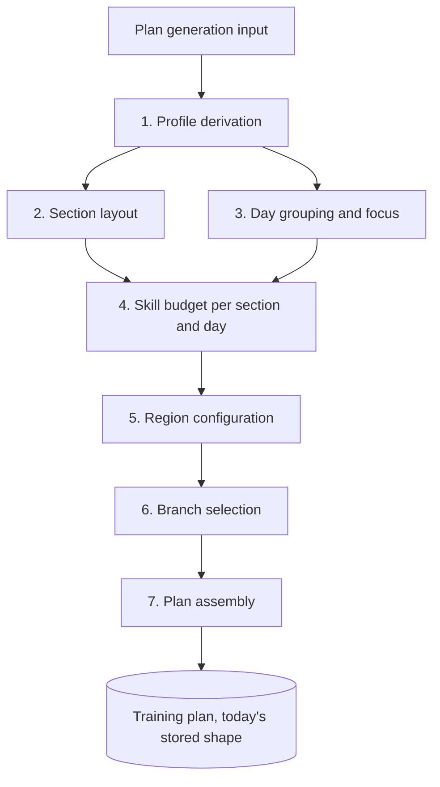
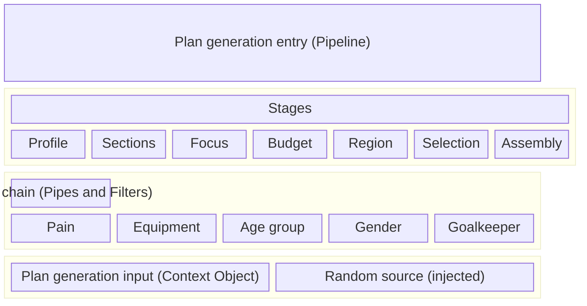

# ADR: Plan generator architecture

## Context

The plan generator turns the anamnesis into the [training plan](../specs/glossary.md) of one athlete, as [Training Plan Creation from the Anamnesis Profile](../specs/planning/training-plan-creation-from-anamnesis.md) defines. It reads:

- the athlete profile from the anamnesis
- the season phase and its end date
- the weekly schedule: active weekdays, duration and training place per day
- the training places and their equipment
- the authored data: section templates, skill priorities, maximum minutes, region configurations, movement direction configurations, skill trees and the exercise catalog
- the athlete's exercise data
- the plan start date the caller picks

The old plan generator in `generators/` mixes all spec sections in one class, loads authored data inline, draws from a global random source and shares state between days. It cannot be tested stage by stage. The [workout generator](./workout-generator-architecture.md) already follows a structure with an injected random source, pure rule families and a lint boundary against `generators/`. This ADR applies that structure to plan creation.

The spec defines the rules, and the new generator follows the spec. This ADR uses the terms of the [Glossary](../specs/glossary.md) and the spec.

## Decision drivers

- Plan creation enters the new generator through one entry point and leaves it as one training plan.
- One stage holds the rules of one spec section, and you read them top to bottom.
- Each stage can be tested on its own, with a repeatable random source.
- State that one day passes to the next is an explicit value.
- The code uses plain TypeScript: modules, plain objects and pure functions. Every module stays within the lint limits without suppressions.
- The new generator writes today's stored plan shape, so neither the store version nor any stored plan changes.
- The old generator stays as it is: no change to its code, its specs or any module it reads. It keeps running unchanged while the flag is off, and a lint block enforces the separation.

## Options

1. Refactor the old class in place.
2. A new class hierarchy: a plan builder object with one subclass per age group.
3. A new stage pipeline built from plain functions over one plan generation input, next to the old generator and behind a router.

## Outcome

Option 3.

- Option 1 changes the generator that every stored plan comes from, without stage tests to check each step.
- Option 2 needs instance state and a base class. Age group is one input among several and fits a rule better than a type.

## Architecture

### Overview

### Patterns

The stages form a pipeline (Pipeline). Each stage reads the plan generation input and the results of earlier stages, and returns a new value.

Each layer uses the layers below it:

- The entry calls the stages in order.
- Branch selection runs the rule chain.
- Every layer reads the plan generation input.

### Stages

Each stage implements one section of the spec:

1. **Profile derivation** reads the anamnesis and returns the age group, derived once from the birth date and the reference date of the input, the fitness level, the pain status, the prevention skills, the playing position group, the season phase with its week count, and whether any active training place has weights. A missing season phase raises an input error. Spec section [1](../specs/planning/training-plan-creation-from-anamnesis.md#1-profile-derivation).
2. **Section layout** picks the section template, appends the repeat list for phases longer than 20 weeks, and applies the max strength and goalkeeper substitutions. It returns the ordered sections without start dates. Plan assembly dates them. Spec section [2](../specs/planning/training-plan-creation-from-anamnesis.md#2-section-layout-periodization).
3. **Day grouping and focus** groups the active weekdays, gives each day a focus and applies the weekly cardio guarantee. The stage runs once per plan, because the focus depends on the schedule and the training places only. Every section reads the same focus per weekday. Spec section [3](../specs/planning/training-plan-creation-from-anamnesis.md#3-day-grouping-and-focus).
4. **Skill budget** runs per section and per day. It picks the skill priority structure, resolves the placeholders, places the prevention skill, gives each skill its minimum and distributes the leftover minutes by priority up to the maximum minutes. Spec section [4](../specs/planning/training-plan-creation-from-anamnesis.md#4-skill-selection-and-time-budgeting-per-day).
5. **Region configuration** reads the region configuration of each skill for its minutes and returns the tag entries branch selection fills. Spec section [5](../specs/planning/training-plan-creation-from-anamnesis.md#5-branch-selection-per-skill), rule 1.
6. **Branch selection** fills each tag entry from the skill tree. It filters candidates through the rule chain, applies the cascading filters with the movement direction priorities and draws the final pick through the random source. Spec section [5](../specs/planning/training-plan-creation-from-anamnesis.md#5-branch-selection-per-skill), rules 2 to 5.
7. **Plan assembly** writes the sections, training days, branch copies and minutes per skill in today's stored plan shape. It sets the plan start to the plan start date and dates the sections in order: the first section starts on the first Monday on or after the plan start, and each later section starts after the weeks of the sections before it.

### State across days

Two values pass from one step to the next:

| State | Scope | How the new generator passes it |
|---|---|---|
| Prevention rotation cursor | The days of one section | Skill budget walks the days as a fold. Each day takes the cursor in and returns the next cursor with its budget. |
| Used branches | The skills of one day | Branch selection walks the skills as a fold. Each skill takes the used branches in and returns them extended with its picks. |

With a fold, each step stays a pure function and the steps run in a fixed order, so the draw order stays fixed and a test can start a step from any state.

### Plan generation input (Context Object)

One read-only object holds every input the stages read:

- the athlete profile from the anamnesis
- the season phase and its end date
- the weekly schedule
- the training places with their equipment
- the authored data: section templates, skill priorities, maximum minutes, region configurations, movement direction configurations, skill trees and the exercise catalog
- the athlete's exercise data
- the plan start date
- the reference date for the athlete's age
- the random source

One input builder reads the stores and the authored data once and builds the object for both callers. The builder reads the clock once for the reference date, so the same input and random sequence always yield the same plan. No stage loads data, reads a store or reads the clock, and no stage changes the object.

### Reuse of the workout generator

The new generator imports leaf modules of the workout generator. It imports neither its entry modules nor its template interpreter.

| Part | Use |
|---|---|
| Pain, equipment, age group and gender rule families | Reused with a narrowed input. Today each family takes the whole workout generation input, which holds one place and the muscle soreness. Each family changes to take only the fields it reads: the athlete, the equipment of one place, or the derived age group. The age group family then no longer reads the clock. The workout generator passes the same fields from its own input, and its specs stay green. |
| Branch resolution | Reused as it is, for the check that a branch resolves at or below the athlete's level |
| Generator error type | Reused as it is |
| Generation input | Not reused. The plan generation input is a plan variant with the schedule, the training places and the plan's authored data, and without muscle soreness. |
| Goalkeeper exclusion | New rule family for the goalkeeper exercises |
| Branch draw of picks blocks | Not used. Plan creation draws per tag entry through the cascading filters of the spec. |
| Muscle soreness and fitness level rule families | Not used. Plan creation reads no soreness, and the fitness level selects authored data instead of filtering branches. |

### Rule families (Pipes and Filters)

Each rule family is a pure filter. A family takes candidate branches and returns the kept ones, with a reason for every removal. Branch selection composes its chain in this order:

1. used branches of the day
2. age group
3. gender
4. equipment of the day's training place
5. pain
6. goalkeeper exclusion

### Behaviour

The new generator follows the spec. In these places the old code differs, and the new code marks the rule with a comment that links the old code:

| Rule in the new generator | Spec | Old code |
|---|---|---|
| Every exercise slot applies the 70/30 split of complex and isolated exercises, the core region included. | Section 5, rule 4 | [Involvement draw](../../src/features/training/generators/PlanGenerator.ts#L1734-L1752) |
| Leftover minutes fill by priority, with no priority 2 prefill for sessions longer than 45 minutes. | Section 4, rule 4 | [Leftover distribution](../../src/features/training/generators/PlanGenerator.ts#L830-L843) |
| A 0 in the maximum minutes table means no time. A missing entry raises a configuration error. | Section 4, table | [Maximum minutes](../../src/features/training/generators/PlanGenerator.ts#L932-L934) |
| A PROFESSIONAL child resolves branches at ADVANCED, the level every other stage uses. | Section 1, Level | [Branch level](../../src/features/training/generators/PlanGenerator.ts#L1270) |
| A season phase without a type or an end date raises the input error NO_ANAMNESIS/MISSING_WORKOUT_DATA. | Section 1, Season phase | [Season phase fallback](../../src/features/training/generators/PlanGenerator.ts#L1084-L1086) |
| The goalkeeper exclusion treats a branch as a goalkeeper exercise when the branch or the exercise of any level carries POSITION_GOAL. The old code lists the exercises 661, 662, 767, 768 and 769. The tag also marks 989, 990, 992, 993 and 994, so field players lose those exercises too. | Section 1, Position | [Goalkeeper exercises](../../src/features/training/generators/PlanGenerator.ts#L2311-L2326) |
| The rule chain checks the equipment tags of the branch, as workout generation does, so the plan holds only branches the workout generator keeps at session start. The old code checks the equipment tags of the exercise at the athlete's level. The GKS branches 544 and 546 carry EQ_TOWEL and leave the pool of a studio without a towel. | Section 5, rule 2 | [Equipment check](../../src/features/training/generators/PlanGenerator.ts#L2339-L2373) |

### Verification

1. Each stage has one spec that tests the spec rules of its section.
2. A test reads the day focus golden table and compares every case with the result of day grouping and focus.
3. A seeded simulation per profile generates a full plan and compares it with a stored snapshot, as a regression guard for the new generator.

The new generator neither ports the old specs nor compares its output with the old generator.

### Routing

The plan generator router is the only module that imports both generators. It reads the plan generator flag `EXPO_PUBLIC_PLAN_GENERATOR_ENABLED`:

1. The flag defaults to off. Only the value `"true"` turns it on.
2. With the flag off, plan creation and regeneration run on the old generator.
3. With the flag on, both run on the new generator.

The plan generator flag is independent of the AIWL generator flag. The old generator knows nothing of the router, the flag or the new generator, and the router calls it with the same inputs as today's callers.

A stored plan stays as it is when the flag flips. The next plan creation or regeneration uses the generator the flag selects. A stored plan carries no marker of the generator that wrote it. Both generators write the same shape, and the workout generator reads both.

The callers stay responsible for:

- the choice of the plan start date and the gap handling
- store reads and writes
- the merge that keeps unchanged training days
- the choice to redraw every day
- the broken stored plan check
- alerts, translations and logging

### Compatibility exceptions

The new generator deviates from the target architecture in these places, so that stored plans keep working:

| Exception | Reason | Ends when |
|---|---|---|
| Training days store branch copies and minutes per skill instead of branch IDs and duration blocks | The workout generator and stored plans read today's shape | Stored plan migration |
| The router sends plan creation to the old generator while the plan generator flag is off | The flag lets the team compare both paths | The flag defaults to on and the old generator is deleted |

### Remaining work

1. The plan generator flag on by default.
2. The stored plan migration to branch IDs and duration blocks.
3. Deletion of the old generator in `generators/`.

### Errors

The new generator raises the typed generator error in three classes:

1. **Input errors** come from profile derivation, such as a missing season phase.
2. **Configuration errors** come from any stage that reads authored data, such as a missing maximum minutes entry or a missing section template.
3. **Empty skill** results remove a skill from a day when no branch resolves, as spec section 5, rule 5 defines. The day keeps its other skills.

### Conventions

- **Discriminated unions.** Focus, section type and stage results are tagged unions, and every `switch` over them is exhaustive.
- **No mutation.** Every stage returns new values and changes no input.
- **Random source.** The plan generation input carries the random function, and every draw goes through it. Each stage draws in a fixed order, and tests pass a fixed sequence.
- **Lint boundary.** Three lint blocks separate the generators:
  1. A block for `planGenerator/**` mirrors the block for `workoutGenerator/**`: the new generator imports nothing from `generators/`.
  2. The workout generator block forbids imports from `planGenerator/`.
  3. A new block for `generators/**` forbids imports from `planGenerator/`, `workoutGenerator/` and both routers, so the old generator never depends on new code. The block adds import rules only and changes no file in `generators/`.
- **Module layout.** The top level of the `planGenerator` folder holds the entry and the input builder. The entry delegates to one subfolder per component of the patterns diagram:

  | Folder | Component | Modules |
  | --- | --- | --- |
  | `stages/` | Stages of the pipeline | one module per stage |
  | `ruleFamilies/` | Goalkeeper exclusion | the goalkeeper family; the other families come from the workout generator |
  | `planGenerationInput/` | Plan generation input | the input and its builder |

  The router sits next to the workout generator router. Each module has its spec next to it. No index file only re-exports other modules.

- **Naming.** Modules and functions use the glossary and spec terms. A function name is a verb plus a full noun.

## Pros and cons

- Pro: each stage maps to one spec section and has its own spec.
- Pro: a seeded random source makes every plan reproducible in tests.
- Pro: the prevention rotation and the used branches pass as explicit values, so a test can start a stage from any state.
- Pro: the router lets the team switch generators without touching stored plans.
- Con: the rules in [Behaviour](#behaviour) change the plans athletes get once the flag turns on.
- Con: until the old generator is deleted, the app holds two plan generators.
- Con: stored plans carry no marker, so a bug report on a plan does not say which generator wrote it.
- Con: the new generator writes branch copies until the stored plan migration.

## More information

- [Training Plan Creation from the Anamnesis Profile](../specs/planning/training-plan-creation-from-anamnesis.md)
- [Workout generator architecture](./workout-generator-architecture.md)
- [Athletic Intelligence Workout Language](./athletic-intelligence-workout-language.md)
- [Pain, Soreness, and Prevention](../specs/foundations/pain-soreness-and-prevention.md)
- [Branches, Exercises, and Levels](../specs/foundations/branches-exercises-and-levels.md)
