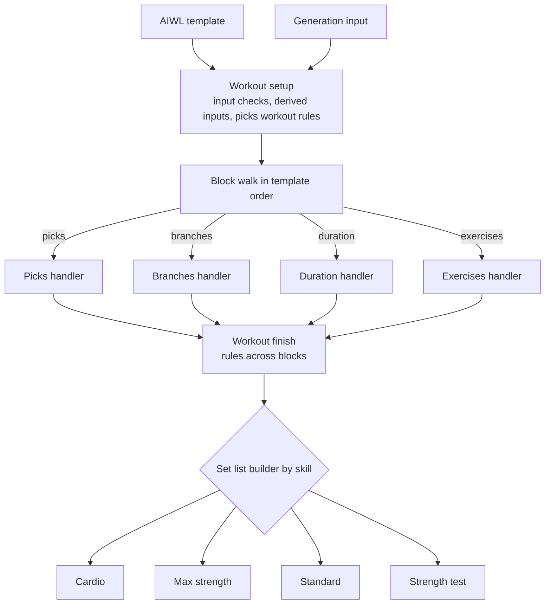
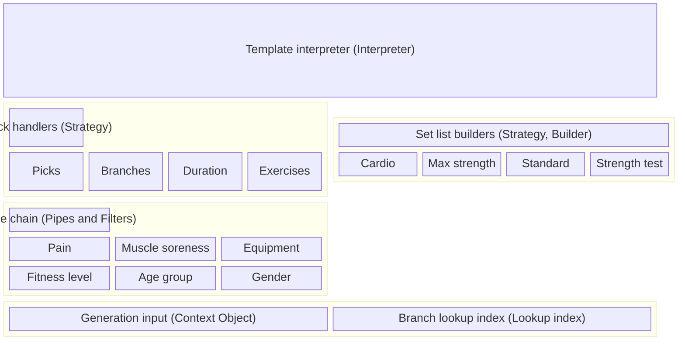

# ADR: Workout generator architecture

## Context

The workout generator turns a workout description into the set list for one athlete on one day. It reads:

- an [AIWL](./athletic-intelligence-workout-language.md) template
- the athlete profile
- the training place and its equipment
- the muscle soreness marked for the day
- the skill catalog and the skill trees
- the exercise catalog
- the athlete's exercise data

AIWL defines four block kinds: picks, duration, branches and exercises. Short workouts use picks blocks and can mix in branches blocks, training days use branches blocks, the strength test source uses a picks block and an exercises block, and a trainer workout will use duration blocks. The specs give each kind its own athlete rules and its own way to select branches. The [current support](./athletic-intelligence-workout-language.md#current-support) section of the AIWL ADR lists which source runs through this generator today.

Some rules in the specs span more than one block, for example [duplicate exercises](./duplicate-exercises.md), the skill boundary in [exercise order](./exercise-order.md), and the special warm-up in [Pain, Soreness, and Prevention](../specs/foundations/pain-soreness-and-prevention.md#pain-mappings). Cardio, max strength, the [strength test](../specs/session/plan-independent-workouts.md#strength-test) and the remaining skills each need their own set list builder.

This ADR defines the structure the generator follows. The specs define the rules. This ADR uses the terms of the [Glossary](../specs/glossary.md) and the block kinds of the AIWL ADR.

## Decision drivers

- Every workout source enters the generator through one entry point and leaves it as one set list.
- A new block kind adds one handler and changes no other handler.
- One handler holds the rules of one block kind, and a reader can follow them top to bottom.
- Each part can be tested on its own, with a repeatable random source.
- The code uses plain TypeScript: modules, plain objects and pure functions. Every module stays within the lint limits without suppressions.
- A stored workout references catalog data and holds no copies of it. Stored plans created before the migration still hold copies, as [Stored workouts](#stored-workouts) describes.

## Options

1. One pipeline per workout source, with shared helper functions.
2. A class hierarchy: an abstract block class with one subclass per kind, and a generator object that calls them in template order.
3. A template interpreter that hands each block to a handler for its kind, built from plain functions.

## Outcome

Option 3.

- Option 1 keeps one flow per source, so a rule added to one flow misses the others.
- Option 2 needs a base class and instance state. A discriminated union gives the same dispatch with less code and an exhaustive check.

## Architecture

### Overview

### Patterns

The stages form a pipeline (Pipeline). Each component names its design pattern in brackets.

Each layer uses the layers below it:

- The template interpreter calls the block handler for each block kind and the set list builder for each skill.
- The block handlers run the rule chain.
- Every layer reads the generation input.

The diagram places the interpreter on top because its `switch` imports the handlers and builders, so the interpreter depends on them.

Each box in a layer implements the contract the layer title names. The code defines each contract as a TypeScript function type, and each implementation as a plain function or object literal.

### Stages

1. **Workout setup** runs once per workout.
   - It runs the input checks the specs define.
   - It derives the inputs that several blocks share, such as the body regions blocked by soreness and the prevention skills.
   - It applies the picks rules to the union of all picks block pools, as [Plan-Independent Workouts](../specs/session/plan-independent-workouts.md#short-workout) defines them.
2. **Block walk** (Interpreter) visits the blocks in template order. An exhaustive `switch` over the block kind calls the block's handler.
3. **Workout finish** applies the rules that need every block, such as the [exercise order](./exercise-order.md).
4. **Set list building** (Strategy, Builder) picks a builder by skill:
   - The cardio builder follows the [Cardio Training System](../specs/session/cardio-training-system.md#building-the-block).
   - The max strength builder follows [Max Strength Training](../specs/progression/max-strength-progression.md), support exercises included.
   - The standard builder follows [Session Set Structure](../specs/session/session-set-structure.md) and [Standard Exercise Progression](../specs/progression/standard-exercise-progression.md).
   - The strength test builder follows [Weight Calculation from Strength Tests](../specs/progression/weight-calculation-from-strength-tests.md#8-strength-test-reference-load-and-1rm-update). The strength test source passes it for the skill of its lifts block, and it builds exercises blocks only.

An exercises block keeps its list through workout finish and set list building: section order sorts the filled blocks around it, `lastWins` keeps every exercises block, and no pairing or exercise order rule touches it. Its result has the status `prescribed` and holds catalog exercise references without a branch.

Builders of exercises blocks share one contract, `PrescribedSetListBuilder`: a `build` function and the block settings the builder reads. A source passes its builders to `createSetListBuilder` by skill and binds the data each builder needs; the strength test source binds its test set loads and 1RM shares. The set list stage resolves the builder by the block's skill and fails on a block setting that builder does not read, so the stage holds no protocol data and reads no skill catalog field for it.

### Set list building rules

One function, `createSetListBuilder`, builds the set list of every workout source. For each filled block it reads the timing, pairs the exercises, orders the pairs and calls the set list builder of the skill. Each source passes a rules object. The rules object names every intended difference between the sources:

| Rule                 | Short workout                                                       | Training day                                                                                                 | Strength test |
| -------------------- | ------------------------------------------------------------------- | ------------------------------------------------------------------------------------------------------------ | ------------- |
| `blockTiming`        | `workoutSetup`: the timing that workout setup resolved                   | `trainingDayDefaults`: the block's own values, then the training day defaults                                | `trainingDayDefaults`: the warm-up block sets every value |
| `cardioPairing`      | `bySuperset`: pairs cardio like every other block                   | `drawOne`: draws one cardio branch                                                                           | `bySuperset`, unused |
| `maxStrengthPairing` | `bySuperset`: pairs by the superset and trains the lead             | `singles`: trains every max strength exercise on its own                                                     | `bySuperset`, unused |
| `branchPairing`      | `bySuperset`: pairs by the block's superset                          | `bySuperset`                                                                                                 | `singlesAsDrawn`: trains every warm-up exercise alone, in draw order, one side only |
| `exerciseOrder`      | `asPaired`: keeps the order of the pairs                            | `awayFromPreviousBlock`: opens each block away from the block before, max strength lower body first, cardio as drawn | `asPaired` |
| `closingRest`        | `lastTemplateBlock`: drops the closing rest of a filled last block  | `setListEnd`: drops the rest that closes the set list                                                        | `setListEnd`: ends on the last test set |

A new difference between sources adds a rule to this object. A fix to a step reaches every source.

#### Defaults

The block's own values come first. The two sources differ in where their defaults come from:

- **Short workouts** read the skill catalog (`skills.json`) during workout setup. A missing default throws an error that names the block.
- **Training days** read `readTrainingDayTimingDefaults`. That function checks three layers in order for each field:
  1. the training day overrides
  2. the skill catalog
  3. the fallback: 2 sets, a superset by muscles and 10 s rests

The training day overrides keep stored plans as they were. They only hold the values the catalog lacks:

- the sets and the rest after an exercise for MAX and MAX_STRENGTH
- the sets, superset and rests of the cardio skills
- the PLYO skill, which has no catalog entry

### Block handlers (Strategy)

A handler is one function. It takes the block, the generation input, the set of used branches and the walk context (the earlier block results and the block path for errors), and returns a block result: the resolved exercises, or the reason the block stayed empty. Handlers share library steps:

- the rule chain runner
- the [resolution of a branch](../specs/foundations/branches-exercises-and-levels.md#resolving-the-level-at-workout-start) to the exercise at the athlete's branch level
- the replacement of blocked branches

Resolution runs inside selection, because the specs drop a candidate whose exercise already appears.

| Block kind | Rules                                                                                          | Scope of the used branches                                     |
| ---------- | ---------------------------------------------------------------------------------------------- | -------------------------------------------------------------- |
| Picks      | [Plan-Independent Workouts](../specs/session/plan-independent-workouts.md#short-workout)       | Whole workout                                                  |
| Branches   | [Plan Workout Generation](../specs/session/plan-workout-generation.md#generating-the-session)  | One block, see [duplicate exercises](./duplicate-exercises.md) |
| Duration   | The [minutes table](./athletic-intelligence-workout-language.md#minutes-table) of the AIWL ADR | Whole workout                                                  |
| Exercises  | [AIWL rules 5 and 6](./athletic-intelligence-workout-language.md#rules): catalog lookup in list order, equipment check per exercise | Whole workout; uses no branch |

A block of whole workout scope receives the branches every earlier block used, whatever the kind of that block. A block of one block scope starts with an empty set. One template can mix block kinds: a short workout runs picks and branches blocks in template order.

A later picks block skips the exercises of an earlier exercises block, and an exercises block keeps an exercise an earlier block trained.

A training day stores its cardio skill as a branches block. The branches handler applies the cardio rules from [Soreness and blocking](../specs/session/cardio-training-system.md#soreness-and-blocking). This ADR amends AIWL rule 1, so the rule applies to duration blocks only.

### Rule families (Pipes and Filters)

Each rule family is a pure filter. A family takes candidate branches and returns the kept ones, with a reason for every removal. The generator has one family each for these rules:

- pain
- muscle soreness
- equipment
- fitness level
- age group
- gender

Each handler composes its chain from these families in the order its spec defines.

### Generation input (Context Object)

One read-only object holds every input the stages read:

- the athlete profile
- the place and its equipment
- the muscle soreness
- the skill catalog
- the branch lookup index
- the exercise catalog
- the athlete's exercise data
- the random source

Workout setup adds the derived inputs once. No stage changes the object.

### Branch lookup index (Lookup index)

The index maps every branch ID to its branch across all skill trees. Skill tree loading builds it once, and a spec asserts that every branch ID is unique across the trees.

### Stored workouts

The target: a training day stores an AIWL template whose branches blocks hold branch IDs and durations. The branch lookup index supplies tags, levels and exercises at generation time, so a stored plan follows catalog changes.

Today a training day stores branches and minutes per skill. With the AIWL generator flag on, the generator runs it as a stored day workout: one branches block per skill, holding branch IDs and durations.

A stored day workout is no AIWL document. Stored data may break the language rules, and the stored day workout keeps the results of the old generator for these cases:

1. A skill without branches keeps a block with an empty branch list. The block stays empty, and its reason counts for the empty workout error.
2. A day without skills holds no block and generates an empty set list.
3. Stored minutes become seconds without rounding, so fractional minutes run fractional seconds.

The stored day workout carries no document header, so the type checker rejects it wherever a workout document is expected, such as import or export.

Until a migration rewrites the stored plans, a temporary decision applies:

1. Planned branches read the branch entries the training day saved at plan creation. A catalog update changes no planned branch, and a branch ID the catalog removed still generates from its saved entry.
2. Replacement branches read the current catalog through the branch lookup index.
3. A workout can therefore mix saved and current branch definitions. The decision accepts that mix so that no catalog update changes an athlete's planned workout without a migration.

A follow-up issue defines the migration, its trigger, and what happens to a slot whose branch ID the catalog removed. After the migration, training day generation switches from the saved entries to the branch lookup index.

### Routing

The router `src/features/training/workoutGeneratorRouter.ts` picks the generator per training type:

1. Short workouts and custom workouts run on the AIWL generator.
2. The strength test runs on the old generator.
3. Plan training days run on the AIWL generator while the AIWL generator flag is on, and on the old generator otherwise.

The old generator in `generators/` stays as it was before the AIWL generator work and knows nothing of the router, the flag or the AIWL generator. Each generator throws its own `GeneratorError` type; both types share one shape, so the training generation hook reads either.

The router selects the stored training day of the plan with its own copy of the old section and weekday selection, so the AIWL path imports nothing from `generators/`.

### Strength test source

`strengthTestGeneration.ts` runs the bundled template `templates/TEST.json`. `loadStrengthTestTemplate` loads it apart from the short workout templates, so no short workout resolves it. The template holds:

1. a picks block of skill `WU` whose picks are the warm-up region quotas, timed as one 60 s set per exercise with 10 s rests and 30 s before the first lift
2. an exercises block of skill `TEST` with the lifts in authored order and the `testSets`: 40, 60 and 85 % of the test set load for 6, 4 and 2 repetitions, then the AMRAP test set

The builder binds the test set loads per lift, gender and fitness level from `strengthTest.json`, which the old path reads too and this source leaves unchanged, and the share of the last estimated 1RM a test set loads per fitness level from `oneRepMaxShares.json`. A lift without an estimated 1RM and without a test set load for the athlete's gender fails the builder instead of building at 0 kg. Lifts no longer vary by fitness level or gender in this source; the template lists them.

Source checks run before any block. `checkStrengthTestTemplate` checks the template first and throws a configuration error naming the path: the warm-up picks block of skill `WU` comes first, the exercises block of lifts second and last, its `testSets` end on their one `amrap` set, and every lift has test set loads for both genders in `strengthTest.json`. The generic interpreter holds none of these rules. The athlete checks follow: workout data, no athlete under 16 (`NO_EXERCISES/AGE`), no muscle soreness (`TOO_MUCH_SORENESS/TEST_WORKOUT`). Workout setup skips the picks workout rules of short workouts. The picks handler of this source keeps the old warm-up rules: age group and gender filters only, region quotas with a fallback to every unused branch, no repeated branch or exercise. A lift missing from the catalog fails the whole test with a template error, missing lift equipment with `NO_EXERCISES/EQUIPMENT`. The source sets the finish rule `requiredBlocks: "every"`, so a warm-up that draws no exercise fails the test with `NO_EXERCISES/SKILL_TREE` and the skill `WU`. Lift entries keep the placeholder branch ID, so session storage, resume, completion, statistics and the estimated 1RM update read them as before and write no branch progression.

The router still sends the strength test to the old generator. This source neither imports nor tests against the old generator, and it changes no module, schema or data file the old generator reads. Compared with the old path, it adds the age and equipment checks. Routing the strength test to this source is open work.

### Compatibility exceptions

The generator deviates from the target architecture in these places, so that stored plans and existing set lists keep working:

| Exception | Reason | Ends when |
|---|---|---|
| Training days store branch entries and minutes instead of a template | Stored plans predate AIWL | Stored plan migration |
| Planned branches read the saved branch entries, replacements read the catalog | No catalog update changes a planned workout without a migration | Stored plan migration |
| Training day overrides for MAX, MAX_STRENGTH, the cardio skills and PLYO | The skill catalog lacks these values | The catalog holds the values |
| The set list rules differ by source | Each source keeps the set lists of its old path | A decision unifies or keeps each rule |
| Training days store cardio as a branches block | Plan creation stores cardio branches, so this ADR amends AIWL rule 1 | Plan creation writes duration blocks |
| The router sends training days to the old generator while the AIWL generator flag is off | The flag lets the team compare both paths | The flag defaults to on and the old generator is deleted |

### Remaining work

1. The duration handler with the minutes table chooser.
2. The `order` field and the `bodyParts` filter.
3. The stored plan migration.
4. The AIWL generator flag on by default, and deletion of the old generator in `generators/`.
5. The router sends the strength test to the strength test source.

### Errors

The generator raises three classes of error:

1. **Input errors** come from workout setup, when an input check fails.
2. **Workout rule errors** come from the picks workout rules, when a rule empties the union pool.
3. **Empty workout** errors come from the block walk, when every block stayed empty. The generator raises the reason of the first empty block in template order.

### Conventions

- **Discriminated unions.** Block kinds, block results and errors are tagged unions, and every `switch` over them is exhaustive.
- **No mutation.** Every stage returns new values and changes neither the template nor the generation input.
- **Random source.** The generation input carries the random function, with `Math.random` as the default, and every component draws through it. Tests pass a fixed sequence. Each component draws in a fixed order.
- **Module layout.** The top level of the `workoutGenerator` folder holds the modules other code calls: one entry module per workout source, the stored day workout, and the template interpreter they hand the workout to. The interpreter delegates to one subfolder per component of the patterns diagram:

  | Folder                    | Component                                | Modules                                                                                   |
  | ------------------------- | ---------------------------------------- | ----------------------------------------------------------------------------------------- |
  | `stages/`                 | Stages of the template interpreter       | workout setup, block walk, workout finish, exercise order, set list building              |
  | `blockHandlers/picks/`    | Picks handler                            | the handler, the picks workout rules, the picks draw                                      |
  | `blockHandlers/branches/` | Branches handler                         | the handler, its rule chain, duplicate branches, cardio replacement, stored branch lookup |
  | `blockHandlers/exercises/` | Exercises handler                       | the handler                                                                               |
  | `blockHandlers/library/`  | Shared library steps                     | resolution, replacement of blocked branches                                               |
  | `ruleFamilies/`           | Rule chain                               | one module per rule family, plus the family contract                                      |
  | `setListBuilders/`        | Set list builders                        | the builder contract, one module per builder, their helpers                               |
  | `exerciseValues/`         | Exercise values the builders read        | start, target and feedback values, weight steps                                           |
  | `generationInput/`        | Generation input and branch lookup index | the input, the index, the skill catalog entry                                             |

  A duration handler goes in `blockHandlers/duration/`. Each module has its spec next to it. No index file only re-exports other modules.

- **Naming.** Modules and functions use the glossary terms. A function name is a verb plus a full noun.

## Pros and cons

- Pro: every workout source runs through one interpreter, so a rule change reaches every source that uses the block kind.
- Pro: a new block kind adds one handler and one `switch` case.
- Pro: the rules of a block kind read as one ordered chain inside one handler.
- Pro: each handler, each rule family and each stage has its own spec.
- Con: four stages apply rules: workout setup, the handlers, workout finish and the builders. A reader has to know which stage applies a rule.
- Con: the builders, not the block handlers, select support exercises.
- Con: until the stored plan migration, a workout can mix saved planned branches with current replacement branches.
- Con: once stored plans read the catalog, a catalog change that removes a branch ID drops that slot from every stored plan.
- Con: the generation input grows with every new input a rule needs.

## More information

- [Athletic Intelligence Workout Language](./athletic-intelligence-workout-language.md)
- [Duplicate exercises in a session](./duplicate-exercises.md)
- [Exercise order inside a skill](./exercise-order.md)
- [Plan Workout Generation](../specs/session/plan-workout-generation.md)
- [Plan-Independent Workouts](../specs/session/plan-independent-workouts.md)
- [Pain, Soreness, and Prevention](../specs/foundations/pain-soreness-and-prevention.md)
