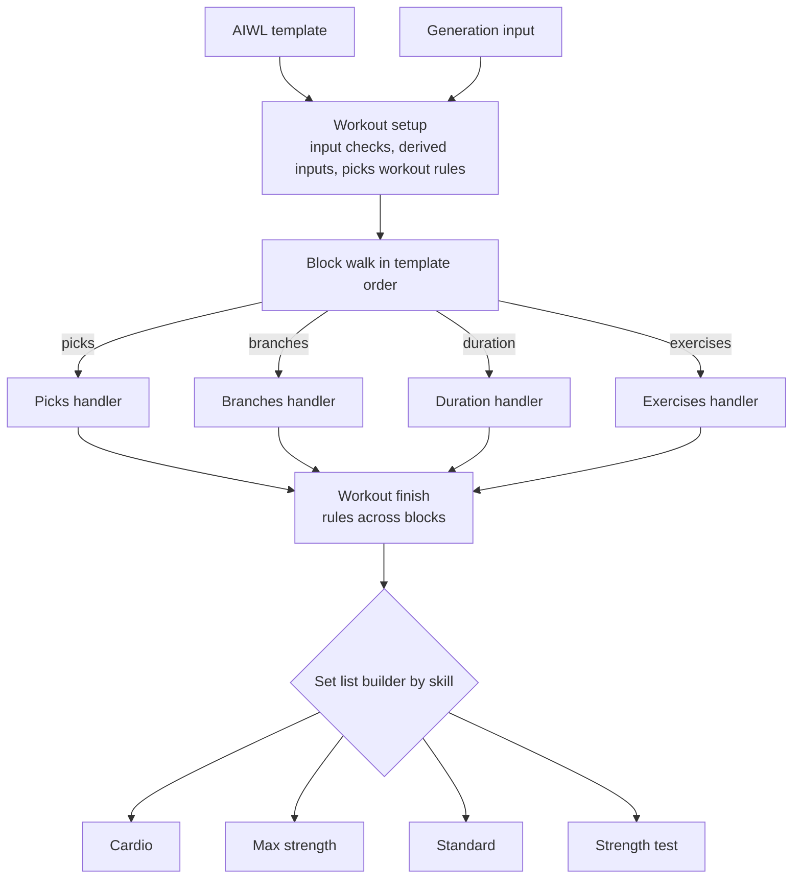
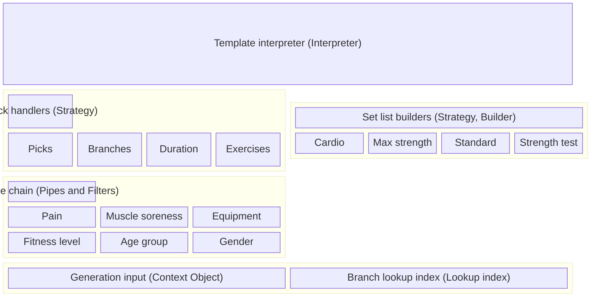

# ADR: Workout generator architecture

## Context

The workout generator turns a workout description into the set list for one athlete on one day. It reads:

- an [AIWL](./athletic-intelligence-workout-language.md) template
- the athlete profile
- the training place and its equipment
- the muscle soreness marked for the day
- the skill catalog and the skill trees
- the exercise catalog
- the athlete's exercise data

AIWL defines four block kinds: picks, duration, branches and exercises. Short workouts use picks blocks and can mix in branches blocks, training days use branches blocks, the strength test source uses a picks block and an exercises block, and a trainer workout will use duration blocks. The specs give each kind its own athlete rules and its own way to select branches. The [current support](./athletic-intelligence-workout-language.md#current-support) section of the AIWL ADR lists which source runs through this generator today.

Some rules in the specs span more than one block, for example [duplicate exercises](./duplicate-exercises.md), the skill boundary in [exercise order](./exercise-order.md), and the special warm-up in [Pain, Soreness, and Prevention](../specs/foundations/pain-soreness-and-prevention.md#pain-mappings). Cardio, max strength, the [strength test](../specs/session/plan-independent-workouts.md#strength-test) and the remaining skills each need their own set list builder.

This ADR defines the structure the generator follows. The specs define the rules. This ADR uses the terms of the [Glossary](../specs/glossary.md) and the block kinds of the AIWL ADR.

## Decision drivers

- Every workout source enters the generator through one entry point and leaves it as one set list.
- A new block kind adds one handler and changes no other handler.
- One handler holds the rules of one block kind, and a reader can follow them top to bottom.
- Each part can be tested on its own, with a repeatable random source.
- The code uses plain TypeScript: modules, plain objects and pure functions. Every module stays within the lint limits without suppressions.
- A stored workout references catalog data and holds no copies of it. Stored plans created before the migration still hold copies, as [Stored workouts](#stored-workouts) describes.

## Options

1. One pipeline per workout source, with shared helper functions.
2. A class hierarchy: an abstract block class with one subclass per kind, and a generator object that calls them in template order.
3. A template interpreter that hands each block to a handler for its kind, built from plain functions.

## Outcome

Option 3.

- Option 1 keeps one flow per source, so a rule added to one flow misses the others.
- Option 2 needs a base class and instance state. A discriminated union gives the same dispatch with less code and an exhaustive check.

## Architecture

### Overview

### Patterns

The stages form a pipeline (Pipeline). Each component names its design pattern in brackets.

Each layer uses the layers below it:

- The template interpreter calls the block handler for each block kind and the set list builder for each skill.
- The block handlers run the rule chain.
- Every layer reads the generation input.

The diagram places the interpreter on top because its `switch` imports the handlers and builders, so the interpreter depends on them.

Each box in a layer implements the contract the layer title names. The code defines each contract as a TypeScript function type, and each implementation as a plain function or object literal.

### Stages

1. **Workout setup** runs once per workout.
   - It runs the input checks the specs define.
   - It derives the inputs that several blocks share, such as the body regions blocked by soreness and the prevention skills.
   - It applies the picks rules to the union of all picks block pools, as [Plan-Independent Workouts](../specs/session/plan-independent-workouts.md#short-workout) defines them.
2. **Block walk** (Interpreter) visits the blocks in template order. An exhaustive `switch` over the block kind calls the block's handler.
3. **Workout finish** applies the rules that need every block, such as the [exercise order](./exercise-order.md).
4. **Set list building** (Strategy, Builder) picks a builder by skill:
   - The cardio builder follows the [Cardio Training System](../specs/session/cardio-training-system.md#building-the-block).
   - The max strength builder follows [Max Strength Training](../specs/progression/max-strength-progression.md), support exercises included.
   - The standard builder follows [Session Set Structure](../specs/session/session-set-structure.md) and [Standard Exercise Progression](../specs/progression/standard-exercise-progression.md).
   - The strength test builder follows [Weight Calculation from Strength Tests](../specs/progression/weight-calculation-from-strength-tests.md#8-strength-test-reference-load-and-1rm-update). The strength test source passes it for the skill of its lifts block, and it builds exercises blocks only.

Workout finish builds the filled blocks in template order, every block of a skill included. An exercises block keeps its list through workout finish and set list building. No pairing or exercise order rule changes that list. Its result has the status `prescribed` and holds catalog exercise references without a branch.

Builders of exercises blocks share one contract, `PrescribedSetListBuilder`: a `build` function and the block settings the builder reads. The entry point passes the builders to `createSetListBuilder` by skill and binds the data each builder needs; for a workout with test sets it binds the test set loads and 1RM shares. The set list stage resolves the builder by the block's skill and holds no protocol data and reads no skill catalog field for it. A skill without a builder fails; a block setting the builder does not read logs a warning and changes nothing.

### Set list building rules

One function, `createSetListBuilder`, builds the set list of every workout source: short workouts, training days and the strength test. For each filled block it reads the timing, pairs the exercises, orders the pairs and calls the set list builder of the skill. The sources pass no rules; set list building reads only the block:

| Block          | Pairing                                                   | Order                                                                                   |
| -------------- | --------------------------------------------------------- | --------------------------------------------------------------------------------------- |
| Cardio         | draws one branch                                          | as drawn                                                                                |
| Max strength   | each exercise on its own, with the other side of a one-sided exercise | opens away from the exercise that ended the block before, lower body first |
| Any other      | by the block's superset                                   | opens away from the exercise that ended the block before                               |

Every superset trains the other side of a one-sided exercise right after it. A max strength block always pairs as the table says, whatever superset it sets. Set list building names the builder of a skill with `readSkillSetListKind` and logs one warning per block for the settings that builder does not read, for example `MAX: the generator ignores superset`. The set list drops the rest at its very end, so every workout ends on a set. A fix to a step reaches every source.

The strength test lifts keep their own builder, the prescribed strength test builder above.

A workout that draws no exercise throws the error of its first empty block in template order.

#### Timing

The block's own values come first. The defaults depend on the block kind:

- A **picks block** takes the timing that workout setup resolved from the skill catalog (`skills.json`). A missing default throws an error that names the block. A cardio block needs no superset, because it pairs nothing.
- **Every other block** reads `readTrainingDayTimingDefaults`: the skill catalog, then the fallback of 2 sets, a superset by muscles and 10 s rests.
- `resolveBlockTiming` resolves `rest.afterBlock` for both: the block value, then the catalog value of the same skill. Without either, the set list builder closes the block on `rest.afterExercise`.

The skill catalog stores the sets, superset and rests of the six cardio skills and of `PLYO`, the plyometric skill of stored training plans. A timing change is a data edit in `skills.json`. The catalog entries `PLYO_HIGH` and `PLYO_MEDIUM` carry the same values for picks blocks.

### Block handlers (Strategy)

A handler is one function. It takes the block, the generation input, the set of used branches and the walk context (the earlier block results and the block path for errors), and returns a block result: the resolved exercises, or the reason the block stayed empty. Handlers share library steps:

- the rule chain runner
- the [resolution of a branch](../specs/foundations/branches-exercises-and-levels.md#resolving-the-level-at-workout-start) to the exercise at the athlete's branch level
- the replacement of blocked branches

Resolution runs inside selection, because the specs drop a candidate whose exercise already appears.

| Block kind | Rules                                                                                          |
| ---------- | ---------------------------------------------------------------------------------------------- |
| Picks      | [Plan-Independent Workouts](../specs/session/plan-independent-workouts.md#short-workout)       |
| Branches   | [Plan Workout Generation](../specs/session/plan-workout-generation.md#generating-the-session), see [duplicate exercises](./duplicate-exercises.md) |
| Duration   | The [minutes table](./athletic-intelligence-workout-language.md#minutes-table) of the AIWL ADR; a cardio duration block draws one branch of its tree and hands it to the branches handler |
| Exercises  | [AIWL rules 5 and 6](./athletic-intelligence-workout-language.md#rules): catalog lookup in list order, equipment check per exercise unless the equipment filter is off; uses no branch |

The block walk hands every block the branches all earlier blocks used, whatever the kind of either block. The branches handler reads no used branches. One registry maps each block kind to its handler function for every workout, so one workout can mix block kinds: a short workout runs picks and branches blocks in template order.

The branches handler sets `swappedFrom` on a result whose skill it swapped. Its value is the stored block, and it replaces the former `swappedFromSkill`. The handler sets it on both swap paths: a cardio block that runs CARDIO_5, and a later block of the same skill that reads an earlier swap.

Two replay options are set only by `generateSetList` with `previousDrawnBlocks`. A fresh run sets neither:

- `branchRefill: "blockedSlots"`: a blocked branch refills only its own slot. Without it, a prevention or special warm-up skill refills every slot.
- `replacementPools`: maps each drawn block to the pool of the picks block it was drawn from. The pool is rebuilt with `resolvePicksBlocks`, and the handler gives it to the block as `replacementPool`. A replacement draws only from that pool.

Edge cases of a replay:

- A slot or block with no replacement drops silently, because a short workout's finish has `requiredBlocks: "none"`.
- The PREV and WUSPEZIAL region narrowing runs before the pool applies. A slot drops when the narrowed tree and the pool share no branch.
- The duplicate check runs per block only. A level change can resolve two blocks to the same exercise.
- The "last block per skill" rule (AIWL rule 7) applies to training days only. A template run trains every block of a repeated skill, so a replay trains both.

A later picks block skips the exercises of an earlier exercises block, and an exercises block keeps an exercise an earlier block trained.

A training day stores its cardio skill as a branches block. The branches handler applies the cardio rules from [Soreness and blocking](../specs/session/cardio-training-system.md#soreness-and-blocking). This ADR amends AIWL rule 1, so the rule applies to duration blocks only.

### Rule families (Pipes and Filters)

Each rule family is a pure filter. A family takes candidate branches and returns the kept ones, with a reason for every removal. The generator has one family each for these rules:

- pain
- muscle soreness
- equipment
- fitness level
- age group
- gender

Each handler composes its chain from these families in the order its spec defines. The branches chain runs pain, age group and gender first, then muscle soreness, equipment and fitness level. A branch that pain, age group or gender removes asks for a replacement of its own region, or of any region when it has no region tag. Plan creation stores no branch these three families remove, so they change no training day of an athlete whose profile stayed the same since plan creation.

#### Workout filters

`options.filters` of the entry point switches off three families for one workout: `soreness`, `pain` and `equipment`. Each one defaults to `true`. Workout setup resolves them once into `WorkoutInput.filters`, and these places read that object:

1. the picks pool rules: pain and equipment; picks blocks ignore soreness in every workout
2. the branches rule chain: soreness, equipment, and pain inside the pain, age group and gender family
3. the cardio duration handler, through the branches rule chain
4. the exercises handler: the equipment check

Age group, gender and fitness level always run. The AIWL template carries no filter.

### Generation input (Context Object)

One read-only object holds every input the stages read:

- the athlete profile
- the place and its equipment
- the muscle soreness
- the skill catalog
- the branch lookup index
- the exercise catalog
- the athlete's exercise data
- the random source

Workout setup adds the derived inputs once. No stage changes the object.

### Branch lookup index (Lookup index)

The index maps every branch ID to its branch across all skill trees. Skill tree loading builds it once, and a spec asserts that every branch ID is unique across the trees.

### Stored workouts

The target: a training day stores an AIWL template whose branches blocks hold branch IDs and durations. The branch lookup index supplies tags, levels and exercises at generation time, so a stored plan follows catalog changes.

Today a training day stores branches and minutes per skill. The generator runs it as a stored day workout: one branches block per skill, holding branch IDs and durations.

A stored day workout is no AIWL document. Stored data may break the language rules, and the stored day workout keeps the results of the old generator for these cases:

1. A skill without branches keeps a block with an empty branch list. The block stays empty, and its reason counts for the empty workout error.
2. A day without skills holds no block and generates an empty set list.
3. Stored minutes become seconds without rounding, so fractional minutes run fractional seconds.

The stored day workout carries no document header, so the type checker rejects it wherever a workout document is expected, such as import or export.

Until a migration rewrites the stored plans, a temporary decision applies:

1. Planned branches read the branch entries the training day saved at plan creation. A catalog update changes no planned branch, and a branch ID the catalog removed still generates from its saved entry.
2. Replacement branches read the current catalog through the branch lookup index.
3. A workout can therefore mix saved and current branch definitions. The decision accepts that mix so that no catalog update changes an athlete's planned workout without a migration.

A follow-up issue defines the migration, its trigger, and what happens to a slot whose branch ID the catalog removed. After the migration, training day generation switches from the saved entries to the branch lookup index.

A plan training may already store the target shape, an AIWL training. `readTrainingDayWorkout` reads either shape as a workout and a branch lookup:

| Training | Workout | Branch data | Missing branch ID |
|---|---|---|---|
| legacy | stored day workout | saved branch copies | trains the saved copy |
| AIWL | the stored AIWL workout | branch lookup index | replaced from the same skill |

1. The training day selection returns the workout of an AIWL training, validated against the AIWL schema. The [exercise swap](#exercise-swap) reads the same day.
2. `readTrainingDayWorkout` sorts the blocks of both shapes once by section order, stable, with a skill outside the section order first. The plan generator writes an AIWL day in the skill priority order of its budget, so the AIWL shape needs the sort too. `createStoredDayWorkout` keeps the stored order.
3. Every workout has one missing branch rule: each distinct branch ID the lookup lacks requests one replacement like a branch that a rule blocks. The request names no region, so the replacement draws from the least used region of the skill. The saved copies of a legacy training hold every branch ID its stored day workout lists, so a legacy training never misses one.

The plan features outside the generator read both shapes. `readPlannedBranches` returns the copied branches of a legacy training, and for an AIWL training the catalog branches of its branch IDs. Every feature skips a branch ID the catalog lacks, because the generator replaces it at run time.

| Feature | Legacy training | AIWL training |
|---|---|---|
| Strength test prompt | exercises of every level of each copied branch | exercises of every level of each resolved branch |
| Exercise swap | reads the skill's timing and minutes from the stored day; alternatives come from the catalog | reads the skill's timing from the AIWL day; alternatives come from the catalog |
| Branch level progression | replaces one copied entry with one or two entries | replaces one branch ID with one or two branch IDs |
| Plan regeneration | keeps the old day when skills and minutes match | keeps the old branch IDs when blocks and durations match |
| Broken plan check | adult-only branches for a child, max strength lifts without equipment | the same two rules on the resolved branches |

### Routing

The router `src/features/training/workoutGeneratorRouter.ts` selects a workout, a branch lookup and the filters per training type, then calls the one entry point `generateSetListFromWorkout(workout, lookUpBranch, input, { skillTrees, filters })` in `workoutGenerator/workoutGeneration.ts`:

| Training type | Workout | Branch lookup | Filters |
|---|---|---|---|
| `PLAN` | `readTrainingDayWorkout` of the selected plan day | branch lookup index for an AIWL training, saved copies for a legacy training | none, every filter on |
| `TEST_WORKOUT` | `loadStrengthTestTemplate`: the bundled `TEST.json`; the entry point checks it with `checkStrengthTestTemplate` | branch lookup index | `STRENGTH_TEST_FILTERS`: `{ pain: false, equipment: false }` |
| any other | the template of the type, short or custom | branch lookup index | `{ soreness: false }` |

`selectWorkout(request)` in the router returns the workout, the branch lookup and the filters of the table, and `generateSetList` passes them to `generateSetListFromWorkout`. The [exercise swap](#exercise-swap) calls `selectWorkout` too, sets the workout up once, builds one branch through `buildBranchSetList` and runs no `generateSetList`.

A type without a template throws `NO_EXERCISES/SKILL_TREE` with the type. A template without blocks throws `NO_EXERCISES/PAIN` without regions, whatever the athlete's pains.

The router has one lookup and one run. `selectWorkout(request)` is the lookup. `generateSetList(selection, request, { random, previousDrawnBlocks? })` runs the selection and returns the set list and what each block drew. The caller passes the random source. Only saved versions of custom workouts pass `previousDrawnBlocks`: these drawn blocks then run as `branches` blocks with the same lookup and filters, plus the replay options of [block handlers](#block-handlers-strategy), and `readReplacementPools` rebuilds the pools from the selected template. The template stays an input because a blocked branch is replaced from the pool of the template block it was drawn from, which a `branches` block does not know.

`generateSetListFromWorkout` runs every workout with one handler registry and one finish rule:

1. The block kind check rejects an exercises block without `testSets`, a duration block of a skill other than a cardio zone and `bodyParts` on a picks or duration block with `OTHER/BLOCK_KIND`. An `order` field passes the check; set list building ignores it with a warning.
2. A workout with test sets runs the test set checks with the load data, then the athlete checks of the strength test section, before any block runs. Only such a workout loads the bundled load data.
3. The template interpreter runs the blocks with the picks handler, the branches handler on the given lookup, the cardio duration handler and the exercises handler, all with the resolved filters. A workout with test sets builds its lifts with the strength test builder and requires every block to fill. Every other workout builds the blocks that fill. The router passes the filters; test sets decide none.

The old training generator and its flag `EXPO_PUBLIC_AIWL_GENERATOR_ENABLED` are deleted. The old plan generator in `generators/PlanGenerator.ts` stays behind its own flag `EXPO_PUBLIC_PLAN_GENERATOR_ENABLED`.

The router selects the stored training day of the plan with its own copy of the old section and weekday selection, so the AIWL path imports nothing from `generators/`.

### Exercise swap

The [exercise swap](../specs/glossary.md) replaces one branch of the current session with another branch, in plan workouts and short workouts, not in the strength test. The swap changes the session only. The plan and the template still list the original branch, so the next workout from the same day or template trains the original again.

#### Decision

A swap builds the set list of the alternative's branch with the generator's set list builders and writes the entries into the session at the set positions of the replaced branch. The session alone cannot build them: it stores results (repetitions, weight, duration, set position) without the block timing that produced them, and its set tuple counts a warm-up set that the block's sets do not.

One branch is enough, because a branch's entries depend on four inputs:

1. The block timing: sets, rest, set duration and values.
2. The block minutes, which a cardio block reads for its intervals.
3. The exercise at the athlete's level and the start values from the athlete's progress.
4. The second exercise of the pair: the other side of a one-sided exercise, else the superset partner.

The other pairs of the block decide only the closing rest, a pause entry without a branch. Max strength support exercises, the cardio warm-up and the filler carry the placeholder branch, so the swap leaves them unchanged.

#### Reused generator parts

- `selectWorkout` in `workoutGeneratorRouter.ts` selects the workout and its filters, the call `generateSetList` makes.
- `setUpSwapWorkout` in `swapWorkout.ts` calls `setUpWorkout` once per overview, with a fixed random draw. The result and the session form the **swap workout** `{ session, workout, input }`.
- `readBlockTiming` and `createSetListBlock` in `setListBlockResolution.ts` read the block timing and minutes, as set list building does.
- `buildBranchSetList` in `branchSetList.ts` builds the entries of one branch with the skill's set list builder.
- `intersectBlockPool` in `picksDraw.ts` intersects the pool of a picks block with the workout pool, for `drawPicksBlock` and for the swap.

#### Block finder rule

The swap offers a branch only when the workout holds exactly one block of the branch's skill and that block is of kind `branches`, `picks` or `duration`. The session cannot tell which of two blocks of one skill drew a branch, so a skill with two blocks offers no swap. A cardio duration block keeps its minutes: `createSetListBlock` takes them from the block duration, so a cardio alternative keeps the block's minute budget.

#### Swap cycle

- `listBranchAlternatives` ranks every candidate that passes the replacement filters, has the target's side setting and repeats no branch or exercise of the session. A branch of the target's body region ranks first, then a branch of its movement direction. A picks block draws its candidates from the block's own pool.
- `listBranchSwaps` keeps the first three ranked alternatives for which `swapBranchFromWorkout` builds a session. A branch without such an alternative has no cycle.
- `replaceSessionBranch` validates every write, swap and restore alike: the entry count equals the replaced branch's count, and no exercise of the entries trains under another branch.
- The tap after the last alternative restores the stored entries of the original branch instead of regenerating them. The session was drawn with the real random source and the swap uses a fixed one, so a regenerated original could pair its superset differently and gain or lose a warm-up set.
- The swap writes only the alternative's entries and never changes the partner. An alternative that adds or removes the warm-up set of an SWR or SK pair changes the entry count, and `replaceSessionBranch` rejects it. The tap then shows the next alternative.
- `listBranchAlternatives` applies the filters once, when the overview loads. Soreness or pain entered later still allows a swap to an alternative listed before.

#### Limits

- A skill with two blocks in one workout offers no swap.
- An exercise without an alternative that builds shows a disabled button.
- The overview shows no swap button before the swap setup exists. `useExerciseSwap` runs the setup once, in a timeout after the overview renders. A failed setup logs the error and leaves no swap button.

A branch-to-block map that the generator records would lift the one-block limit. No change builds it.

### Saved versions of custom workouts

An own or team training saves its first generation per training place as a **version**, so later starts at that place train the same branches. `savedVersion.ts` in `features/customWorkouts` reads and replays versions. Apart from the replay options, the generator is unchanged.

- **Format.** A version is `{ templateBlocks, blocks }`, where `templateBlocks` is `JSON.stringify(template.blocks)`. Each saved block is a `DrawnBlock` `{ block, templateIndex? }`. `block` is a `branches` block with the skill of `swappedFrom ?? block` and the distinct branch IDs of the block result in draw order; a swapped cardio block saves the `swappedFrom` branches. `block` copies the timing fields `sets`, `setDuration`, `values`, `rest`, `superset` and `duration`. `templateIndex` names the picks block of the template that the block was drawn from. A block without branches is not saved.
- **Replay.** While `templateBlocks` matches the template, `generateSetList(selection, request, { random, previousDrawnBlocks: saved.blocks })` runs the saved blocks. Levels, values and loads come from the current progress. After a template change, the start generates fresh and overwrites the version.
- **Transparency rule.** A blocked saved branch changes only its own slot, and only for that start. `branchRefill: "blockedSlots"` refills the blocked slots alone, from the pool of the original picks block, which `replacementPools` rebuilds from the template block at `templateIndex`. A slot without a replacement is dropped alone. No replacement is persisted, so the original branch returns once the block is gone.
- **Store.** `setListVersionsStore` persists `versionsByWorkout[workoutId][place]` as `set-list-versions-storage` (`SET_LIST_VERSIONS`). `useTrainingGeneration` reads and saves versions only after the store has hydrated. Logout, the Supabase `SIGNED_OUT` event and account deletion clear versions. Exercise swaps stay session only.

### Strength test source

`strengthTestLoadData.ts` loads the bundled test set loads and 1RM shares. The router loads the bundled template `templates/TEST.json` and the entry point runs and checks it. `loadStrengthTestTemplate` loads it apart from the short workout templates, so no short workout resolves it. The template holds:

1. a picks block of skill `WU` whose picks are the warm-up region quotas, timed as one 60 s set per exercise with 10 s rests and 30 s before the first lift
2. an exercises block of skill `TEST` with the lifts in authored order and the `testSets`: 40, 60 and 85 % of the test set load for 6, 4 and 2 repetitions, then the AMRAP test set

The builder binds the test set loads per lift, gender and fitness level from `strengthTest.json` and the share of the last estimated 1RM a test set loads per fitness level from `oneRepMaxShares.json`. A lift without an estimated 1RM and without a test set load for the athlete's gender fails the builder instead of building at 0 kg. Lifts no longer vary by fitness level or gender in this source; the template lists them.

The test set checks come from the workout: the entry point runs them for every workout that holds test sets, whatever its source. `loadStrengthTestTemplate` parses `TEST.json` with the AIWL `TemplateSchema` and checks the id `TEST`. `checkStrengthTestTemplate` checks the template first and throws a configuration error naming the path: the lifts block holds `testSets`, and `checkTestSetWorkout` runs the checks every workout with test sets passes: the warm-up picks block of skill `WU` comes first, the exercises block of lifts second and last, its `testSets` end on their one `amrap` set, and every lift has test set loads for both genders in `strengthTest.json`. The template interpreter holds none of these rules. The athlete checks follow: workout data, no athlete under 16 (`NO_EXERCISES/AGE`), no muscle soreness (`TOO_MUCH_SORENESS/TEST_WORKOUT`). The entry point runs the test with the shared workout setup and the shared picks handler. The router passes `STRENGTH_TEST_FILTERS`, so the age group and gender rules filter the warm-up pool and throw their pool errors `NO_EXERCISES/AGE` and `GENDER`, while pain and equipment filter nothing. `TEST.json` names the region quotas with `REGION_` tags and sets `countBy: "exercises"` on the warm-up, so a one-sided branch fills one quota slot, and `fallbackToWholeTree: true`, so a region quota without a matching branch draws any unused branch. `TEST.json` sets `superset: "none"` on the warm-up, so the warm-up trains each exercise on its own, follows a one-sided exercise with its other side, and orders its exercises like any other block. A lift missing from the catalog fails the whole test with a template error. The athlete picks no place for the test and the app passes the STUDIO equipment, so the equipment filter of the test is off. Missing lift equipment then blocks no lift. A workout with test sets generated with every filter on checks the lift equipment and throws `NO_EXERCISES/EQUIPMENT`. For every workout with test sets the entry point sets the finish rule `requiredBlocks: "every"`, so a warm-up that draws no exercise fails the test with `NO_EXERCISES/SKILL_TREE` and the skill `WU`. Lift entries keep the placeholder branch ID, so session storage, resume, completion, statistics and the estimated 1RM update read them as before and write no branch progression.

The router runs every strength test from this template. Compared with the deleted old path, the test adds the age check.

### Behaviour changes of the one entry point

1. A short workout whose branches block loses every listed branch to pain, age group or gender trains replacement branches of the same skill. Before, the deleted template branch restriction threw the rule's `NO_EXERCISES` error. A cardio duration block whose tree pain blocks in full swaps to the CARDIO_5 run instead of throwing.
2. A short workout branches block that lists a branch ID the catalog lacks trains a replacement of the same skill. The short workout dropped that slot before.
3. Short and custom workouts ignore muscle soreness in every block kind, as [Pain, Soreness, and Prevention](../specs/foundations/pain-soreness-and-prevention.md#soreness-rules) defines. Their branches blocks and cardio duration blocks no longer drop or swap a branch for soreness, and lower body soreness no longer turns a cardio duration block into the CARDIO_5 run. Picks blocks ignored soreness before. Plan days and the strength test keep their set lists.

For an old plan whose stored skills are out of section order, the plan day sort changes two results. We accept both:

1. The handlers draw in section order, not in stored order. A stored day already in section order generates the same set list.
2. When every block of a day stays empty, the error comes from the first empty block in section order.

### Compatibility exceptions

The generator deviates from the target architecture in these places, so that stored plans and existing set lists keep working:

| Exception | Reason | Ends when |
|---|---|---|
| Training days store branch entries and minutes instead of a template | Stored plans predate AIWL | Stored plan migration |
| Planned branches read the saved branch entries, replacements read the catalog | No catalog update changes a planned workout without a migration | Stored plan migration |
| Training days store cardio as a branches block | Plan creation stores cardio branches, so this ADR amends AIWL rule 1 | Plan creation writes duration blocks |

### Remaining work

1. The duration handler of a skill other than a cardio zone, with the minutes table chooser. Until then, the block kind check rejects such a block.
2. The `order` field, which the generator ignores with a warning, and the `bodyParts` filter, which the block kind check rejects until then.
3. The stored plan migration.
4. Domain errors (`NO_EXERCISES`, `TOO_MUCH_SORENESS`, `NO_ANAMNESIS`) as a returned result at the generator boundary instead of thrown values. Programmer and data errors keep throwing.

### Errors

The generator raises three classes of error:

1. **Input errors** come from workout setup, when an input check fails.
2. **Workout rule errors** come from the picks workout rules, when a rule empties the union pool.
3. **Empty workout** errors come from the block walk, when every block stayed empty. The generator raises the reason of the first empty block in template order.

### Conventions

- **Discriminated unions.** Block kinds, block results and errors are tagged unions, and every `switch` over them is exhaustive.
- **No mutation.** Every stage returns new values and changes neither the template nor the generation input.
- **Random source.** The generation input carries the random function, and every component draws through it. The router reads no `Math.random`: `useTrainingGeneration` passes it at the app edge, and tests pass a fixed sequence or a seeded source. Each component draws in a fixed order.
- **Module layout.** The top level of the `workoutGenerator` folder holds the modules other code calls: the entry point `workoutGeneration.ts`, the modules that load or read a workout (`trainingDayWorkout.ts`, `strengthTestLoadData.ts`, the stored day workout), the test set checks, and the template interpreter the entry point hands the workout to. The interpreter delegates to one subfolder per component of the patterns diagram:

  | Folder                    | Component                                | Modules                                                                                   |
  | ------------------------- | ---------------------------------------- | ----------------------------------------------------------------------------------------- |
  | `stages/`                 | Stages of the template interpreter       | workout setup, block walk, workout finish, exercise order, set list building              |
  | `blockHandlers/picks/`    | Picks handler                            | the handler, the picks workout rules, the picks draw                                      |
  | `blockHandlers/branches/` | Branches handler                         | the handler, its rule chain, duplicate branches, cardio replacement, stored branch lookup |
  | `blockHandlers/duration/` | Duration handler                         | the cardio duration handler                                                               |
  | `blockHandlers/exercises/` | Exercises handler                       | the handler                                                                               |
  | `blockHandlers/library/`  | Shared library steps                     | resolution, replacement of blocked branches                                               |
  | `ruleFamilies/`           | Rule chain                               | one module per rule family, plus the family contract                                      |
  | `setListBuilders/`        | Set list builders                        | the builder contract, one module per builder, their helpers                               |
  | `exerciseValues/`         | Exercise values the builders read        | start, target and feedback values, weight steps                                           |
  | `generationInput/`        | Generation input and branch lookup index | the input, the index, the skill catalog entry                                             |

  Each module has its spec next to it. No index file only re-exports other modules.

- **Naming.** Modules and functions use the glossary terms. A function name is a verb plus a full noun.

## Pros and cons

- Pro: every workout runs through one entry point with one handler registry, so a rule change reaches every workout that uses the block kind.
- Pro: a new block kind adds one handler and one `switch` case.
- Pro: the rules of a block kind read as one ordered chain inside one handler.
- Pro: each handler, each rule family and each stage has its own spec.
- Con: four stages apply rules: workout setup, the handlers, workout finish and the builders. A reader has to know which stage applies a rule.
- Con: the builders, not the block handlers, select support exercises.
- Con: until the stored plan migration, a workout can mix saved planned branches with current replacement branches.
- Con: once stored plans read the catalog, a catalog change that removes a branch ID drops that slot from every stored plan.
- Con: the generation input grows with every new input a rule needs.

## More information

- [Athletic Intelligence Workout Language](./athletic-intelligence-workout-language.md)
- [Duplicate exercises in a session](./duplicate-exercises.md)
- [Exercise order inside a skill](./exercise-order.md)
- [Plan Workout Generation](../specs/session/plan-workout-generation.md)
- [Plan-Independent Workouts](../specs/session/plan-independent-workouts.md)
- [Pain, Soreness, and Prevention](../specs/foundations/pain-soreness-and-prevention.md)
