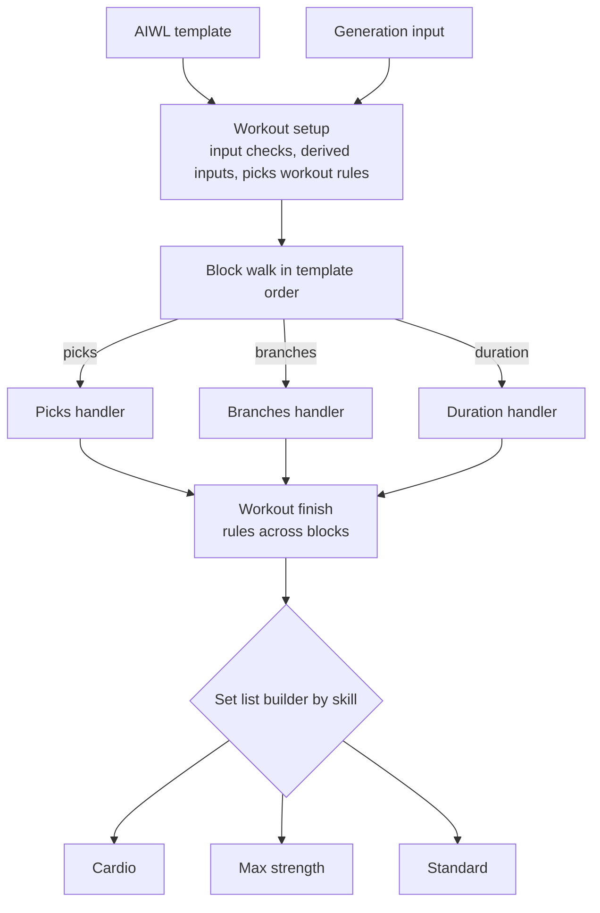
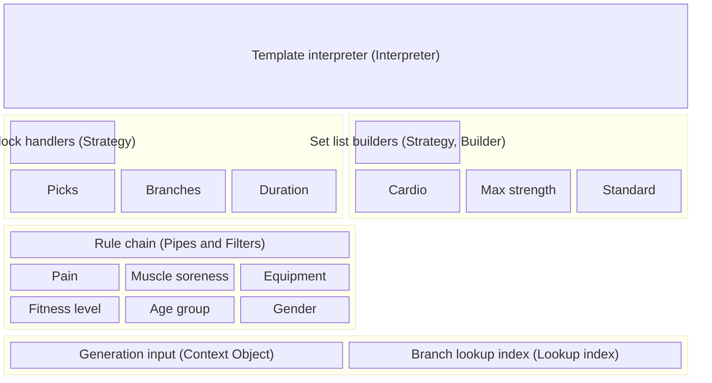

# ADR: Workout generator architecture

## Context

The workout generator turns a workout description into the set list for one athlete on one day. It reads:

- an [AIWL](./athletic-intelligence-workout-language.md) template
- the athlete profile
- the training place and its equipment
- the muscle soreness marked for the day
- the skill catalog and the skill trees
- the exercise catalog
- the athlete's exercise data

AIWL defines three block kinds: picks, duration and branches. Short workouts use picks blocks, training days use branches blocks, and a trainer workout uses duration blocks. The specs give each kind its own athlete rules and its own way to select branches.

Some rules in the specs span more than one block, for example [duplicate exercises](./duplicate-exercises.md), the skill boundary in [exercise order](./exercise-order.md), and the special warm-up in [Pain, Soreness, and Prevention](../specs/foundations/pain-soreness-and-prevention.md#pain-mappings). Cardio, max strength and the remaining skills each need their own set list builder. The [strength test](../specs/session/plan-independent-workouts.md#strength-test) has no template.

This ADR defines the structure the generator follows. The specs define the rules. This ADR uses the terms of the [Glossary](../specs/glossary.md) and the block kinds of the AIWL ADR.

## Decision drivers

- Every workout source enters the generator through one entry point and leaves it as one set list.
- A new block kind adds one handler and changes no other handler.
- One handler holds the rules of one block kind, and a reader can follow them top to bottom.
- Each part can be tested on its own, with a repeatable random source.
- The code uses plain TypeScript: modules, plain objects and pure functions. Every module stays within the lint limits without suppressions.
- A stored workout references catalog data and holds no copies of it.

## Options

1. One pipeline per workout source, with shared helper functions.
2. A class hierarchy: an abstract block class with one subclass per kind, and a generator object that calls them in template order.
3. A template interpreter that hands each block to a handler for its kind, built from plain functions.

## Outcome

Option 3.

- Option 1 keeps one flow per source, so a rule added to one flow misses the others.
- Option 2 needs a base class and instance state. A discriminated union gives the same dispatch with less code and an exhaustive check.

## Architecture

### Overview

### Patterns

The stages form a pipeline (Pipeline). Each component names its design pattern in brackets.

Each layer uses the layers below it:

- The template interpreter calls the block handler for each block kind and the set list builder for each skill.
- The block handlers run the rule chain.
- Every layer reads the generation input.

The diagram places the interpreter on top because its `switch` imports the handlers and builders, so the interpreter depends on them.

Each box in a layer implements the contract the layer title names. The code defines each contract as a TypeScript function type, and each implementation as a plain function or object literal.

### Stages

1. **Workout setup** runs once per workout.
   - It runs the input checks the specs define.
   - It derives the inputs that several blocks share, such as the body regions blocked by soreness and the prevention skills.
   - It applies the picks rules to the union of all picks block pools, as [Plan-Independent Workouts](../specs/session/plan-independent-workouts.md#short-workout) defines them.
2. **Block walk** (Interpreter) visits the blocks in template order. An exhaustive `switch` over the block kind calls the block's handler.
3. **Workout finish** applies the rules that need every block, such as the [exercise order](./exercise-order.md).
4. **Set list building** (Strategy, Builder) picks a builder by skill:
   - The cardio builder follows the [Cardio Training System](../specs/session/cardio-training-system.md#building-the-block).
   - The max strength builder follows [Max Strength Training](../specs/progression/max-strength-progression.md), support exercises included.
   - The standard builder follows [Session Set Structure](../specs/session/session-set-structure.md) and [Standard Exercise Progression](../specs/progression/standard-exercise-progression.md).

The strength test enters through the same entry point. It skips the template stages and uses its own builder.

### Set list building rules

One function, `createSetListBuilder`, builds the set list of every workout source. For each filled block it reads the timing, pairs the exercises, orders the pairs and calls the set list builder of the skill. Each source passes a rules object. The rules object names every intended difference between the sources:

| Rule                 | Short workout                                                       | Training day                                                                                                 |
| -------------------- | ------------------------------------------------------------------- | ------------------------------------------------------------------------------------------------------------ |
| `blockTiming`        | `workoutSetup`: the timing that workout setup resolved                   | `trainingDayDefaults`: the block's own values, then the training day defaults                                |
| `cardioPairing`      | `bySuperset`: pairs cardio like every other block                   | `drawOne`: draws one cardio branch                                                                           |
| `maxStrengthPairing` | `bySuperset`: pairs by the superset and trains the lead             | `singles`: trains every max strength exercise on its own                                                     |
| `exerciseOrder`      | `asPaired`: keeps the order of the pairs                            | `awayFromPreviousBlock`: opens each block away from the block before, max strength lower body first, cardio as drawn |
| `closingRest`        | `lastTemplateBlock`: drops the closing rest of a filled last block  | `setListEnd`: drops the rest that closes the set list                                                        |

A new difference between sources adds a rule to this object. A fix to a step reaches every source.

#### Defaults

The block's own values come first. The two sources differ in where their defaults come from:

- **Short workouts** read the skill catalog (`skills.json`) during workout setup. A missing default throws an error that names the block.
- **Training days** read `readTrainingDayTimingDefaults`. That function checks three layers in order for each field:
  1. the training day overrides
  2. the skill catalog
  3. the fallback: 2 sets, a superset by muscles and 10 s rests

The training day overrides keep stored plans as they were. They only hold the values the catalog lacks:

- the sets and the rest after an exercise for MAX and MAX_STRENGTH
- the sets, superset and rests of the cardio skills
- the PLYO skill, which has no catalog entry

### Block handlers (Strategy)

A handler is one function. It takes the block, the generation input and the set of used branches, and returns a block result: the resolved exercises, or the reason the block stayed empty. Handlers share library steps:

- the rule chain runner
- the [resolution of a branch](../specs/foundations/branches-exercises-and-levels.md#resolving-the-level-at-workout-start) to the exercise at the athlete's branch level
- the replacement of blocked branches

Resolution runs inside selection, because the specs drop a candidate whose exercise already appears.

| Block kind | Rules                                                                                          | Scope of the used branches                                     |
| ---------- | ---------------------------------------------------------------------------------------------- | -------------------------------------------------------------- |
| Picks      | [Plan-Independent Workouts](../specs/session/plan-independent-workouts.md#short-workout)       | Whole workout                                                  |
| Branches   | [Plan Workout Generation](../specs/session/plan-workout-generation.md#generating-the-session)  | One block, see [duplicate exercises](./duplicate-exercises.md) |
| Duration   | The [minutes table](./athletic-intelligence-workout-language.md#minutes-table) of the AIWL ADR | Whole workout                                                  |

A training day stores its cardio skill as a branches block. The branches handler applies the cardio rules from [Soreness and blocking](../specs/session/cardio-training-system.md#soreness-and-blocking). This ADR amends AIWL rule 1, so the rule applies to duration blocks only.

### Rule families (Pipes and Filters)

Each rule family is a pure filter. A family takes candidate branches and returns the kept ones, with a reason for every removal. The generator has one family each for these rules:

- pain
- muscle soreness
- equipment
- fitness level
- age group
- gender

Each handler composes its chain from these families in the order its spec defines.

### Generation input (Context Object)

One read-only object holds every input the stages read:

- the athlete profile
- the place and its equipment
- the muscle soreness
- the skill catalog
- the branch lookup index
- the exercise catalog
- the athlete's exercise data
- the random source

Workout setup adds the derived inputs once. No stage changes the object.

### Branch lookup index (Lookup index)

The index maps every branch ID to its branch across all skill trees. Skill tree loading builds it once, and a spec asserts that every branch ID is unique across the trees.

### Stored workouts

A training day stores an AIWL template. Its branches blocks hold branch IDs and durations. The branch lookup index supplies tags, levels and exercises at generation time, so a stored plan follows catalog changes.

### Errors

The generator raises three classes of error:

1. **Input errors** come from workout setup, when an input check fails.
2. **Workout rule errors** come from the picks workout rules, when a rule empties the union pool.
3. **Empty workout** errors come from the block walk, when every block stayed empty. The generator raises the reason of the first empty block in template order.

### Conventions

- **Discriminated unions.** Block kinds, block results and errors are tagged unions, and every `switch` over them is exhaustive.
- **No mutation.** Every stage returns new values and changes neither the template nor the generation input.
- **Random source.** The generation input carries the random function, with `Math.random` as the default, and every component draws through it. Tests pass a fixed sequence. Each component draws in a fixed order.
- **Module layout.** The top level of the `workoutGenerator` folder holds the modules other code calls: one entry module per workout source, the stored day template, and the template interpreter they hand the template to. The interpreter delegates to one subfolder per component of the patterns diagram:

  | Folder                    | Component                                | Modules                                                                                   |
  | ------------------------- | ---------------------------------------- | ----------------------------------------------------------------------------------------- |
  | `stages/`                 | Stages of the template interpreter       | workout setup, block walk, workout finish, exercise order, set list building              |
  | `blockHandlers/picks/`    | Picks handler                            | the handler, the picks workout rules, the picks draw                                      |
  | `blockHandlers/branches/` | Branches handler                         | the handler, its rule chain, duplicate branches, cardio replacement, stored branch lookup |
  | `blockHandlers/library/`  | Shared library steps                     | resolution, replacement of blocked branches                                               |
  | `ruleFamilies/`           | Rule chain                               | one module per rule family, plus the family contract                                      |
  | `setListBuilders/`        | Set list builders                        | the builder contract, one module per builder, their helpers                               |
  | `exerciseValues/`         | Exercise values the builders read        | start, target and feedback values, weight steps                                           |
  | `generationInput/`        | Generation input and branch lookup index | the input, the index, the skill catalog entry                                             |

  A duration handler goes in `blockHandlers/duration/`. Each module has its spec next to it. No index file only re-exports other modules.

- **Naming.** Modules and functions use the glossary terms. A function name is a verb plus a full noun.

## Pros and cons

- Pro: every workout source runs through one interpreter, so a rule change reaches every source that uses the block kind.
- Pro: a new block kind adds one handler and one `switch` case.
- Pro: the rules of a block kind read as one ordered chain inside one handler.
- Pro: each handler, each rule family and each stage has its own spec.
- Con: four stages apply rules: workout setup, the handlers, workout finish and the builders. A reader has to know which stage applies a rule.
- Con: the builders, not the block handlers, select support exercises and the strength test exercises.
- Con: a catalog change that removes a branch ID drops that slot from every stored plan.
- Con: the generation input grows with every new input a rule needs.

## More information

- [Athletic Intelligence Workout Language](./athletic-intelligence-workout-language.md)
- [Duplicate exercises in a session](./duplicate-exercises.md)
- [Exercise order inside a skill](./exercise-order.md)
- [Plan Workout Generation](../specs/session/plan-workout-generation.md)
- [Plan-Independent Workouts](../specs/session/plan-independent-workouts.md)
- [Pain, Soreness, and Prevention](../specs/foundations/pain-soreness-and-prevention.md)
