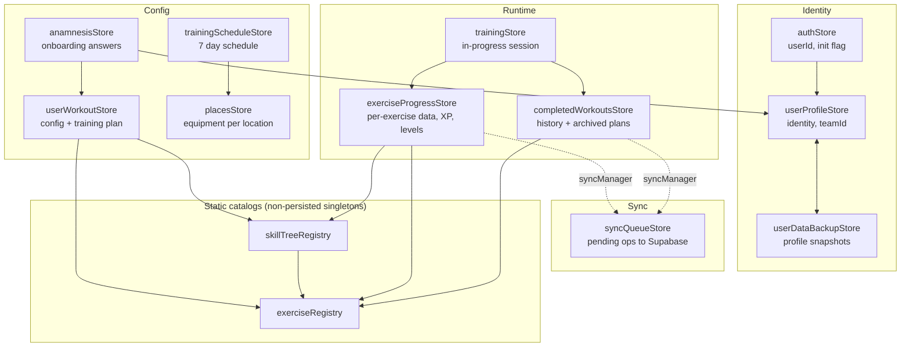
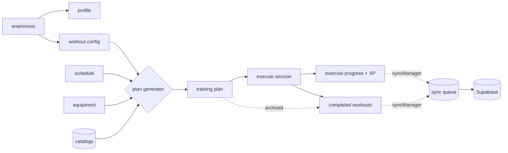

# Athlete-Mobile Data Model

A map of how local state is structured, persisted, and connected. For exact field types, read the store files in `src/store/` and schemas in `src/schemas/`.

## Persistence

All persisted stores use `persist(immer(...))` over an AsyncStorage adapter (`src/store/middleware.ts`), serialized as JSON.

Each store carries its **own** version in `STORE_VERSIONS` (`src/store/storeVersions.ts`) with an incremental `migrate` function in `src/store/migrations/`. A schema change bumps and migrates only the affected store; `createMigrate` bridges the legacy shared version 13 to the per-store baseline (14+).

Runtime validation uses **valibot** (`src/schemas/`).

## Store Map

## Stores

| Store | Key | Holds |
|-------|-----|-------|
| authStore | `auth-storage` | Auth reference (`userId` only; the JWT stays inside the Supabase client and is stripped from persistence) and init flag. Only store with direct Supabase integration; gates all user data. |
| userProfileStore | `user-profile-storage` | Single source of truth for identity (username, gender, birthday, height, weight), `anamnesisCompleted` gate, and `teamId` linking to a trainer team. |
| userSettingsStore | `user-settings-storage` | App preferences: review-prompt state, anonymised-data-use flag, and GDPR `consentStatus` (`loading`/`accepted`/`missing`). Independent of training data. |
| anamnesisStore | `anamnesis-storage` | Onboarding answers: form `values`, structured `tags` (21 groups), `seasonPhase`, `isSkipped`. Flows into profile and workout stores on completion. |
| userWorkoutStore | `user-workout-storage` | Central domain entity: training config (sport, tags, season phase, max strength), the generated `trainingPlan`, and optional `temporalData` (expiring tags, e.g. soreness, that the generator uses to filter or replace branches). |
| trainingScheduleStore | `training-schedule-storage` | 7 day entries (Mon-Sun): active flag, duration (`DurationMinutes`), and location. Feeds session count and length into the generator. |
| placesStore | `places-storage` | Equipment lists for HOME, STUDIO, HALL, OUTSIDE. Equipment filters exercise selection during generation. |
| exerciseProgressStore | `exercise-progress-storage` | Per-exercise data (reps, weight, feedback), per-branch level, cumulative totals, XP and derived level, and max-strength test history. |
| completedWorkoutsStore | `completed-workouts-storage` | Workout history with full exercise snapshots and pre-calculated aggregates, a lightweight `workoutsList` index, and archived training plans. |
| syncQueueStore | `sync-queue-storage` | Persistent queue of sync operations to Supabase with status, retry count (max 5), and a 500-item cap. |
| trainingStore | `training-storage` | In-progress session: live exercise list, feedback, timers, active index. Cleared when the session finishes. (`src/features/training/`) |
| userDataBackupStore | `user-data-backup-storage` | Per-user profile snapshots keyed by userId. Saved on logout, restored on next sign-in. |

`registrationConsentStore` is **in-memory only** so param manipulation cannot bypass the consent UI.

## Static Catalogs

Exercise and skill tree data are bundled JSON, loaded once per launch into module-level singletons (not Zustand, not persisted).

| Registry | File | Source | Lookup |
|----------|------|--------|--------|
| exerciseRegistry | `src/data/exerciseRegistry.ts` | `assets/.../Exercises.json` | `getExerciseById`, `getExercisesByTag`, `getAllExercises` |
| skillTreeRegistry | `src/data/skillTreeRegistry.ts` | 27 files in `assets/.../skillTrees/` | `getSkillTree`, `getAllSkillTrees`, `getSkillTreeNames` |
| loadSkillPriorities | `src/data/loadSkillPriorities.ts` | `assets/.../skillPriorities.json` | `loadSkillPriorities` |
| loadMaxMinutes | `src/data/loadMaxMinutes.ts` | `assets/.../maxMinutes.json` | `loadMaxMinutes` |
| loadStrengthTest | `src/data/loadStrengthTest.ts` | `assets/.../strengthTest.json` | `loadStrengthTest` |
| loadDirections | `src/data/loadDirections.ts` | `assets/.../directions.json` | `loadDirections` |
| loadRegionConfig | `src/data/loadRegionConfig.ts` | `assets/.../regions.json` | `loadRegionConfig(name)` |
| loadIntensityConfig | `src/data/loadIntensityConfig.ts` | `assets/.../intensity.json` | `loadIntensityConfig(name)` |

A skill branch maps `levels[n] -> { exerciseId }` into the exercise registry. Training plans reference branches by `branchId`.

## Data Flow

1. **Onboarding**: anamnesis answers populate profile (personal data, completion flag) and workout config (tags, season phase).
2. **Generation**: workout config + profile + schedule + equipment + catalogs produce `trainingPlan`.
3. **Execution**: the plan drives `trainingStore`; per-exercise results land in `exerciseProgressStore`.
4. **Completion**: snapshots and aggregates go to `completedWorkoutsStore`; XP and totals to `exerciseProgressStore`; the finished plan is archived.
5. **Sync**: store actions notify `syncManager`, which enqueues items; a sync service drains the queue to Supabase with retry.

### Key referential links

| Source | Target | Via |
|--------|--------|-----|
| anamnesisStore `tags`, `seasonPhase` | userWorkoutStore `workoutData` | same structured format |
| anamnesisStore `values` | userProfileStore `personalData` | height, weight, gender, birthday |
| trainingScheduleStore `place` | placesStore | selects active equipment |
| skillTreeRegistry `levels[n]` | exerciseRegistry | `exerciseId` |
| userWorkoutStore plan `branchId` | skillTreeRegistry | branch key |
| exerciseProgressStore `exerciseData`/`branchData` | registries | `exerciseId` / `branchId` |
| exerciseProgressStore `testHistory` | userWorkoutStore `maxValues` | same shape |
| completedWorkoutsStore `trainingPlans` | userWorkoutStore `trainingPlan` | same shape |

## Architectural Notes

- **Local-first**: only `authStore` touches Supabase at the store level. The sync queue provides eventual consistency for workouts, exercise progress, and strength tests.
- **Single source of truth for identity**: gender, birthday, height, weight live only in `userProfileStore`; generators read them via `userDataUtils.ts`.
- **Tag-driven**: tags use a structured `TagsByGroup` format consistently across anamnesis and workout stores; 21 groups in `src/constants/tagGroups.ts`.
- **Branded time types**: `DurationMinutes` and `DurationSeconds` keep units distinct at compile time (`src/features/training/models/TimeUnits.ts`).
- **Centralized sync schema**: `src/schemas/sync.schema.ts` is the source of truth for `CompleteWorkoutType`, `UserExerciseDataType`, `MaxForceRepetitionsDataType`, and `FocusArea`; model files re-export these.
- **Dual type system**: valibot infers generic `Record` types while model files declare explicit keys, so casts appear at the boundary. Several core types now re-export from schemas to narrow the gap.
- **Level formula**: the store derives level as `Math.floor(xp / 1000) + 1`.

## Known Gaps

| Area | Detail |
|------|--------|
| Unbounded history | `completedWorkoutsStore` keeps full snapshots per workout with no pagination or cap, growing AsyncStorage over time. |
| Rehydration validation | Rehydrated state is JSON-parsed but not schema-validated (the `onRehydrateStorage` handlers in auth, profile, and training stores only log errors and set a hydration flag), so corrupt data surfaces as deep runtime errors. |
| Partial sync coverage | Sync covers workouts, exercise data, and strength tests; profile, plan, schedule, and places stay local-only. |

## Recommended Improvements

| # | Improvement | Impact | Effort |
|---|-------------|--------|--------|
| 1 | Cap and paginate completed workouts; lazy-load full data via `workoutsList` | High | Low |
| 2 | Validate each store in `onRehydrateStorage`, reset to defaults on failure | High | Low |
| 3 | Make valibot schemas the single source of truth to remove boundary casts | High | High |
| 4 | Store per-workout deltas instead of full exercise snapshots | Medium | Medium |
| 5 | Extend sync to profile, plan, schedule, and places stores | Medium | Medium |
| 6 | Brand ID types (`ExerciseId`, `BranchId`, `WorkoutId`) like the time units | Medium | Low |
