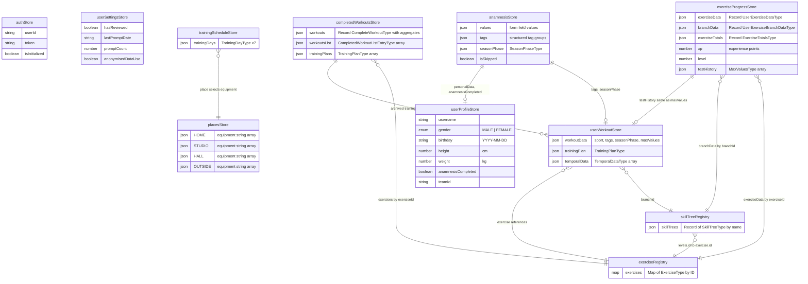

# Athlete-Mobile Internal Data Model

Complete documentation of all persisted data structures, their fields, and relationships.

**Version**: 2.0
**Updated**: 2026-02-04

---

## Table of Contents

1. [Persistence Infrastructure](#1-persistence-infrastructure)
2. [Stores Overview](#2-stores-overview)
3. [Store Details](#3-store-details)
   - [Auth Store](#31-auth-store)
   - [User Profile Store](#32-user-profile-store)
   - [User Settings Store](#33-user-settings-store)
   - [Anamnesis Store](#34-anamnesis-store)
   - [User Workout Store](#35-user-workout-store)
   - [Training Schedule Store](#36-training-schedule-store)
   - [Places Store](#37-places-store)
   - [Exercise Progress Store](#38-exercise-progress-store)
   - [Completed Workouts Store](#39-completed-workouts-store)
4. [Non-Persisted Data](#4-non-persisted-data)
   - [Exercise Registry](#41-exercise-registry)
   - [Skill Tree Registry](#42-skill-tree-registry)
5. [Bundled Static Data](#5-bundled-static-data)
6. [Entity Relationship Diagram](#6-entity-relationship-diagram)
7. [Data Flow Summary](#7-data-flow-summary)
8. [Architectural Notes](#8-architectural-notes)
9. [Recommended Improvements](#9-recommended-improvements)
10. [Changelog from v1](#10-changelog-from-v1)

---

## 1. Persistence Infrastructure

**Storage adapter**: `src/store/middleware.ts`
- Wraps `@react-native-async-storage/async-storage` into Zustand's `PersistStorage<unknown>` interface.
- Serialization: `JSON.stringify` / `JSON.parse`.

**Middleware stack**: All stores use `persist(immer(...))` from `zustand/middleware`.

**Version control**: `src/constants/sharedConstants.ts`
- `PERSIST_VERSION = 3` -- shared across all stores.
- Migration strategy: if persisted version < `PERSIST_VERSION`, the store **resets to default state**. No incremental migration.

**Validation**: Uses **valibot** (not Zod) for runtime schema validation in `src/schemas/`.

---

## 2. Stores Overview

| # | Store | AsyncStorage Key | Primary Purpose |
|---|-------|-----------------|-----------------|
| 1 | authStore | `auth-storage` | Holds the Supabase authentication session, including the user ID and JWT token. This is the only store that directly integrates with Supabase, and it gates access to all other user-specific data. It also tracks whether the auth state has been initialized from the persisted session on app launch. |
| 2 | userProfileStore | `user-profile-storage` | Stores the user's identity and personal data including username, gender, birthday, height, and weight. This is the **single source of truth** for user identity data. It also tracks whether the onboarding anamnesis flow has been completed, which gates navigation to the main app. The `teamId` field links the athlete to a trainer's team managed through the trainer-web dashboard. |
| 3 | userSettingsStore | `user-settings-storage` | Manages app-level preferences and consent flags independent of the user's training data. Tracks the app store review prompt state (whether reviewed, prompt count, last prompt date) to avoid over-prompting. Also stores the user's anonymised data usage consent for privacy compliance. |
| 4 | anamnesisStore | `anamnesis-storage` | Captures all responses from the onboarding questionnaire that profiles the athlete's fitness level, sport, injuries, and training preferences. Stores form field values, structured tag groups (20 groups covering level, body region, equipment, pain areas, etc.), and the current season phase. After completion, this data flows into `userProfileStore` and `userWorkoutStore` to configure the training plan generator. |
| 5 | userWorkoutStore | `user-workout-storage` | The central domain entity that holds the user's training configuration (sport, tags, season phase, max strength values) and the generated training plan. Note: user identity data (gender, birthday, height, weight) has been moved to `userProfileStore`. The training plan contains time-phased sections, each with weekly training sessions that map skills to exercise branches. This store is the primary input and output of the training plan generator. |
| 6 | trainingScheduleStore | `training-schedule-storage` | Defines the user's weekly training schedule as 7 day entries (Monday through Sunday), each with an active/inactive flag, duration in minutes (using `DurationMinutes` branded type), and training location. Active days and their durations feed directly into the training plan generator to determine how many sessions to create and how long each should be. The location selection connects to `placesStore` to determine available equipment for each session. |
| 7 | placesStore | `places-storage` | Maintains the available equipment for each of the four training locations: HOME, STUDIO, HALL, and OUTSIDE. Each location has a default equipment list (e.g., STUDIO includes barbell, dumbbell, power rack, etc.) that the user can customize. During training plan generation, exercises are filtered based on the equipment available at the selected location for each training day. |
| 8 | exerciseProgressStore | `exercise-progress-storage` | Tracks the user's per-exercise performance data (reps, weight, duration, feedback), per-branch progression level, and **cumulative exercise totals** (total weight, reps, duration, height per exercise). Also maintains the user's **XP**, derived level, and a history of max strength test results. Feedback streaks (consecutive "too easy" or "too hard" ratings) drive automatic progression and regression through branch levels. |
| 9 | completedWorkoutsStore | `completed-workouts-storage` | Archives completed workout sessions with full exercise snapshots, timestamps, duration (in seconds, using `DurationSeconds` branded type), and **XP earned**. Now includes **pre-calculated aggregates** (exerciseCount, movedWeight, userSkills) for efficient statistics display. Maintains both a detailed `workouts` record (keyed by ID) and a lightweight `workoutsList` index for efficient listing without loading full exercise data. Also stores archived training plans that have been completed or replaced, preserving the user's full training history. |

All 9 stores persist to AsyncStorage. Static catalog data (exercises and skill trees) is loaded as non-persisted modules via registries (see [Non-Persisted Data](#4-non-persisted-data)).

---

## 3. Store Details

### 3.1 Auth Store

**File**: `src/store/authStore.ts`
**Key**: `"auth-storage"`

```
State {
  auth: {
    userId: string                    // Supabase user ID
    token: string                     // Supabase JWT
  } | null
  isInitialized: boolean              // transient -- always starts false
}
```

**Default**: `{ auth: null, isInitialized: false }`

**Actions**: `setAuth`, `clearAuth`, `initializeFromSupabase`
**Selectors**: `isAuthenticated`

**Relationships**:
- `auth.userId` is referenced by `userProfileStore.userId`
- Initialized from `supabase.auth.getSession()`
- Only store with direct Supabase integration

---

### 3.2 User Profile Store

**File**: `src/store/userProfileStore.ts`
**Key**: `"user-profile-storage"`

This store is the **single source of truth** for user profile data (gender, birthday, height, weight).
Note: `userId` is managed exclusively by `authStore` - use `auth.userId` from authStore.

```
State {
  personalData: {
    username: string
    gender: "MALE" | "FEMALE"
    birthday: string                  // ISO 8601 format (YYYY-MM-DD)
    height?: number                   // height in cm (50-250)
    weight?: number                   // weight in kg (20-300)
  }
  anamnesisCompleted: boolean         // gates the anamnesis onboarding flow
  teamId: string | null               // links user to a trainer team
}
```

**Actions**: `setUsername`, `setGender`, `setBirthday`, `setHeight`, `setWeight`, `setPersonalData`, `setAnamnesisCompleted`, `setTeamId`, `clearProfile`
**Selectors**: `getAge`

**Relationships**:
- `anamnesisCompleted` <-- set after anamnesis flow completes
- `teamId` links to a trainer team (trainer-web domain)
- `personalData.gender`, `personalData.birthday`, `personalData.height`, `personalData.weight` are accessed by training generators via utility functions in `userDataUtils.ts`
- For `userId`, use `authStore.auth.userId` instead

---

### 3.3 User Settings Store

**File**: `src/store/userSettingsStore.ts`
**Key**: `"user-settings-storage"`

```
State {
  reviewStatus: {
    hasReviewed: boolean
    lastPromptDate?: string
    promptCount?: number
  }
  anonymisedDataUse: boolean          // privacy consent flag
}
```

**Default**: `{ reviewStatus: { hasReviewed: false, promptCount: 0 }, anonymisedDataUse: false }`

**Actions**: `setSettings`, `setReviewStatus`, `setAnonymisedDataUse`, `clearSettings`

**Relationships**: Independent from other stores.

---

### 3.4 Anamnesis Store

**File**: `src/store/anamnesisStore.ts`
**Key**: `"anamnesis-storage"`

```
State {
  values: Record<string, AnamnesisValue>  // form field values (e.g. { height: "175" })
                                          // where AnamnesisValue = string | number | boolean | null | undefined
  tags: Record<string, string[]>          // tag group -> tag values (e.g. { LEVEL: ["BEGINNER"], POSITION: ["FIELD"] })
  seasonPhase: {                          // SeasonPhaseType, nullable
    type: "PAUSE" | "PREPARATORY" | "COMPETITION" | null
    numOfWeeks?: number
    endDate: string                       // ISO 8601 format (YYYY-MM-DD)
  } | null
  isSkipped: boolean
}
```

**Default**: `{ values: {}, tags: { LEVEL: ["BEGINNER"] }, seasonPhase: null, isSkipped: false }`

**Actions**: `setValue`, `setTag`, `setSeasonPhase`, `clearAnamnesisData`, `setCompleted`, `saveData`, `setIsSkipped`

**Tag groups** (20 groups, from `TagGroups` enum in `src/constants/tagGroups.ts`):

| Key | Enum Value | Example Tags |
|-----|-----------|-------------|
| LEVEL | `"LEVEL"` | BEGINNER, ADVANCED, PROFESSIONAL |
| AGE | `"AGE"` | CHILD, ADOLESCENT, ADULT |
| GENDER | `"GENDER"` | MALE, FEMALE |
| SIDE | `"SIDE"` | LEFT, RIGHT |
| EQUIPMENT | `"EQ"` | BARBELL, DUMBBELL, ... |
| EQTYPE | `"EQTYPE"` | Equipment type classification |
| REGION | `"REGION"` | Body region |
| MUSCLE | `"MUSCLE"` | 30 muscle names |
| MUSCLE_SECONDARY | `"MUSCLESECONDARY"` | Secondary muscles |
| POSITION | `"POSITION"` | POSITION_FIELD, POSITION_GOAL, ... |
| PREVENTION | `"PREVENTION"` | Prevention area tags |
| PAIN | `"PAIN"` | Pain area tags |
| PART | `"PART"` | Body part tags |
| FOCUS | `"FOCUS"` | Training focus tags |
| DEFECT | `"DEFECT"` | Physical defect tags |
| BLOCK | `"BLOCK"` | Exercise blocking tags |
| SKILL | `"SKILL"` | Skill type tags |
| MUSCLE_INVOLVEMENT | `"MUSCLEINVOLVEMENT"` | Muscle involvement degree |
| EXERCISE_DIRECTION | `"EXERCISEDIRECTION"` | Movement direction |
| EXERCISENAME | `"EXERCISENAME"` | Exercise name tags |

**Relationships**:
- After completion, data flows into:
  - `userProfileStore.anamnesisCompleted = true`
  - `userProfileStore.personalData` <-- receives height, weight, gender, birthday from form values
  - `userWorkoutStore.workoutData.tags` <-- directly copied from `anamnesisStore.tags` (same structured format)
  - `userWorkoutStore.workoutData.seasonPhase` <-- `anamnesisStore.seasonPhase`

---

### 3.5 User Workout Store

**File**: `src/store/userWorkoutStore.ts`
**Key**: `"user-workout-storage"`

This is the **central domain entity** -- contains the user's training configuration and generated plan.

Note: User identity data (`gender`, `birthday`, `height`, `weight`, `anamnesisCompleted`) has been moved to `userProfileStore` as the single source of truth. Use `getUserHeight()` and `getUserWeight()` from `userDataUtils.ts` for access with fallback support.

```
State {
  workoutData: {
    sport: Sport                      // 9 sport enum values (see below)
    tags: TagsByGroup                 // structured format, e.g. { LEVEL: ["BEGINNER"], POSITION: ["FIELD"] }
    seasonPhase: {
      type: "PAUSE" | "PREPARATORY" | "COMPETITION" | null
      numOfWeeks?: number
      endDate: string                 // ISO 8601 format (YYYY-MM-DD)
    }
    maxValues: {
      testDate: string                // ISO 8601 format (YYYY-MM-DD)
      verticalPush: MaxValueType
      verticalPull: MaxValueType
      horizontalPush: MaxValueType
      horizontalPull: MaxValueType
      hip: MaxValueType
      knee: MaxValueType
      lowerBody: MaxValueType         // renamed from "unterkoerper" for consistency
    }
  }

  trainingPlan: {                     // TrainingPlanType, nullable
    start: string                     // ISO 8601 format (YYYY-MM-DD)
    sections: {                       // TrainingSectionType[]
      start: string                   // ISO 8601 format (YYYY-MM-DD)
      numOfWeeks: number
      type: SectionTypes              // "SWR1" | "SWR1KG" | "SWR2" | "SWR2KG" | "MAX" | "MAX_KRAFT" | "SK" | "SKKG" | "SAKG" | "SA"
      cardioType: CardioTypes         // "CARDIO_1" | "CARDIO_1_SHORT" | "CARDIO_1_LAKTAT" | "CARDIO_2" | "CARDIO_3" | "CARDIO_4" | "CARDIO_5"
      trainings: {                    // UserTrainingType[]
        weekday: number               // 0-6
        skills: {                     // keyed by SkillTypes
          [skillKey: string]: {       // ExerciseBranchType[]
            branchId: string
            tags: string[]
            exercises: { [level: number]: { exerciseId: string } }
          }[]
        }
        lengths: { [skillKey: string]: number }
        focus: "PHASE" | "CARDIO" | "STABILITY" | "COMBINED"
      }[]
    }[]
  } | null

  temporalData?: {                    // TemporalDataType[], optional
    date: string                      // ISO 8601 format (YYYY-MM-DD)
    expiration: string                // ISO 8601 format (YYYY-MM-DD)
    tag: string
  }[]
}
```

Where **MaxValueType** is:
```
{
  barbell?: number
  dumbbells?: number
  oneSidedUpper?: number
  oneSidedBarbell?: number
  oneSidedLower?: number
  oneSidedLowerSupported?: number
}
```

**Default**: `workoutData: { sport: "OTHER_SPORT", tags: { POSITION: ["FIELD"], LEVEL: ["BEGINNER"] }, seasonPhase: <default>, maxValues: DEFAULT_MAX_VALUES }`, `trainingPlan: null`, `temporalData: undefined`

**Sport enum** (9 values): `HANDBALL_SPORT`, `FOOTBALL_SPORT`, `VOLLEYBALL_SPORT`, `BASKETBALL_SPORT`, `ICE_HOCKEY_SPORT`, `HOCKEY_SPORT`, `AMERICAN_FOOTBALL_SPORT`, `RUGBY_SPORT`, `OTHER_SPORT`

**Actions**: `setWorkoutData`, `setSport`, `setSeasonPhase`, `setTags`, `setTrainingPlan`, `setTemporalData`, `clearUserWorkoutData`, `replaceBranchInTrainingPlan`, `saveMaxValues`

**Relationships**:
- `workoutData.tags` populated from `anamnesisStore.tags` (same structured format)
- `workoutData.seasonPhase` populated from `anamnesisStore.seasonPhase`
- Training generators access user identity data from `userProfileStore` via `userDataUtils.ts`
- `trainingPlan.sections[].trainings[].skills` references exercise branches that map into `exerciseRegistry` and `skillTreeRegistry`
- `maxValues` feeds into the training generator for weight calculations
- Completed plans are archived into `completedWorkoutsStore.trainingPlans`

**Key model files**: `src/features/training/models/UserWorkoutData.ts`, `TrainingPlan.ts`, `TrainingSection.ts`, `UserTraining.ts`, `ExerciseBranch.ts`, `SeasonPhase.ts`, `MaxValues.ts`, `TemporalData.ts`, `Tags.ts`

---

### 3.6 Training Schedule Store

**File**: `src/store/trainingScheduleStore.ts`
**Key**: `"training-schedule-storage"`

```
State {
  trainingDays: {                     // always 7 entries (Mon-Sun)
    active: boolean
    weekday: number                   // 0-6 (Monday=0, Sunday=6)
    duration: DurationMinutes         // branded type for minutes (typical range: 15-120)
    place: "HOME" | "OUTSIDE" | "HALL" | "STUDIO"
  }[]
}
```

**Default**: 7 days, all `active: false`, `duration: 30`, `place: "STUDIO"`

**Actions**: `setTrainingDays`, `toggleDay`, `setDayPlace`, `setDayDuration`, `clearTrainingSchedule`
**Selectors**: `getActiveTrainingDays`, `getTotalActiveHours`

**Relationships**:
- `place` references equipment configuration in `placesStore`
- Active days and durations feed into the training plan generator
- Duration recommendations come from `RECOMMENDATIONS_TRAINING_MINUTES` in `src/constants/workoutConstants.ts`

**Key model files**: `src/features/training/models/TrainingDay.ts`, `src/features/training/models/TimeUnits.ts`

---

### 3.7 Places Store

**File**: `src/store/placesStore.ts`
**Key**: `"places-storage"`

```
State {
  places: {
    HOME:    { equipment: string[] }
    STUDIO:  { equipment: string[] }
    HALL:    { equipment: string[] }
    OUTSIDE: { equipment: string[] }
  }
}
```

**Default equipment** (loaded from `assets/data/generator/places/`):

| Place | Equipment |
|-------|-----------|
| HOME | BOTTLE, CHAIR, TOWEL, SLIPPERY_GROUND, WALL |
| STUDIO | BENCH, FOAM_ROLLER, FOAM_BALL, TOWEL, CROSS_BAR, POWER_RACK, BARBELL, DUMBBELL, BARBELL_BENCH, TREADMILL, MEDICINE_BALL, ADJUSTABLE_BENCH, WALL, INCLINE_BENCH, MEDICINE_BALL_JUMPING, BOX_HIGH, MARKERS |
| HALL | FOAM_BALL, FOAM_ROLLER, BOTTLE, HANDBALL, HANDBALL_GOAL, TOWEL, BOX_HIGH, SPEED_LADDER, TRACK_5, TRACK_20, TRACK_LONG, AREA_5, AREA_10, AREA_20, MARKERS, MEDICINE_BALL, MULTIPLE_EXERCISING_BENCHES, BOX_LOW, WALL_BAR, EXERCISING_BENCH, WALL, SLIPPERY_GROUND, MEDICINE_BALL_JUMPING, CEILING |
| OUTSIDE | PARK_BENCH, TRACK_5, TRACK_20, TRACK_LONG, AREA_5, AREA_10, AREA_20, MARKERS |

50+ equipment types defined in `src/constants/workoutConstants.ts`.

**Actions**: `setPlaceEquipment`, `toggleEquipment`, `getPlaceEquipment`, `clearPlaces`

**Relationships**:
- `trainingScheduleStore.trainingDays[].place` selects which place's equipment is active
- Equipment filters exercise selection during training generation (exercises are filtered by required equipment tags)

---

### 3.8 Exercise Progress Store

**File**: `src/store/exerciseProgressStore.ts`
**Key**: `"exercise-progress-storage"`

```
State {
  exerciseData: {                     // Record<string, UserExerciseDataType | undefined>, keyed by exerciseId
    [exerciseId: string]: {
      exerciseId: string
      repetition?: number
      weight?: number
      nextWeightPercentage?: number
      maxFRepetitions?: {             // MaxForceRepetitionsDataType[]
        level: "WARMUP" | "EASY" | "MEDIUM" | "HARD"
        repetitions: number
      }[]
      maxFLevelAdjustment?: null | "TOO_HARD" | "TOO_EASY" | "SUCCEEDED"
      duration?: number
      height?: number
      weightType?: string
      skipped?: boolean
      set?: [number, number]          // [currentSet, totalSets]
      skill: "PREVENTION" | "MOBILITY" | "SWR" | "WARMUP" | "STABILITY" | "CARDIO" | "SUPPORT" | "FOAM_ROLLER" | "SCHNELLIGKEITSAUSDAUER_SPECIAL"
      feedback?: {
        difficulty: null | "TOO_HARD" | "TOO_EASY" | "SUCCEEDED"
        streakCounter?: number        // consecutive same-difficulty feedback count
      }
      branchId?: string
    } | undefined
  }

  branchData: {                       // Record<string, UserExerciseBranchDataType | undefined>, keyed by branchId
    [branchId: string]: {
      branchId: string
      level: number                   // current level within the branch
    } | undefined
  }

  exerciseTotals: {                   // ExerciseTotalsMapType - cumulative values per exercise
    [exerciseId: string]: {
      weight: number                  // total weight moved
      duration: number                // total time in seconds
      repetition: number              // total reps completed
      height: number                  // total height (for jump exercises)
    }
  }

  xp: number                          // user's experience points
  level: number                       // derived: based on xp using progressive formula

  testHistory: {                      // MaxValuesType[] -- historical max value snapshots
    testDate: string                  // ISO 8601 format (YYYY-MM-DD)
    verticalPush: MaxValueType
    verticalPull: MaxValueType
    horizontalPush: MaxValueType
    horizontalPull: MaxValueType
    hip: MaxValueType
    knee: MaxValueType
    lowerBody: MaxValueType           // renamed from "unterkoerper" for consistency
  }[]
}
```

Where **MaxValueType** = `{ barbell?, dumbbells?, oneSidedUpper?, oneSidedBarbell?, oneSidedLower?, oneSidedLowerSupported? }` (all optional numbers).

**Actions**: `setExerciseData`, `updateExercise`, `setBranchLevel`, `updateUserExerciseTotals`, `addXP`, `setLevel`, `addTestResult`, `clearProgress`
**Selectors**: `getExerciseData`, `getBranchLevel`, `getLatestTestResult`, `getExerciseTotals`

**Relationships**:
- `exerciseData` keys are `ExerciseType.id` from exercise registry
- `branchData` keys are branch IDs from skill tree registry
- `branchData[].level` selects which exercise within a branch is active
- `exerciseTotals` accumulates values per exercise across all workouts
- `testHistory` stores `MaxValuesType` snapshots (same structure as `userWorkoutStore.workoutData.maxValues`)
- `feedback.streakCounter` drives progression/regression decisions

**Key model files**: `src/features/training/models/UserExerciseData.ts`, `MaxForceRepetitionsData.ts`, `MaxValues.ts`, `ExerciseTotals.ts`

---

### 3.9 Completed Workouts Store

**File**: `src/store/completedWorkoutsStore.ts`
**Key**: `"completed-workouts-storage"`

```
State {
  workouts: {                         // Record<string, CompleteWorkoutType>, keyed by workout ID
    [workoutId: string]: {
      id: string
      timestamp: number               // epoch ms
      exercises: {                    // UserExerciseDataType[] -- full snapshot per exercise
        exerciseId: string
        repetition?: number
        weight?: number
        nextWeightPercentage?: number
        maxFRepetitions?: { level: "WARMUP" | "EASY" | "MEDIUM" | "HARD", repetitions: number }[]
        maxFLevelAdjustment?: null | "TOO_HARD" | "TOO_EASY" | "SUCCEEDED"
        duration?: number
        height?: number
        weightType?: string
        skipped?: boolean
        set?: [number, number]
        skill: "PREVENTION" | "MOBILITY" | "SWR" | "WARMUP" | "STABILITY" | "CARDIO" | "SUPPORT" | "FOAM_ROLLER" | "SCHNELLIGKEITSAUSDAUER_SPECIAL"
        feedback?: { difficulty: null | "TOO_HARD" | "TOO_EASY" | "SUCCEEDED", streakCounter?: number }
        branchId?: string
      }[]
      duration: DurationSeconds       // branded type for seconds (distinct from TrainingDay.duration: DurationMinutes)

      // Aggregate fields (new in v2)
      xpEarned?: number               // experience points earned in this workout
      exerciseCount?: number          // number of non-pause exercises
      movedWeight?: number            // total weight * reps
      userSkills?: {                  // exercise counts per focus area
        PREVENTION: number
        MOBILITY: number
        SWR: number
        WARMUP: number
        STABILITY: number
        CARDIO: number
      }
    }
  }

  workoutsList: {                     // lightweight index for listing without loading full exercise data
    id: string
    timestamp: number
    summary: string                   // e.g. "Workout completed in X minutes"
  }[]

  trainingPlans: {                    // archived TrainingPlanType[]
    start: string                     // ISO 8601 format (YYYY-MM-DD)
    sections: {
      start: string                   // ISO 8601 format (YYYY-MM-DD)
      numOfWeeks: number
      type: "SWR1" | "SWR1KG" | "SWR2" | "SWR2KG" | "MAX" | "MAX_KRAFT" | "SK" | "SKKG" | "SAKG" | "SA"
      cardioType: "CARDIO_1" | "CARDIO_1_SHORT" | "CARDIO_1_LAKTAT" | "CARDIO_2" | "CARDIO_3" | "CARDIO_4" | "CARDIO_5"
      trainings: {
        weekday: number
        skills: { [skillKey: string]: { branchId: string, tags: string[], exercises: { [level: number]: { exerciseId: string } } }[] }
        lengths: { [skillKey: string]: number }
        focus: "PHASE" | "CARDIO" | "STABILITY" | "COMBINED"
      }[]
    }[]
  }[]
}
```

**Actions**: `addCompletedWorkout`, `setCompletedWorkouts`, `setWorkoutsList`, `addCompletedTrainingPlan`, `setCompletedTrainingPlans`, `clearWorkoutHistory`
**Selectors**: `getWorkoutById`, `getRecentWorkouts`, `getTotalWorkouts`, `getTotalTrainingTime`

**Relationships**:
- `exercises[].exerciseId` references `ExerciseType.id` from exercise registry
- `trainingPlans[]` archives completed plans (same shape as `userWorkoutStore.trainingPlan`)
- `workoutsList` is a denormalized index over `workouts` -- `id` and `timestamp` are duplicated
- `userSkills` matches `FocusArea` type for radar chart display

**Legacy fields not migrated (REGRESSION)**:
- `time.pause` - Pause duration in ms, was used to exclude pauses from XP calculation (low impact)
- `time.skill` - **REGRESSION**: Time spent per skill area in ms, was the **preferred metric** for radar charts post-2021. The legacy code explicitly switched from exercise counts to time-based metrics on 2021-01-01 because time more accurately represents training focus.
- `userSkillsDuration` - Time per skill in seconds (defined but not actively used in legacy UI)

**Current limitation:** The radar chart uses **exercise counts** instead of the preferred **time-based** metric. This is a regression from the intentional 2021 improvement. A 5-minute strength exercise counts the same as a 30-second mobility stretch, which misrepresents the user's actual training distribution.

**See:** `issue-restore-time-based-radar-chart.md` for the fix implementation plan.

---

## 4. Non-Persisted Data

### 4.1 Exercise Registry

**File**: `src/data/exerciseRegistry.ts`

The exercise catalog is now managed as a **non-persisted module-level singleton** rather than a Zustand store. This change was made because:
- Exercise data is static and bundled with the app binary
- It doesn't need to survive across sessions -- it's reloaded from JSON on each app launch
- Removing persistence reduces AsyncStorage usage and eliminates unnecessary serialization

```
Module State {
  exerciseRegistry: Map<string, ExerciseType>  // O(1) lookup by ID
  exerciseArray: ExerciseType[]                // Full array for filtering/iteration
}
```

Where **ExerciseType** is:
```
{
  id: string                        // unique exercise identifier
  level: {
    m: number                       // male difficulty level
    w: number                       // female difficulty level
  }
  name: string                      // internal name
  displayName: string | null        // user-facing name
  description: string | null
  picture: string | null            // image asset reference
  video: string | null              // video asset reference
  values: ExerciseValues | null     // parameter values for reps, weight, duration, height
  tags: string[]                    // classification tags
  isAdvanceByReps: boolean          // progression by repetitions
  isAdvanceByDuration: boolean      // progression by duration
  isJump: boolean                   // jump exercise flag
  otherSideExerciseId?: string | null   // bilateral exercise partner
  equivalentExercises?: string[]    // alternative exercise IDs
}
```

**Data source**: Loaded from `assets/data/generator/Exercises.json` via `src/data/loadExercises.ts`. Validated against valibot `ExercisesArraySchema` in `src/schemas/exercise.schema.ts`.

**Exported functions**:
- `getExerciseById(id)` - O(1) lookup by exercise ID
- `getExercisesByTag(tag)` - Filter exercises by tag
- `getAllExercises()` - Get full exercise array
- `getExerciseRegistry()` - Get underlying Map for direct access
- `clearExerciseRegistry()` - Reset for testing

**Relationships**:
- Referenced by `exerciseId` throughout training plans and exercise progress
- `otherSideExerciseId` links bilateral exercise pairs (self-referential)
- `equivalentExercises` lists interchangeable exercise IDs (self-referential)
- Tags match against user tags and equipment tags for filtering

---

### 4.2 Skill Tree Registry

**File**: `src/data/skillTreeRegistry.ts`

The skill tree catalog is managed as a **non-persisted module-level singleton**, similar to the exercise registry. Skill trees organize exercises into progression branches by skill type.

```
Module State {
  skillTreeRegistry: Record<string, SkillTreeType>  // Keyed by skill tree name
}
```

Where **SkillTreeType** is:
```
Record<string, SkillBranchType>  // Keyed by branch name

SkillBranchType = {
  tags: string[]                    // Tags for filtering
  levels: {                         // Numeric key -> exercise reference
    [levelNumber: number]: { exerciseId: string }
  }
}
```

**Data source**: 26 JSON files in `assets/data/generator/skillTrees/`, loaded via `src/data/loadSkillTrees.ts`. Validated against valibot `SkillTreeSchema` in `src/schemas/skillTree.schema.ts`.

**Skill tree names** (26 total):
BAS, BR, CARDIO_1_LAKTAT, CARDIO_1_SHORT, CARDIO_2, CARDIO_3, CARDIO_4, CARDIO_5, CD, GKS, GKSKG, MAX, MOB, PLYO, PREV, PREVKG, SA, SAKG, SASPEZIAL, SK, SKKG, SWR1, SWR1KG, WU, WUSKSA, WUSPEZIAL

**Exported functions**:
- `getSkillTree(name)` - Get skill tree by name
- `getAllSkillTrees()` - Get all skill trees as Record
- `getSkillTreeNames()` - Get array of all skill tree names
- `clearSkillTreeRegistry()` - Reset for testing

**Relationships**:
- `levels[n].id` references `ExerciseType.id` in exercise registry
- Branch tags are matched against user tags during plan generation
- Training plans reference branches via `branchId`
- `exerciseProgressStore.branchData` keys reference branch IDs from skill trees

---

## 5. Bundled Static Data

| Asset Path | Format | Loaded By | Loaded Into |
|-----------|--------|-----------|-------------|
| `assets/data/generator/Exercises.json` | JSON | `src/data/loadExercises.ts` | `exerciseRegistry` (non-persisted) |
| `assets/data/generator/skillTrees/*.json` (26 files) | JSON | `src/data/loadSkillTrees.ts` | `skillTreeRegistry` (non-persisted) |
| `assets/data/generator/TestIntensity.json` | JSON | Training generator | Runtime only |
| `assets/data/generator/places/HOME.ts` | TS export | `placesStore` initial state | `placesStore` |
| `assets/data/generator/places/STUDIO.ts` | TS export | `placesStore` initial state | `placesStore` |
| `assets/data/generator/places/HALL.ts` | TS export | `placesStore` initial state | `placesStore` |
| `assets/data/generator/places/OUTSIDE.ts` | TS export | `placesStore` initial state | `placesStore` |

---

## 6. Entity Relationship Diagram



---

## 7. Data Flow Summary

1. **Onboarding flow**: `anamnesisStore` -> `userProfileStore` (personalData, anamnesisCompleted) + `userWorkoutStore` (tags, seasonPhase)
2. **Plan generation**: `userWorkoutStore.workoutData` + `userProfileStore.personalData` + `trainingScheduleStore` + `placesStore` + `skillTreeRegistry` + `exerciseRegistry` -> `userWorkoutStore.trainingPlan`
3. **Workout execution**: `trainingPlan` + `exerciseRegistry` -> `exerciseProgressStore` (updated per exercise)
4. **Workout completion**: Exercise snapshots -> `completedWorkoutsStore.workouts` (with aggregates), XP -> `exerciseProgressStore.xp`, Totals -> `exerciseProgressStore.exerciseTotals`
5. **Plan archival**: Completed `trainingPlan` -> `completedWorkoutsStore.trainingPlans`
6. **Exercise selection**: `skillTreeRegistry` branches filtered by tags + `placesStore` equipment -> `exerciseRegistry` lookup by ID -> `exerciseProgressStore.branchData[].level` selects difficulty level
7. **Statistics display**: `completedWorkoutsStore.workouts` (with userSkills, xpEarned, movedWeight) -> `useWorkoutsData` hook -> radar chart and summary cards

### Key Referential Links

| Source | Field | Target | Field |
|--------|-------|--------|-------|
| anamnesisStore | `tags` | userWorkoutStore | `workoutData.tags` |
| anamnesisStore | `seasonPhase` | userWorkoutStore | `workoutData.seasonPhase` |
| anamnesisStore | `values` (height, weight, etc.) | userProfileStore | `personalData` |
| trainingScheduleStore | `trainingDays[].place` | placesStore | `places[place]` |
| skillTreeRegistry | `levels[n].id` | exerciseRegistry | `exercises.get(id)` |
| userWorkoutStore | `trainingPlan...skills[].branchId` | skillTreeRegistry | branch key |
| exerciseProgressStore | `exerciseData[exerciseId]` | exerciseRegistry | `exercises.get(id)` |
| exerciseProgressStore | `branchData[branchId]` | skillTreeRegistry | branch key |
| exerciseProgressStore | `exerciseTotals[exerciseId]` | exerciseRegistry | `exercises.get(id)` |
| exerciseProgressStore | `testHistory[]` | userWorkoutStore | `workoutData.maxValues` (same shape) |
| completedWorkoutsStore | `workouts[].exercises[]` | exerciseRegistry | via `exerciseId` |
| completedWorkoutsStore | `workouts[].userSkills` | FocusArea type | radar chart display |
| completedWorkoutsStore | `trainingPlans[]` | userWorkoutStore | `trainingPlan` (same shape) |
| exerciseRegistry | `otherSideExerciseId` | exerciseRegistry | `exercises.get(id)` |
| exerciseRegistry | `equivalentExercises[]` | exerciseRegistry | `exercises.get(id)` |

---

## 8. Architectural Notes

1. **Local-first architecture**: Only `authStore` integrates with Supabase at the store level. All other data is persisted locally via AsyncStorage.

2. **Destructive migration**: A single `PERSIST_VERSION` counter controls all 9 persisted stores. Incrementing it resets every store to defaults -- no incremental migration support.

3. **Unbounded growth**: `completedWorkoutsStore` grows without pagination, cleanup, or size limits. Each completed workout stores a full snapshot of all exercise data.

4. **Dual type system**: Valibot schemas produce generic `Record<string, ...>` types, while model files define explicit property keys. Type casts are required at boundaries between these two systems. Note: Some model types now re-export from schemas (e.g., `MaxValuesType`) to reduce duplication.

5. **Tag-driven architecture**: Tags are now stored in a structured format (`TagsByGroup`) with tag group keys mapping to arrays of values. This is consistent across `anamnesisStore` and `userWorkoutStore`. 20 tag groups cover level, body region, equipment, pain areas, muscle groups, and more.

6. **Immutable store pattern**: All stores use `immer` middleware, allowing mutable-style writes within actions that produce immutable state updates externally.

7. **Hardcoded credentials in constants**: `src/constants/sharedConstants.ts` contains `ADMIN_USER` with plaintext email and password, a `TEST_PASSWORD`, and API keys for Amplitude, Bugsnag, and RevenueCat. These should be moved to environment variables.

8. **Validation library mismatch**: The project-level `CLAUDE.md` lists Zod in the tech stack, but the actual runtime validation uses **valibot**. The documentation is out of date.

9. **Static data as module singletons**: Exercise and skill tree data are now loaded as non-persisted module-level singletons (`exerciseRegistry`, `skillTreeRegistry`) rather than Zustand stores, reducing AsyncStorage usage since they are bundled static data.

10. **Branded time types**: Duration values use branded types (`DurationMinutes`, `DurationSeconds`) to prevent mixing units at compile time. See `src/features/training/models/TimeUnits.ts`.

11. **Single source of truth for user identity**: User identity data (gender, birthday, height, weight) is stored exclusively in `userProfileStore.personalData`. Training generators access this via utility functions in `userDataUtils.ts`.

12. **Terminology: XP**: The gamification system uses "XP" (experience points) terminology consistently throughout the codebase.

13. **Exercise totals tracking**: Per-exercise cumulative values (weight, duration, reps, height) are now tracked in `exerciseProgressStore.exerciseTotals` for lifetime statistics.

14. **Pre-calculated workout aggregates**: `CompleteWorkoutType` now includes pre-calculated `exerciseCount`, `movedWeight`, and `userSkills` fields for efficient statistics display without recalculating from exercise arrays.

---

## 9. Recommended Improvements

Each improvement is classified by **impact** (how much it improves reliability, performance, or maintainability) and **effort** (implementation complexity).

| # | Improvement | Impact | Effort |
|---|-------------|--------|--------|
| 1 | Per-store migration versioning | High | Medium |
| 2 | Bounded completed workouts with pagination | High | Low |
| 3 | Unify the dual type system | High | High |
| 4 | Normalize exercise snapshots in completed workouts | Medium | Medium |
| 5 | Add data integrity validation on rehydration | High | Low |
| 6 | Add Supabase sync for workout and progress stores | High | High |
| 7 | Replace loose string IDs with branded types | Medium | Low |

---

### 1. Per-Store Migration Versioning

**Impact: High** | **Effort: Medium**

**Problem**: A single `PERSIST_VERSION` controls all 9 persisted stores. Any schema change to any store forces a full reset of every store, effectively logging the user out and wiping all local progress, workout history, and configuration.

**Recommendation**: Give each store its own version number and migration function. When a store's schema changes, only that store migrates or resets. Zustand's `persist` middleware already supports per-store `version` and `migrate` fields -- they are just not being used independently.

```
// Before: shared version, destructive reset
persist(..., { version: PERSIST_VERSION, migrate: () => initialState })

// After: per-store version with incremental migration
persist(..., {
  version: 2,
  migrate: (persisted, version) => {
    if (version === 1) return migrateV1toV2(persisted)
    return persisted
  }
})
```

---

### 2. Bounded Completed Workouts with Pagination

**Impact: High** | **Effort: Low**

**Problem**: `completedWorkoutsStore` grows unboundedly. Every completed workout stores a full snapshot of all `UserExerciseDataType` entries. Over months of use, this store can grow to megabytes in AsyncStorage, degrading app startup time and memory usage.

**Recommendation**:
- Cap `workouts` to the most recent N entries (e.g. 200) and archive or drop older ones.
- Use the existing `workoutsList` lightweight index for listing, and lazy-load full workout data only when the user views a specific workout.
- Consider moving historical workouts to Supabase to free local storage.

---

### 3. Unify the Dual Type System

**Impact: High** | **Effort: High**

**Problem**: Valibot schemas infer generic `Record<string, ...>` types while model files define explicit property keys (e.g. `verticalPush`, `horizontalPull`). This forces type casts at every boundary and defeats TypeScript's ability to catch mismatches at compile time.

**Recommendation**: Make valibot schemas the single source of truth. Define schemas with explicit property keys using `v.object({ verticalPush: ..., horizontalPull: ... })` instead of `v.record(...)`, and infer model types directly from them. Remove the parallel manual type definitions in the `models/` directory.

Note: Some progress has been made here -- `MaxValuesType` and `SeasonPhaseType` now re-export from schemas as the single source of truth.

---

### 4. Normalize Exercise Snapshots in Completed Workouts

**Impact: Medium** | **Effort: Medium**

**Problem**: Each `CompleteWorkoutType` stores a full array of `UserExerciseDataType` objects. If the user does 5 workouts per week with 20 exercises each, that is 100 full exercise snapshots per week -- many containing the same exercise IDs with slightly different rep/weight values.

**Recommendation**:
- Store only the delta (exerciseId, reps, weight, duration, feedback) per completed workout, not the full `UserExerciseDataType` with skill, branchId, weightType, and other static fields that can be looked up.
- Create a `CompletedExerciseEntry` type with only the mutable fields.
- This reduces storage by roughly 40-60% per workout entry.

---

### 5. Add Data Integrity Validation on Rehydration

**Impact: High** | **Effort: Low**

**Problem**: When stores rehydrate from AsyncStorage, the data is parsed from JSON but not validated against the current schema. If persisted data is corrupted, partially written, or from an incompatible version that slipped through, the app may crash with opaque runtime errors deep in business logic.

**Recommendation**:
- Run valibot schema validation in each store's `onRehydrateStorage` callback.
- If validation fails, reset that store to defaults and log the error.
- This provides a safety net independent of the version-based migration and catches corruption from interrupted writes or manual AsyncStorage edits.

```
onRehydrateStorage: () => (state) => {
  const result = v.safeParse(StoreSchema, state)
  if (!result.success) {
    console.error('Store rehydration failed validation', result.issues)
    // Reset to defaults
  }
}
```

---

### 6. Add Supabase Sync for Workout and Progress Stores

**Impact: High** | **Effort: High**

**Problem**: Only `authStore` integrates with Supabase. All workout data, exercise progress, completed workouts, and training plans are purely local. If the user switches devices, reinstalls the app, or clears app data, everything is lost.

**Recommendation**:
- Prioritize syncing `exerciseProgressStore`, `completedWorkoutsStore`, and `userWorkoutStore` to Supabase.
- Use a last-write-wins or timestamp-based merge strategy for conflict resolution.
- Sync on workout completion (not continuously) to minimize network overhead.
- The `userProfileStore` already has `userId` and `teamId` that imply a server-side relationship -- extend this to cover training data.

---

### 7. Replace Loose String IDs with Branded Types

**Impact: Medium** | **Effort: Low**

**Problem**: Exercise IDs, branch IDs, user IDs, and workout IDs are all typed as plain `string`. This means TypeScript cannot prevent passing a branchId where an exerciseId is expected, or vice versa. The special sentinel values (`PLACEHOLDER_BRANCH_ID = "-1"`, `PAUSE_EXERCISE_ID = "999999"`) further blur the boundaries.

**Recommendation**: Use TypeScript branded types to make ID types nominally distinct:

```typescript
type ExerciseId = string & { readonly __brand: 'ExerciseId' }
type BranchId = string & { readonly __brand: 'BranchId' }
type WorkoutId = string & { readonly __brand: 'WorkoutId' }

// Constructor functions
const exerciseId = (id: string): ExerciseId => id as ExerciseId
const branchId = (id: string): BranchId => id as BranchId
```

This is a zero-runtime-cost change that catches cross-ID assignment bugs at compile time.

Note: Branded types for time units (`DurationMinutes`, `DurationSeconds`) have already been implemented in `src/features/training/models/TimeUnits.ts` -- this pattern could be extended to IDs.

---

## 10. Changelog from v1

### Terminology

The gamification system uses **XP** (experience points) terminology:
- `exerciseProgressStore.xp` - user's total experience points
- `addXP()` - action to add XP after workout completion
- `XP_PER_MINUTE` - constant for XP earned per minute of training
- `xpEarned` - XP earned in a completed workout

### New Types and Fields

| Type/Field | Location | Description |
|------------|----------|-------------|
| `ExerciseTotalsType` | `models/ExerciseTotals.ts` | Cumulative values (weight, duration, repetition, height) |
| `ExerciseTotalsMapType` | `models/ExerciseTotals.ts` | Map of exerciseId -> ExerciseTotalsType |
| `exerciseTotals` | `exerciseProgressStore` | Per-exercise cumulative totals |
| `FocusArea` | `models/Training.ts` | Union type for 6 radar chart categories |
| `FOCUS_AREAS` | `models/Training.ts` | Array constant of focus areas |
| `exerciseCount` | `CompleteWorkoutType` | Pre-calculated exercise count |
| `movedWeight` | `CompleteWorkoutType` | Pre-calculated total weight moved |
| `userSkills` | `CompleteWorkoutType` | Pre-calculated skill counts for radar chart |

### New Utility Functions

| Function | File | Description |
|----------|------|-------------|
| `calculateUserLevel(xp)` | `userProgressUtils.ts` | Calculate level from total XP |
| `getXPInLevel(xp)` | `userProgressUtils.ts` | Get progress within current level |
| `getXPForNextLevel(xp)` | `userProgressUtils.ts` | Get XP needed for next level |
| `accumulateExerciseTotals()` | `models/ExerciseTotals.ts` | Add values to existing totals |
| `createEmptyExerciseTotals()` | `models/ExerciseTotals.ts` | Create zero-initialized totals |
| `updateUserExerciseTotals()` | `exerciseProgressStore.ts` | Store action for totals |
| `getExerciseTotals()` | `exerciseProgressStore.ts` | Selector for exercise totals |

### Statistics Support

| Feature | Implementation |
|---------|----------------|
| Radar chart data | `userSkills` field in `CompleteWorkoutType` mapped to `FocusArea` type |
| Time filtering | `useWorkoutsData` hook with `ScaleType` (week/month/year/total) |
| Summary aggregation | `WorkoutsSummary` type with duration, count, xp, weight |
| Statistics hook | `useWorkoutsData()` in `hooks/useWorkoutsData.ts` |

### Level Calculation Formula

The level calculation uses a progressive formula (constants in `userProgressConstants.ts`):

```typescript
XP_PER_MINUTE = 4          // XP earned per minute
LEVEL_STEP_1 = 150         // XP for level 1 -> 2
LEVEL_STEP_2 = 200         // XP for level 2 -> 3
LEVEL_STEP = 5             // standard increase per level
BIG_LEVEL_STEP = 150       // bonus increase at milestone levels
BIG_LEVEL_FREQUENCE = 15   // milestone frequency
```

Level titles are defined in `LEVEL_STAGES_TITLES` from level 1 (ROOKIE) to level 45 (HANDBALL_GOTT).
