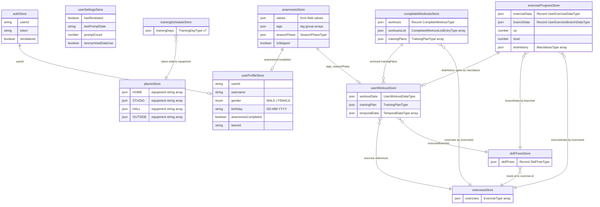

# Athlete-Mobile Internal Data Model

Complete documentation of all persisted data structures, their fields, and relationships.

---

## Table of Contents

1. [Persistence Infrastructure](#1-persistence-infrastructure)
2. [Stores Overview](#2-stores-overview)
3. [Store Details](#3-store-details)
   - [Auth Store](#31-auth-store)
   - [User Profile Store](#32-user-profile-store)
   - [User Settings Store](#33-user-settings-store)
   - [Anamnesis Store](#34-anamnesis-store)
   - [User Workout Store](#35-user-workout-store)
   - [Training Schedule Store](#36-training-schedule-store)
   - [Places Store](#37-places-store)
   - [Exercises Store](#38-exercises-store)
   - [Skill Trees Store](#39-skill-trees-store)
   - [Exercise Progress Store](#310-exercise-progress-store)
   - [Completed Workouts Store](#311-completed-workouts-store)
4. [Bundled Static Data](#4-bundled-static-data)
5. [Entity Relationship Diagram](#5-entity-relationship-diagram)
6. [Data Flow Summary](#6-data-flow-summary)
7. [Architectural Notes](#7-architectural-notes)
8. [Recommended Improvements](#8-recommended-improvements)
9. [Structural Issues in the Data Model](#9-structural-issues-in-the-data-model)

---

## 1. Persistence Infrastructure

**Storage adapter**: `src/store/middleware.ts`
- Wraps `@react-native-async-storage/async-storage` into Zustand's `PersistStorage<unknown>` interface.
- Serialization: `JSON.stringify` / `JSON.parse`.

**Middleware stack**: All stores use `persist(immer(...))` from `zustand/middleware`.

**Version control**: `src/constants/sharedConstants.ts`
- `PERSIST_VERSION = 3` -- shared across all stores.
- Migration strategy: if persisted version < `PERSIST_VERSION`, the store **resets to default state**. No incremental migration.

**Validation**: Uses **valibot** (not Zod) for runtime schema validation in `src/schemas/`.

---

## 2. Stores Overview

| # | Store | AsyncStorage Key | Primary Purpose |
|---|-------|-----------------|-----------------|
| 1 | authStore | `auth-storage` | Holds the Supabase authentication session, including the user ID and JWT token. This is the only store that directly integrates with Supabase, and it gates access to all other user-specific data. It also tracks whether the auth state has been initialized from the persisted session on app launch. |
| 2 | userProfileStore | `user-profile-storage` | Stores the user's identity and personal data such as username, gender, and birthday. It also tracks whether the onboarding anamnesis flow has been completed, which gates navigation to the main app. The `teamId` field links the athlete to a trainer's team managed through the trainer-web dashboard. |
| 3 | userSettingsStore | `user-settings-storage` | Manages app-level preferences and consent flags independent of the user's training data. Tracks the app store review prompt state (whether reviewed, prompt count, last prompt date) to avoid over-prompting. Also stores the user's anonymised data usage consent for privacy compliance. |
| 4 | anamnesisStore | `anamnesis-storage` | Captures all responses from the onboarding questionnaire that profiles the athlete's fitness level, sport, injuries, and training preferences. Stores form field values, structured tag groups (20 groups covering level, body region, equipment, pain areas, etc.), and the current season phase. After completion, this data flows into `userProfileStore` and `userWorkoutStore` to configure the training plan generator. |
| 5 | userWorkoutStore | `user-workout-storage` | The central domain entity that holds both the user's training configuration (body metrics, sport, tags, season phase, max strength values) and the generated training plan. The training plan contains time-phased sections, each with weekly training sessions that map skills to exercise branches. This store is the primary input and output of the training plan generator. |
| 6 | trainingScheduleStore | `training-schedule-storage` | Defines the user's weekly training schedule as 7 day entries (Monday through Sunday), each with an active/inactive flag, duration in minutes, and training location. Active days and their durations feed directly into the training plan generator to determine how many sessions to create and how long each should be. The location selection connects to `placesStore` to determine available equipment for each session. |
| 7 | placesStore | `places-storage` | Maintains the available equipment for each of the four training locations: HOME, STUDIO, HALL, and OUTSIDE. Each location has a default equipment list (e.g., STUDIO includes barbell, dumbbell, power rack, etc.) that the user can customize. During training plan generation, exercises are filtered based on the equipment available at the selected location for each training day. |
| 8 | exercisesStore | `exercises-storage` | Contains the full exercise catalog loaded from bundled JSON data, with each exercise defining its difficulty levels, parameter values (reps, weight, duration, height), media references, and classification tags. Exercises are referenced by ID throughout training plans, skill trees, and progress tracking. The catalog also defines bilateral exercise pairs and equivalent exercise alternatives for substitution. |
| 9 | skillTreesStore | `skill-trees-storage` | Stores 27 skill trees (e.g., SWR1, MAX, CARDIO, PREV, MOB) that organize exercises into branches by skill type and progression level. Each branch contains tags for filtering and a set of leveled exercise references, where higher levels correspond to more difficult exercises. The training plan generator selects branches based on user tags and equipment, and `exerciseProgressStore` tracks which level the user has reached within each branch. |
| 10 | exerciseProgressStore | `exercise-progress-storage` | Tracks the user's per-exercise performance data (reps, weight, duration, feedback) and per-branch progression level that determines which exercise difficulty the user currently trains at. Also maintains the user's XP, derived level, and a history of max strength test results. Feedback streaks (consecutive "too easy" or "too hard" ratings) drive automatic progression and regression through branch levels. |
| 11 | completedWorkoutsStore | `completed-workouts-storage` | Archives completed workout sessions with full exercise snapshots, timestamps, duration, and XP earned. Maintains both a detailed `workouts` record (keyed by ID) and a lightweight `workoutsList` index for efficient listing without loading full exercise data. Also stores archived training plans that have been completed or replaced, preserving the user's full training history. |

All 11 stores persist to AsyncStorage. There are no ephemeral-only stores.

---

## 3. Store Details

### 3.1 Auth Store

**File**: `src/store/authStore.ts`
**Key**: `"auth-storage"`

```
State {
  auth: {
    userId: string                    // Supabase user ID
    token: string                     // Supabase JWT
  } | null
  isInitialized: boolean              // transient -- always starts false
}
```

**Default**: `{ auth: null, isInitialized: false }`

**Actions**: `setAuth`, `clearAuth`, `initializeFromSupabase`
**Selectors**: `isAuthenticated`

**Relationships**:
- `auth.userId` is referenced by `userProfileStore.userId`
- Initialized from `supabase.auth.getSession()`
- Only store with direct Supabase integration

---

### 3.2 User Profile Store

**File**: `src/store/userProfileStore.ts`
**Key**: `"user-profile-storage"`

```
State {
  userId: string | null               // matches authStore.auth.userId
  personalData: {
    username: string
    gender: "MALE" | "FEMALE"
    birthday: string                  // DD-MM-YYYY
  }
  anamnesisCompleted: boolean         // gates the anamnesis onboarding flow
  teamId: string | null               // links user to a trainer team
}
```

**Actions**: `setUserId`, `setUsername`, `setGender`, `setBirthday`, `setPersonalData`, `setAnamnesisCompleted`, `setTeamId`, `clearProfile`
**Selectors**: `getAge`

**Relationships**:
- `userId` <-- `authStore.auth.userId`
- `anamnesisCompleted` <-- set after anamnesis flow completes
- `teamId` links to a trainer team (trainer-web domain)

---

### 3.3 User Settings Store

**File**: `src/store/userSettingsStore.ts`
**Key**: `"user-settings-storage"`

```
State {
  reviewStatus: {
    hasReviewed: boolean
    lastPromptDate?: string
    promptCount?: number
  }
  anonymisedDataUse: boolean          // privacy consent flag
}
```

**Default**: `{ reviewStatus: { hasReviewed: false, promptCount: 0 }, anonymisedDataUse: false }`

**Actions**: `setSettings`, `setReviewStatus`, `setAnonymisedDataUse`, `clearSettings`

**Relationships**: Independent from other stores.

---

### 3.4 Anamnesis Store

**File**: `src/store/anamnesisStore.ts`
**Key**: `"anamnesis-storage"`

```
State {
  values: { [path: string]: any }     // form field values (e.g. { height: "175" })
  tags: { [tagGroup: string]: string[] }  // tag group -> tag values
  seasonPhase: {                      // SeasonPhaseType, nullable
    type: "PAUSE" | "PREPATORY" | "COMPETITION" | null
    numOfWeeks?: number
    endDate: string                   // DD-MM-YYYY
  } | null
  isSkipped: boolean
}
```

**Default**: `{ values: {}, tags: { LEVEL: ["BEGINNER"] }, seasonPhase: null, isSkipped: false }`

**Actions**: `setValue`, `setTag`, `setSeasonPhase`, `clearAnamnesisData`, `setCompleted`, `saveData`, `setIsSkipped`

**Tag groups** (20 groups, from `TagGroups` enum in `src/constants/tagGroups.ts`):

| Key | Enum Value | Example Tags |
|-----|-----------|-------------|
| LEVEL | `"LEVEL"` | BEGINNER, ADVANCED, PROFESSIONAL |
| AGE | `"AGE"` | CHILD, ADOLESCENT, ADULT |
| GENDER | `"GENDER"` | MALE, FEMALE |
| SIDE | `"SIDE"` | LEFT, RIGHT |
| EQUIPMENT | `"EQ"` | BARBELL, DUMBBELL, ... |
| EQTYPE | `"EQTYPE"` | Equipment type classification |
| REGION | `"REGION"` | Body region |
| MUSCLE | `"MUSCLE"` | 30 muscle names |
| MUSCLE_SECONDARY | `"MUSCLESECONDARY"` | Secondary muscles |
| POSITION | `"POSITION"` | POSITION_FIELD, POSITION_GOAL, ... |
| PREVENTION | `"PREVENTION"` | Prevention area tags |
| PAIN | `"PAIN"` | Pain area tags |
| PART | `"PART"` | Body part tags |
| FOCUS | `"FOCUS"` | Training focus tags |
| DEFECT | `"DEFECT"` | Physical defect tags |
| BLOCK | `"BLOCK"` | Exercise blocking tags |
| SKILL | `"SKILL"` | Skill type tags |
| MUSCLE_INVOLVEMENT | `"MUSCLEINVOLVEMENT"` | Muscle involvement degree |
| EXERCISE_DIRECTION | `"EXERCISEDIRECTION"` | Movement direction |
| EXERCISENAME | `"EXERCISENAME"` | Exercise name tags |

**Relationships**:
- After completion, data flows into:
  - `userProfileStore.anamnesisCompleted = true`
  - `userWorkoutStore.workoutData.tags` <-- flattened from `anamnesisStore.tags`
  - `userWorkoutStore.workoutData.seasonPhase` <-- `anamnesisStore.seasonPhase`

---

### 3.5 User Workout Store

**File**: `src/store/userWorkoutStore.ts`
**Key**: `"user-workout-storage"`

This is the **central domain entity** -- contains the user's training configuration and generated plan.

```
State {
  workoutData: {
    anamnesisCompleted: boolean
    gender: "MALE" | "FEMALE"
    birthday: string                  // DD-MM-YYYY
    weight: number                    // kg
    height: number                    // cm
    sport: Sport                      // 9 sport enum values (see below)
    tags: string[]                    // flat array, e.g. ["POSITION_FIELD", "LEVEL_BEGINNER"]
    seasonPhase: {
      type: "PAUSE" | "PREPATORY" | "COMPETITION" | null
      numOfWeeks?: number
      endDate: string                 // DD-MM-YYYY
    }
    maxValues: {
      testDate: string                // DD-MM-YYYY
      verticalPush: MaxValueType
      verticalPull: MaxValueType
      horizontalPush: MaxValueType
      horizontalPull: MaxValueType
      hip: MaxValueType
      knee: MaxValueType
      unterkoerper: MaxValueType      // "lower body" (German)
    }
  }

  trainingPlan: {                     // TrainingPlanType, nullable
    start: Date
    sections: {                       // TrainingSectionType[]
      start: string                   // DD-MM-YYYY
      numOfWeeks: number
      type: SectionTypes              // "SWR1" | "SWR1KG" | "SWR2" | "SWR2KG" | "MAX" | "MAX_KRAFT" | "SK" | "SKKG" | "SAKG" | "SA"
      cardioType: CardioTypes         // "CARDIO_1" | "CARDIO_1_SHORT" | "CARDIO_1_LAKTAT" | "CARDIO_2" | "CARDIO_3" | "CARDIO_4" | "CARDIO_5"
      trainings: {                    // UserTrainingType[]
        weekday: number               // 0-6
        skills: {                     // keyed by SkillTypes
          [skillKey: string]: {       // ExerciseBranchType[]
            exerciseBranchId: string
            tags: string[]
            exercises: { [level: number]: { exerciseId: string } }
          }[]
        }
        lengths: { [skillKey: string]: number }
        focus: "PHASE" | "CARDIO" | "STABILITY" | "COMBINED"
      }[]
    }[]
  } | null

  temporalData?: {                    // TemporalDataType[], optional
    date: Date
    expiration: Date
    tag: string
  }[]
}
```

Where **MaxValueType** is:
```
{
  barbell?: number
  dumbbells?: number
  oneSidedUpper?: number
  oneSidedBarbell?: number
  oneSidedLower?: number
  oneSidedLowerSupported?: number
}
```

**Default**: `workoutData: { anamnesisCompleted: false, gender: "MALE", birthday: "01-01-2000", weight: 65, height: 175, sport: "OTHER_SPORT", tags: ["POSITION_FIELD", "LEVEL_BEGINNER"], seasonPhase: <default>, maxValues: DEFAULT_MAX_VALUES }`, `trainingPlan: null`, `temporalData: undefined`

**Sport enum** (9 values): `HANDBALL_SPORT`, `FOOTBALL_SPORT`, `VOLLEYBALL_SPORT`, `BASKETBALL_SPORT`, `ICE_HOCKEY_SPORT`, `HOCKEY_SPORT`, `AMERICAN_FOOTBALL_SPORT`, `RUGBY_SPORT`, `OTHER_SPORT`

**Actions**: `setWorkoutData`, `setSport`, `setSeasonPhase`, `setTags`, `setTrainingPlan`, `setTemporalData`, `clearUserWorkoutData`, `replaceBranchInTrainingPlan`, `saveMaxValues`

**Relationships**:
- `workoutData` populated from `anamnesisStore` + `userProfileStore`
- `trainingPlan.sections[].trainings[].skills` references exercise branches that map into `exercisesStore` and `skillTreesStore`
- `maxValues` feeds into the training generator for weight calculations
- Completed plans are archived into `completedWorkoutsStore.trainingPlans`

**Key model files**: `src/features/training/models/UserWorkoutData.ts`, `TrainingPlan.ts`, `TrainingSection.ts`, `UserTraining.ts`, `ExerciseBranch.ts`, `SeasonPhase.ts`, `MaxValues.ts`, `TemporalData.ts`

---

### 3.6 Training Schedule Store

**File**: `src/store/trainingScheduleStore.ts`
**Key**: `"training-schedule-storage"`

```
State {
  trainingDays: {                     // always 7 entries (Mon-Sun)
    active: boolean
    weekday: number                   // 0-6 (Monday=0, Sunday=6)
    duration: number                  // in minutes (despite misleading "hh:mm" comment in model)
    place: "HOME" | "OUTSIDE" | "HALL" | "STUDIO"
  }[]
}
```

**Default**: 7 days, all `active: false`, `duration: 30`, `place: "STUDIO"`

**Actions**: `setTrainingDays`, `toggleDay`, `setDayLocation`, `setDayDuration`, `clearTrainingSchedule`
**Selectors**: `getActiveTrainingDays`, `getTotalActiveHours`

**Relationships**:
- `place` references equipment configuration in `placesStore`
- Active days and durations feed into the training plan generator
- Duration recommendations come from `RECOMMENDATIONS_TRAINING_MINUTES` in `src/constants/workoutConstants.ts`

**Key model file**: `src/features/training/models/TrainingDay.ts`

---

### 3.7 Places Store

**File**: `src/store/placesStore.ts`
**Key**: `"places-storage"`

```
State {
  places: {
    HOME:    { name: "HOME",    equipment: string[] }
    STUDIO:  { name: "STUDIO",  equipment: string[] }
    HALL:    { name: "HALL",    equipment: string[] }
    OUTSIDE: { name: "OUTSIDE", equipment: string[] }
  }
}
```

Note: `name` is redundant with the record key. It holds a type identifier, not a human-readable name.

**Default equipment** (loaded from `assets/data/generator/places/`):

| Place | Equipment |
|-------|-----------|
| HOME | BOTTLE, CHAIR, TOWEL, SLIPPERY_GROUND, WALL |
| STUDIO | BENCH, BLACK_ROLL, BLACK_BALL, TOWEL, CROSS_BAR, POWER_RACK, BARBELL, DUMBBELL, BARBELL_BENCH, TREADMILL, MEDICINE_BALL, ADJUSTABLE_BENCH, WALL, INCLINE_BENCH, MEDICINE_BALL_JUMPING, BOX_HIGH, MARKERS |
| HALL | BLACK_BALL, BLACK_ROLL, BOTTLE, HANDBALL, HANDBALL_GOAL, TOWEL, BOX_HIGH, SPEED_LADDER, TRACK_5, TRACK_20, TRACK_LONG, AREA_5, AREA_10, AREA_20, MARKERS, MEDICINE_BALL, MULTIPLE_EXERCISING_BENCHES, BOX_LOW, WALL_BAR, EXERCISING_BENCH, WALL, SLIPPERY_GROUND, MEDICINE_BALL_JUMPING, CEILING |
| OUTSIDE | PARK_BENCH, TRACK_5, TRACK_20, TRACK_LONG, AREA_5, AREA_10, AREA_20, MARKERS |

50+ equipment types defined in `src/constants/workoutConstants.ts`.

**Actions**: `setPlaceEquipment`, `toggleEquipment`, `getPlaceEquipment`, `clearPlaces`

**Relationships**:
- `trainingScheduleStore.trainingDays[].place` selects which place's equipment is active
- Equipment filters exercise selection during training generation (exercises are filtered by required equipment tags)

---

### 3.8 Exercises Store

**File**: `src/store/exercisesStore.ts`
**Key**: `"exercises-storage"`

```
State {
  exercises: {                        // ExerciseType[] | null
    id: string                        // unique exercise identifier
    level: {
      m: number                       // male difficulty level
      w: number                       // female difficulty level
    }
    name: string                      // internal name
    displayName: string | null        // user-facing name
    description: string | null
    picture: string | null            // image asset reference
    video: string | null              // video asset reference
    values: {                         // ExerciseValues, nullable
      [param in "duration" | "height" | "repetition" | "weight"]: {
        startValue: {
          type?: { type: "weightFMax" | "weightAbsolute" | "Unknown" | "Single" }
          default?: Record<TrainingLevel, string>
          m?: Record<TrainingLevel, string>
          w?: Record<TrainingLevel, string>
          k?: Record<TrainingLevel, string>
        }
        targetValue: { ... }          // same shape as startValue
      }
    } | null
    tags: string[]                    // classification tags
    isAdvanceByReps: boolean          // progression by repetitions
    isAdvanceByDuration: boolean      // progression by duration
    isJump: boolean                   // jump exercise flag
    otherSideExerciseId?: string | null   // bilateral exercise partner
    equivalentExercises?: string[]    // alternative exercise IDs
  }[] | null
}
```

Where **TrainingLevel** = `"default" | "beginner" | "intermediate" | "advanced" | "professional"`

**Data source**: Loaded from `assets/data/generator/Exercises.json` via `src/data/loadExercises.ts`. Validated against valibot `ExercisesArraySchema` in `src/schemas/exercise.schema.ts`.

**Actions**: `setExercises`, `clearExercises`
**Selectors**: `getExerciseById`, `getExercisesByTag`

**Relationships**:
- Referenced by `exerciseId` throughout training plans and exercise progress
- `otherSideExerciseId` links bilateral exercise pairs (self-referential)
- `equivalentExercises` lists interchangeable exercise IDs (self-referential)
- Tags match against user tags and equipment tags for filtering

---

### 3.9 Skill Trees Store

**File**: `src/store/skillTreesStore.ts`
**Key**: `"skill-trees-storage"`

```
State {
  skillTrees: {                       // Record<string, SkillTreeType>, keyed by skill tree name
    [treeName: string]: {             // SkillTreeType = Record<string, SkillBranchType>
      [branchName: string]: {
        tags: string[]
        levels: {                     // numeric string key -> exercise ID
          [levelNumber: string]: { id: string }
        }
      }
    }
  }
}
```

**Data source**: 27 JSON files in `assets/data/generator/skillTrees/`, loaded via `src/data/loadSkillTrees.ts`. Validated against valibot `SkillTreeSchema` in `src/schemas/skillTree.schema.ts`.

**Skill tree names** (27 total):
BAS, BR, CARDIO_1_LAKTAT, CARDIO_1_SHORT, CARDIO_2, CARDIO_3, CARDIO_4, CARDIO_5, CD, GKS, GKSKG, MAX, MOB, PLYO, PREV, PREVKG, SA, SAKG, SASPEZIAL, SK, SKKG, SUPPORT, SWR1, SWR1KG, WU, WUSKSA, WUSPEZIAL

**Actions**: `setSkillTree`, `setAllSkillTrees`, `clearSkillTrees`
**Selectors**: `getSkillTree`

**Relationships**:
- `levels[n].id` references `ExerciseType.id` in exercises store
- Branch tags are matched against user tags during plan generation
- Training plans reference branches via `exerciseBranchId`

---

### 3.10 Exercise Progress Store

**File**: `src/store/exerciseProgressStore.ts`
**Key**: `"exercise-progress-storage"`

```
State {
  exerciseData: {                     // Record<string, UserExerciseDataType | undefined>, keyed by exerciseId
    [exerciseId: string]: {
      exerciseId: string
      repetition?: number
      weight?: number
      nextWeightPercentage?: number
      maxFRepetitions?: {             // MaxForceRepetitionsDataType[]
        level: "WARMUP" | "EASY" | "MEDIUM" | "HARD"
        repetitions: number
      }[]
      maxFLevelAdjustment?: null | "TOO_HARD" | "TOO_EASY" | "SUCCEEDED"
      duration?: number
      height?: number
      weightType?: string
      skipped?: boolean
      set?: [number, number]          // [currentSet, totalSets]
      skill: "PREVENTION" | "MOBILITY" | "SWR" | "WARMUP" | "STABILITY" | "CARDIO" | "SUPPORT" | "BLACK_ROLL" | "SCHNELLIGKEITSAUSDAUER_SPECIAL"
      feedback?: {
        difficulty: null | "TOO_HARD" | "TOO_EASY" | "SUCCEEDED"
        streakCounter?: number        // consecutive same-difficulty feedback count
      }
      branchId?: string
    } | undefined
  }

  branchData: {                       // Record<string, UserExerciseBranchDataType | undefined>, keyed by branchId
    [branchId: string]: {
      branchId: string
      level: number                   // current level within the branch
    } | undefined
  }

  xp: number
  level: number                       // derived: Math.floor(xp / 1000) + 1

  testHistory: {                      // MaxValuesType[] -- historical max value snapshots
    testDate: string
    verticalPush: MaxValueType
    verticalPull: MaxValueType
    horizontalPush: MaxValueType
    horizontalPull: MaxValueType
    hip: MaxValueType
    knee: MaxValueType
    unterkoerper: MaxValueType
  }[]
}
```

Where **MaxValueType** = `{ barbell?, dumbbells?, oneSidedUpper?, oneSidedBarbell?, oneSidedLower?, oneSidedLowerSupported? }` (all optional numbers).

**Actions**: `setExerciseData`, `updateExercise`, `setBranchLevel`, `addXP`, `setLevel`, `addTestResult`, `clearProgress`
**Selectors**: `getExerciseData`, `getBranchLevel`, `getLatestTestResult`

**Relationships**:
- `exerciseData` keys are `ExerciseType.id` from exercises store
- `branchData` keys are branch IDs from skill trees store
- `branchData[].level` selects which exercise within a branch is active
- `testHistory` stores `MaxValuesType` snapshots (same structure as `userWorkoutStore.workoutData.maxValues`)
- `feedback.streakCounter` drives progression/regression decisions

**Key model files**: `src/features/training/models/UserExerciseData.ts`, `MaxForceRepetitionsData.ts`, `MaxValues.ts`

---

### 3.11 Completed Workouts Store

**File**: `src/store/completedWorkoutsStore.ts`
**Key**: `"completed-workouts-storage"`

```
State {
  workouts: {                         // Record<string, CompleteWorkoutType>, keyed by workout ID
    [workoutId: string]: {
      id: string
      timestamp: number               // epoch ms
      exercises: {                    // UserExerciseDataType[] -- full snapshot per exercise
        exerciseId: string
        repetition?: number
        weight?: number
        nextWeightPercentage?: number
        maxFRepetitions?: { level: "WARMUP" | "EASY" | "MEDIUM" | "HARD", repetitions: number }[]
        maxFLevelAdjustment?: null | "TOO_HARD" | "TOO_EASY" | "SUCCEEDED"
        duration?: number
        height?: number
        weightType?: string
        skipped?: boolean
        set?: [number, number]
        skill: "PREVENTION" | "MOBILITY" | "SWR" | "WARMUP" | "STABILITY" | "CARDIO" | "SUPPORT" | "BLACK_ROLL" | "SCHNELLIGKEITSAUSDAUER_SPECIAL"
        feedback?: { difficulty: null | "TOO_HARD" | "TOO_EASY" | "SUCCEEDED", streakCounter?: number }
        branchId?: string
      }[]
      duration: number                // in seconds (note: different unit from TrainingDay.duration which is minutes)
      xpEarned?: number
    }
  }

  workoutsList: {                     // lightweight index for listing without loading full exercise data
    id: string
    timestamp: number
    summary: string                   // e.g. "Workout completed in X minutes"
  }[]

  trainingPlans: {                    // archived TrainingPlanType[]
    start: Date
    sections: {
      start: string
      numOfWeeks: number
      type: "SWR1" | "SWR1KG" | "SWR2" | "SWR2KG" | "MAX" | "MAX_KRAFT" | "SK" | "SKKG" | "SAKG" | "SA"
      cardioType: "CARDIO_1" | "CARDIO_1_SHORT" | "CARDIO_1_LAKTAT" | "CARDIO_2" | "CARDIO_3" | "CARDIO_4" | "CARDIO_5"
      trainings: {
        weekday: number
        skills: { [skillKey: string]: { exerciseBranchId: string, tags: string[], exercises: { [level: number]: { exerciseId: string } } }[] }
        lengths: { [skillKey: string]: number }
        focus: "PHASE" | "CARDIO" | "STABILITY" | "COMBINED"
      }[]
    }[]
  }[]
}
```

**Actions**: `addCompletedWorkout`, `setCompletedWorkouts`, `setWorkoutsList`, `addCompletedTrainingPlan`, `setCompletedTrainingPlans`, `clearWorkoutHistory`
**Selectors**: `getWorkoutById`, `getRecentWorkouts`, `getTotalWorkouts`, `getTotalTrainingTime`

**Relationships**:
- `exercises[].exerciseId` references `exercisesStore.exercises[].id`
- `trainingPlans[]` archives completed plans (same shape as `userWorkoutStore.trainingPlan`)
- `workoutsList` is a denormalized index over `workouts` -- `id` and `timestamp` are duplicated

---

## 4. Bundled Static Data

| Asset Path | Format | Loaded By | Loaded Into |
|-----------|--------|-----------|-------------|
| `assets/data/generator/Exercises.json` | JSON | `src/data/loadExercises.ts` | `exercisesStore` |
| `assets/data/generator/skillTrees/*.json` (27 files) | JSON | `src/data/loadSkillTrees.ts` | `skillTreesStore` |
| `assets/data/generator/TestIntensity.json` | JSON | Training generator | Runtime only |
| `assets/data/generator/places/HOME.ts` | TS export | `placesStore` initial state | `placesStore` |
| `assets/data/generator/places/STUDIO.ts` | TS export | `placesStore` initial state | `placesStore` |
| `assets/data/generator/places/HALL.ts` | TS export | `placesStore` initial state | `placesStore` |
| `assets/data/generator/places/OUTSIDE.ts` | TS export | `placesStore` initial state | `placesStore` |

---

## 5. Entity Relationship Diagram



---

## 6. Data Flow Summary

1. **Onboarding flow**: `anamnesisStore` -> `userProfileStore` + `userWorkoutStore`
2. **Plan generation**: `userWorkoutStore.workoutData` + `trainingScheduleStore` + `placesStore` + `skillTreesStore` + `exercisesStore` -> `userWorkoutStore.trainingPlan`
3. **Workout execution**: `trainingPlan` + `exercisesStore` -> `exerciseProgressStore` (updated per exercise)
4. **Workout completion**: Exercise snapshots -> `completedWorkoutsStore.workouts`, XP -> `exerciseProgressStore.xp`
5. **Plan archival**: Completed `trainingPlan` -> `completedWorkoutsStore.trainingPlans`
6. **Exercise selection**: `skillTreesStore` branches filtered by tags + `placesStore` equipment -> `exercisesStore` lookup by ID -> `exerciseProgressStore.branchData[].level` selects difficulty level

### Key Referential Links

| Source | Field | Target | Field |
|--------|-------|--------|-------|
| authStore | `auth.userId` | userProfileStore | `userId` |
| anamnesisStore | `tags` | userWorkoutStore | `workoutData.tags` |
| anamnesisStore | `seasonPhase` | userWorkoutStore | `workoutData.seasonPhase` |
| trainingScheduleStore | `trainingDays[].place` | placesStore | `places[place]` |
| skillTreesStore | `levels[n].id` | exercisesStore | `exercises[].id` |
| userWorkoutStore | `trainingPlan...skills[].exerciseBranchId` | skillTreesStore | branch key |
| exerciseProgressStore | `exerciseData[exerciseId]` | exercisesStore | `exercises[].id` |
| exerciseProgressStore | `branchData[branchId]` | skillTreesStore | branch key |
| exerciseProgressStore | `testHistory[]` | userWorkoutStore | `workoutData.maxValues` (same shape) |
| completedWorkoutsStore | `workouts[].exercises[]` | exercisesStore | via `exerciseId` |
| completedWorkoutsStore | `trainingPlans[]` | userWorkoutStore | `trainingPlan` (same shape) |
| exercisesStore | `otherSideExerciseId` | exercisesStore | `exercises[].id` |
| exercisesStore | `equivalentExercises[]` | exercisesStore | `exercises[].id` |

---

## 7. Architectural Notes

1. **Local-first architecture**: Only `authStore` integrates with Supabase at the store level. All other data is persisted locally via AsyncStorage.

2. **Destructive migration**: A single `PERSIST_VERSION` counter controls all 11 stores. Incrementing it resets every store to defaults -- no incremental migration support.

3. **Unbounded growth**: `completedWorkoutsStore` grows without pagination, cleanup, or size limits. Each completed workout stores a full snapshot of all exercise data.

4. **Dual type system**: Valibot schemas produce generic `Record<string, ...>` types, while model files define explicit property keys. Type casts are required at boundaries between these two systems.

5. **Tag-driven architecture**: String tag arrays are the primary classification and filtering mechanism. Tags flow from anamnesis through workout data into exercise branch selection during plan generation. 20 tag groups cover level, body region, equipment, pain areas, muscle groups, and more.

6. **Immutable store pattern**: All stores use `immer` middleware, allowing mutable-style writes within actions that produce immutable state updates externally.

7. **Hardcoded credentials in constants**: `src/constants/sharedConstants.ts` contains `ADMIN_USER` with plaintext email and password, a `TEST_PASSWORD`, and API keys for Amplitude, Bugsnag, and RevenueCat. These should be moved to environment variables.

8. **Validation library mismatch**: The project-level `CLAUDE.md` lists Zod in the tech stack, but the actual runtime validation uses **valibot**. The documentation is out of date.

9. **Possible TIME_IN_MS bug**: In `src/constants/sharedConstants.ts`, `TIME_IN_MS.MONTH` and `TIME_IN_MS.YEAR` use `+ 1000` instead of `* 1000` (e.g. `30 * 24 * 60 * 60 + 1000`), which produces values in seconds plus one second rather than milliseconds. This is likely a bug.

---

## 8. Recommended Improvements (Architecture)

Each improvement is classified by **impact** (how much it improves reliability, performance, or maintainability) and **effort** (implementation complexity).

| # | Improvement | Impact | Effort |
|---|-------------|--------|--------|
| 1 | Per-store migration versioning | High | Medium |
| 2 | Bounded completed workouts with pagination | High | Low |
| 3 | Unify the dual type system | High | High |
| 4 | Typed tag system with enums | High | Medium |
| 5 | Separate static catalog data from persisted user data | Medium | Medium |
| 6 | Normalize exercise snapshots in completed workouts | Medium | Medium |
| 7 | Add data integrity validation on rehydration | High | Low |
| 8 | Add Supabase sync for workout and progress stores | High | High |
| 9 | Replace loose string IDs with branded types | Medium | Low |
| 10 | Consistent date representation | Medium | Low |

---

### 1. Per-Store Migration Versioning

**Impact: High** | **Effort: Medium**

**Problem**: A single `PERSIST_VERSION = 3` controls all 11 stores. Any schema change to any store forces a full reset of every store, effectively logging the user out and wiping all local progress, workout history, and configuration.

**Recommendation**: Give each store its own version number and migration function. When a store's schema changes, only that store migrates or resets. Zustand's `persist` middleware already supports per-store `version` and `migrate` fields -- they are just not being used independently.

```
// Before: shared version, destructive reset
persist(..., { version: PERSIST_VERSION, migrate: () => initialState })

// After: per-store version with incremental migration
persist(..., {
  version: 2,
  migrate: (persisted, version) => {
    if (version === 1) return migrateV1toV2(persisted)
    return persisted
  }
})
```

---

### 2. Bounded Completed Workouts with Pagination

**Impact: High** | **Effort: Low**

**Problem**: `completedWorkoutsStore` grows unboundedly. Every completed workout stores a full snapshot of all `UserExerciseDataType` entries. Over months of use, this store can grow to megabytes in AsyncStorage, degrading app startup time and memory usage.

**Recommendation**:
- Cap `workouts` to the most recent N entries (e.g. 200) and archive or drop older ones.
- Use the existing `workoutsList` lightweight index for listing, and lazy-load full workout data only when the user views a specific workout.
- Consider moving historical workouts to Supabase to free local storage.

---

### 3. Unify the Dual Type System

**Impact: High** | **Effort: High**

**Problem**: Valibot schemas infer generic `Record<string, ...>` types while model files define explicit property keys (e.g. `verticalPush`, `horizontalPull`). This forces type casts at every boundary and defeats TypeScript's ability to catch mismatches at compile time.

**Recommendation**: Make valibot schemas the single source of truth. Define schemas with explicit property keys using `v.object({ verticalPush: ..., horizontalPull: ... })` instead of `v.record(...)`, and infer model types directly from them. Remove the parallel manual type definitions in the `models/` directory.

---

### 4. Typed Tag System with Enums

**Impact: High** | **Effort: Medium**

**Problem**: Tags are plain `string[]` arrays throughout the entire system -- in anamnesis, workout data, exercise definitions, and branch filtering. There is no compile-time validation that a tag string is valid for its group, leading to silent mismatches if a tag is misspelled or used in the wrong group.

**Recommendation**:
- Define a discriminated union or string literal type per tag group (e.g. `type LevelTag = "BEGINNER" | "ADVANCED" | "PROFESSIONAL"`).
- Replace `tags: string[]` with a structured type: `tags: { level?: LevelTag[], equipment?: EquipmentTag[], ... }`.
- At minimum, create valibot schemas for each tag group and validate at ingestion boundaries.

---

### 5. Separate Static Catalog Data from Persisted User Data

**Impact: Medium** | **Effort: Medium**

**Problem**: `exercisesStore` and `skillTreesStore` persist bundled JSON data (exercises catalog, 27 skill trees) into AsyncStorage alongside user-specific data. This data is static, ships with the app binary, and does not need to survive across sessions -- yet it consumes significant AsyncStorage space and is subject to the destructive migration reset.

**Recommendation**:
- Load catalog data from bundled JSON on every app launch (it is already done via `loadExercises()` and `loadSkillTree()`).
- Remove `persist` from these two stores, or move them to a separate in-memory-only store.
- This reduces AsyncStorage usage and eliminates unnecessary serialization/deserialization on startup.

---

### 6. Normalize Exercise Snapshots in Completed Workouts

**Impact: Medium** | **Effort: Medium**

**Problem**: Each `CompleteWorkoutType` stores a full array of `UserExerciseDataType` objects. If the user does 5 workouts per week with 20 exercises each, that is 100 full exercise snapshots per week -- many containing the same exercise IDs with slightly different rep/weight values.

**Recommendation**:
- Store only the delta (exerciseId, reps, weight, duration, feedback) per completed workout, not the full `UserExerciseDataType` with skill, branchId, weightType, and other static fields that can be looked up.
- Create a `CompletedExerciseEntry` type with only the mutable fields.
- This reduces storage by roughly 40-60% per workout entry.

---

### 7. Add Data Integrity Validation on Rehydration

**Impact: High** | **Effort: Low**

**Problem**: When stores rehydrate from AsyncStorage, the data is parsed from JSON but not validated against the current schema. If persisted data is corrupted, partially written, or from an incompatible version that slipped through, the app may crash with opaque runtime errors deep in business logic.

**Recommendation**:
- Run valibot schema validation in each store's `onRehydrateStorage` callback.
- If validation fails, reset that store to defaults and log the error.
- This provides a safety net independent of the version-based migration and catches corruption from interrupted writes or manual AsyncStorage edits.

```
onRehydrateStorage: () => (state) => {
  const result = v.safeParse(StoreSchema, state)
  if (!result.success) {
    console.error('Store rehydration failed validation', result.issues)
    // Reset to defaults
  }
}
```

---

### 8. Add Supabase Sync for Workout and Progress Stores

**Impact: High** | **Effort: High**

**Problem**: Only `authStore` integrates with Supabase. All workout data, exercise progress, completed workouts, and training plans are purely local. If the user switches devices, reinstalls the app, or clears app data, everything is lost.

**Recommendation**:
- Prioritize syncing `exerciseProgressStore`, `completedWorkoutsStore`, and `userWorkoutStore` to Supabase.
- Use a last-write-wins or timestamp-based merge strategy for conflict resolution.
- Sync on workout completion (not continuously) to minimize network overhead.
- The `userProfileStore` already has `userId` and `teamId` that imply a server-side relationship -- extend this to cover training data.

---

### 9. Replace Loose String IDs with Branded Types

**Impact: Medium** | **Effort: Low**

**Problem**: Exercise IDs, branch IDs, user IDs, and workout IDs are all typed as plain `string`. This means TypeScript cannot prevent passing a branchId where an exerciseId is expected, or vice versa. The special sentinel values (`PLACEHOLDER_BRANCH_ID = "-1"`, `PAUSE_EXERCISE_ID = "999999"`) further blur the boundaries.

**Recommendation**: Use TypeScript branded types to make ID types nominally distinct:

```typescript
type ExerciseId = string & { readonly __brand: 'ExerciseId' }
type BranchId = string & { readonly __brand: 'BranchId' }
type WorkoutId = string & { readonly __brand: 'WorkoutId' }

// Constructor functions
const exerciseId = (id: string): ExerciseId => id as ExerciseId
const branchId = (id: string): BranchId => id as BranchId
```

This is a zero-runtime-cost change that catches cross-ID assignment bugs at compile time.

---

### 10. Consistent Date Representation

**Impact: Medium** | **Effort: Low**

**Problem**: Dates are represented inconsistently across the data model:
- `string` in DD-MM-YYYY format (`birthday`, `testDate`, `seasonPhase.endDate`, `section.start`)
- `Date` objects (`trainingPlan.start`, `temporalData.date/expiration`)
- `number` epoch ms (`completeWorkout.timestamp`, `trainingTime.start/end`)
- `string | Date` union in valibot schemas (`TrainingPlanSchema.start`, `TemporalDataSchema.date`)

This forces format conversions scattered throughout the codebase and creates ambiguity about what type a date field actually holds at runtime (especially after JSON serialization, which converts `Date` to string).

**Recommendation**:
- Standardize on ISO 8601 strings (`"2024-03-15"` for dates, `"2024-03-15T10:30:00Z"` for timestamps) as the canonical persisted format.
- Use epoch `number` only for elapsed durations (already the case for `duration` fields).
- Create a `DateString` branded type and utility functions for parsing/formatting.
- This eliminates the DD-MM-YYYY format (which is ambiguous internationally and incompatible with `Date.parse`) and the `Date` object serialization problem.

---

## 9. Structural Issues in the Data Model

These are problems within the data model itself: duplicated fields, naming inconsistencies, type mismatches, missing constraints, and shape conflicts.

### 9.1 Duplicated Fields Across Stores

Fields that exist in multiple stores with no synchronization mechanism, creating desync risk.

| Field | Store A | Store B | Risk |
|-------|---------|---------|------|
| `gender` | `userProfileStore.personalData.gender` | `userWorkoutStore.workoutData.gender` | Independently settable, can drift |
| `birthday` | `userProfileStore.personalData.birthday` | `userWorkoutStore.workoutData.birthday` | Independently settable, can drift |
| `anamnesisCompleted` | `userProfileStore.anamnesisCompleted` | `userWorkoutStore.workoutData.anamnesisCompleted` | Two sources of truth for the same gate |
| `seasonPhase` | `anamnesisStore.seasonPhase` (nullable) | `userWorkoutStore.workoutData.seasonPhase` (required) | Different nullability, set independently |
| `tags` | `anamnesisStore.tags` (structured map) | `userWorkoutStore.workoutData.tags` (flat array) | **Incompatible shapes** -- see 9.5a |
| `userId` | `authStore.auth.userId` | `userProfileStore.userId` | Two copies of user identity |
| `maxValues` | `userWorkoutStore.workoutData.maxValues` | `exerciseProgressStore.testHistory` (latest entry) | No enforcement that latest testHistory matches workoutData |
| `trainingPlan` | `userWorkoutStore.trainingPlan` (active) | `completedWorkoutsStore.trainingPlans` (archived) | No mechanism prevents same plan in both |

**Recommendation**: Designate a single canonical store for each field. Other stores should read from it rather than maintaining their own copy. For example, `gender` and `birthday` should live only in `userProfileStore`, and `userWorkoutStore` should reference them at generation time rather than storing copies.

---

### 9.2 Inconsistent Naming

Same concept using different names across files.

| Concept | Name A | Location | Name B | Location |
|---------|--------|----------|--------|----------|
| Branch identifier | `exerciseBranchId` | `ExerciseBranch.ts:4` | `branchId` | `ExerciseBranch.ts:16`, `UserExerciseData.ts:23`, `exerciseProgressStore.ts:10` |
| Branch identifier | `branchId` | (above) | `id` | `BranchSelectionResult` in `ExerciseBranch.ts:37` |
| Exercise ref in branch | `exerciseId` | `ExerciseBranch.ts:6` | `id` | `skillTree.schema.ts:10` |
| Set day location | `setDayLocation` | `trainingScheduleStore.ts:65` | `place` | `TrainingDay.ts:7` (field it sets) |
| Place identity | `name` | `placesStore.ts:13` | key in `PlacesData` record | `placesStore.ts:7-12` (redundant) |
| Review status | `hasReviewed` | `userSettingsStore.ts:8` | `hasGivenReview` | `user.schema.ts:135` |

**Recommendation**: Standardize on one name per concept. Use `branchId` consistently for branch identifiers and `exerciseId` consistently for exercise references.

---

### 9.3 Type Mismatches

Same logical field using different types in different locations.

#### a. `TrainingDay.duration` -- comment says "hh:mm" but type is `number` (minutes)

- `src/features/training/models/TrainingDay.ts:6`: `duration: number; // "hh:mm" format`
- Actual usage in `trainingScheduleStore.ts:146`: `day.duration / 60` (treating as minutes)
- The comment is factually wrong and misleading.

#### b. `TemporalData.date` -- model requires `Date`, schema accepts `Date | string`

- `src/features/training/models/TemporalData.ts`: `date: Date; expiration: Date`
- `src/schemas/user.schema.ts:115-119`: `v.union([v.date(), v.string()])`
- Data passing schema validation can violate the model type.

#### c. `TrainingPlan.start` -- same Date vs Date|string mismatch

- `src/features/training/models/TrainingPlan.ts:7`: `start: Date`
- `src/schemas/user.schema.ts:130`: `v.union([v.date(), v.string()])`

#### d. `ExerciseBranch.exercises` keys -- model uses `number`, schemas use `string`

- `src/features/training/models/ExerciseBranch.ts:6`: `{ [level: number]: ... }`
- `src/schemas/generator.schema.ts:161`: `v.record(v.string(), ...)`
- `src/schemas/skillTree.schema.ts:10`: `v.record(NumericStringSchema, ...)`
- JS object keys are always strings at runtime, making the `number` key type misleading.

#### e. `ExerciseDifficultyType` -- two incompatible definitions

- `src/constants/workoutConstants.ts:834-838`: `null | "TOO_HARD" | "TOO_EASY" | "SUCCEEDED"`
- `src/schemas/generator.schema.ts:513`: `"SUCCEEDED" | "TOO_EASY" | "TOO_HARD"` (no `null`)

#### f. `ReviewStatusType` -- store and schema are completely different shapes

- Store (`userSettingsStore.ts`): `{ hasReviewed, lastPromptDate?, promptCount? }`
- Schema (`user.schema.ts`): `{ hasGivenReview, reviewDate, reviewYears, reviewSkips }`
- Zero field names in common. Data cannot cross between the two.

---

### 9.4 Denormalization Problems

#### a. `completedWorkoutsStore` has both `workouts` (Record) and `workoutsList` (array)

- `workoutsList` contains `{ id, timestamp, summary }` where `id` and `timestamp` duplicate data from `workouts`.
- Only `addCompletedWorkout` keeps both in sync. The individual setters (`setCompletedWorkouts`, `setWorkoutsList`) do not.

#### b. `exerciseProgressStore.level` is derived from `xp` but also independently settable

- `addXP` computes `level = Math.floor(xp / 1000) + 1`.
- `setLevel` can set any arbitrary value, breaking the derived relationship.

---

### 9.5 Shape Inconsistencies

#### a. Tags: structured map vs flat array

- `anamnesisStore.tags`: `{ LEVEL: ["BEGINNER"], POSITION: ["FIELD"] }` -- structured by tag group.
- `userWorkoutStore.workoutData.tags`: `["POSITION_FIELD", "LEVEL_BEGINNER"]` -- flat array with group name prefixed.
- Converting between these shapes is lossy and error-prone.

#### b. Exercises as array vs skill trees as record

- `exercisesStore.exercises`: `ExerciseType[] | null` -- array, requiring O(n) lookup by ID.
- `skillTreesStore.skillTrees`: `Record<string, SkillTreeType>` -- record, O(1) lookup.
- Both are static catalogs of entities. The array forces linear search for exercises.

#### c. `ExerciseBranch.exercises` vs `SkillBranch.levels` -- same concept, different names and inner fields

- Model (`ExerciseBranch.ts:6`): `exercises: { [level: number]: { exerciseId: string } }`
- Schema (`skillTree.schema.ts:10`): `levels: Record<NumericString, { id: string }>`
- `BranchFilter.ts:15-16` has to support both `exerciseId` and `id` patterns because of this.

#### d. Set tuple `[number, number]` defined inline three separate times

- `UserExerciseData.ts:17`: `set?: [number, number]`
- `SetListEntry.ts:6`: `set: [number, number]`
- `generator.schema.ts:287`: `SetTupleSchema = v.tuple([v.number(), v.number()])`
- Should be a shared type alias.

---

### 9.6 Missing Constraints

| Field | Location | Issue |
|-------|----------|-------|
| `anamnesisStore.values` | `anamnesisStore.ts:11` | `{ [path: string]: any }` -- entirely untyped, zero validation |
| `anamnesisStore.tags` | `anamnesisStore.ts:12` | Keys are not constrained to `TagGroups` enum values |
| `TrainingDay.weekday` | `TrainingDay.ts:5` | Bare `number`, not `0 \| 1 \| 2 \| 3 \| 4 \| 5 \| 6` |
| `TrainingDay.duration` | `TrainingDay.ts:6` | No min/max, allows negative or absurd values |
| `UserWorkoutData.weight` | `UserWorkoutData.ts:11` | No min/max, allows zero or negative |
| `UserWorkoutData.height` | `UserWorkoutData.ts:12` | No min/max, allows zero or negative |
| `CompleteWorkoutType.id` | `completedWorkoutsStore.ts:10` | No format constraint (UUID, etc.) |
| `MaxValues.testDate` | `user.schema.ts:53` | `v.string()` with no date format validation |
| `feedback.difficulty` | `UserExerciseData.ts:20` | Allows `null` inside an existing feedback object (semantically odd) |

---

### 9.7 Semantic Issues

#### a. `SeasonPhase.PREPATORY` is misspelled

- `src/features/training/models/SeasonPhase.ts:5` and `src/schemas/common.schema.ts:66`
- Correct spelling: "PREPARATORY". Embedded in persisted data.

#### b. `UserProgress.totals` has typos in field names

- `src/features/training/models/UserProgress.ts:15`: `timeStreched` (should be `timeStretched`)
- `src/features/training/models/UserProgress.ts:16`: `timeMobilysed` (should be `timeMobilised`)

#### c. `MaxValues.unterkoerper` uses German while siblings use English

- `src/features/training/models/MaxValues.ts:22`: `unterkoerper` alongside `verticalPush`, `verticalPull`, `hip`, `knee`

#### d. `duration` means different units in different types

- `CompleteWorkoutType.duration`: **seconds** (divided by 60 to get minutes in display code)
- `TrainingDay.duration`: **minutes**
- Same field name, different units, no suffix or type to distinguish.

#### e. `PlaceEquipment.name` holds a type identifier, not a human-readable name

- `placesStore.ts:13`: `name: PlaceType` holds `"HOME"`, `"STUDIO"`, etc. -- should be `type` or `placeType`.

---

### 9.8 Orphan References

| Reference | Source | Target | Risk |
|-----------|--------|--------|------|
| `exerciseId` | `exerciseProgressStore.exerciseData` keys | `exercisesStore.exercises[].id` | Progress data orphaned if catalog changes |
| `branchId` | `exerciseProgressStore.branchData` keys | `skillTreesStore` branches | Branch data orphaned if skill trees change |
| Hardcoded IDs | `UserExerciseData.ts:26-235` (`DEFAULT_USER_EXERCISE_DATA_LIST`) | Exercise catalog | Magic strings `"126"`, `"999999"`, `"1"`-`"8"` silently break if catalog changes |

---

### 9.9 Unused or Vestigial Fields

| Field/Method | Location | Issue |
|-------------|----------|-------|
| `UserWorkoutData.height` | `UserWorkoutData.ts:12` | Has `// TODO do we need this?` |
| `UserProgress.rank` | `UserProgress.ts:8` | Has `// TODO do we need this?` |
| `anamnesisStore.setCompleted` | `anamnesisStore.ts:91` | Stub with `console.log` and TODO referencing Firebase |
| `anamnesisStore.saveData` | `anamnesisStore.ts:97` | Stub with `console.log` and TODO referencing Firebase |
| `UserProgressType` | `UserProgress.ts` | Defines rich `totals`, `qualities`, per-exercise stats -- none represented in `exerciseProgressStore` |
| `MaxValueSchema.oneSidedBarbell` | `user.schema.ts:45` | Defined in schema, absent from `DEFAULT_MAX_VALUE` |
| `PAUSE_EXERCISE_ID` | `workoutConstants.ts:850` + `IdTypes.ts:5` | Defined independently in two files |

---

### 9.10 Parallel Type Definitions

Types defined twice (manual TypeScript + valibot schema) that must be kept in sync manually.

| Type | Manual Definition | Schema Definition |
|------|------------------|-------------------|
| `CardioTypes` | `workoutConstants.ts:244-263` | `common.schema.ts:41-52` |
| `SectionTypes` | `workoutConstants.ts:244-263` | `common.schema.ts:54-62` |
| `SkillType` | `Training.ts:16-25` | `generator.schema.ts:197-208` |
| `ReviewStatusType` | `userSettingsStore.ts:7-11` | `user.schema.ts:134-139` |
| `FilterResult` | `BranchFilter.ts:23-27` (generic, with `missingEquipment`) | `generator.schema.ts:591-594` (concrete, without `missingEquipment`) |
