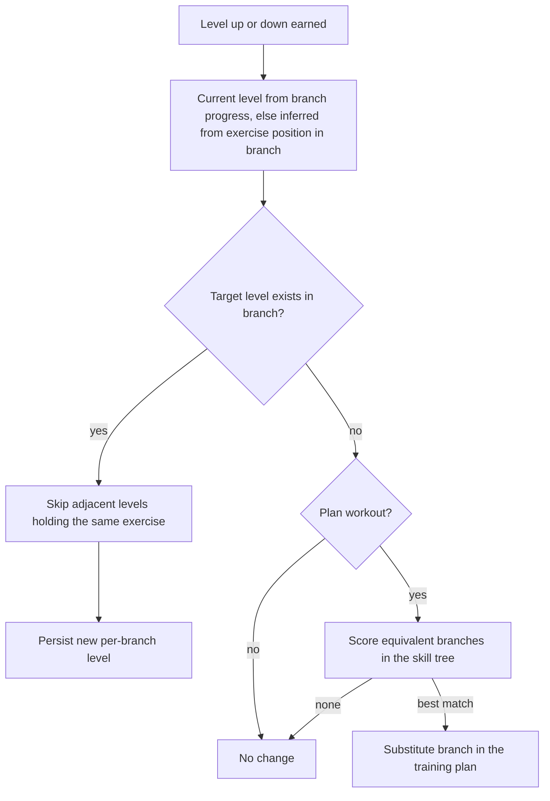
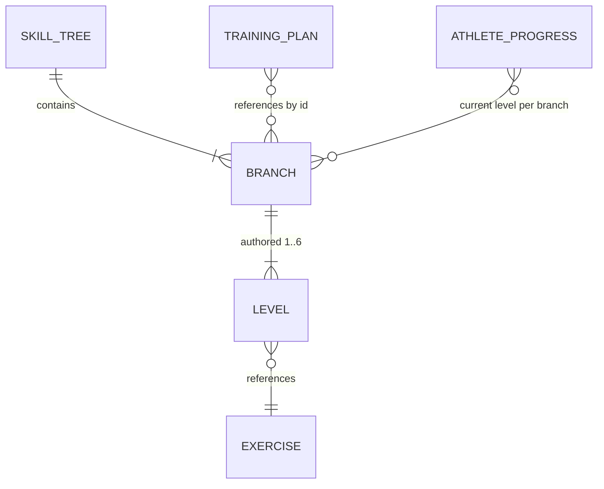

# Branches, Exercises, and Levels

## Why & What

The exercise content of the app is organized in three layers. At the top sit **skill trees**: one authored tree per **skill**, the training components a session is built from (warm-up, mobility, stability, hypertrophy, Maxkraft, speed strength, prevention, cardio zones, support work). A skill tree is the complete pool of content usable for that skill; whenever a workout needs an exercise for a skill, selection and substitution happen inside that skill's tree and never across trees. Each tree is made of **branches**. A branch is a progression lane: an ordered set of **levels**, each level referencing one exercise from the flat **exercise catalog** (roughly 1200 exercises with tags and value configurations), where higher levels hold harder variants of the same movement pattern. Plans and workouts always reference branches; the concrete exercise an athlete performs is resolved from the branch at execution time using the athlete's level. This spec describes the three layers, how an athlete moves up and down levels, and why the indirection exists.

## Problem

An exercise alone carries no notion of difficulty relative to other exercises. A training plan that referenced exercises directly would freeze the athlete's difficulty at plan creation: every improvement would require editing the plan, and a beginner and a professional could not share the same plan structure. The system needs a stable identity for "the squat-pattern slot on Tuesday" that survives the athlete progressing from an assisted variant to a loaded one.

## Solution

Branches provide that stable identity. The plan stores branch references; the athlete's per-branch progress (a single level number) is stored separately; generation joins the two at workout start. Progression is therefore a one-number update, never a plan edit. Levels serve a double purpose by design:

1. **Entry mapping**: an athlete without progress on a branch enters at the level matching their overall training level (BEGINNER at 1, ADVANCED at 2, PROFESSIONAL at 3).
2. **Progression ladder**: performance moves the per-branch level up or down independently of the overall training level, so difficulty adapts per movement pattern, not globally.

When a branch runs out of levels in the required direction, the system substitutes a comparable branch from the same skill tree instead of stalling, mutating the plan only in that case.

## Out of Scope

- How branches are initially selected into plans and workouts (see the plan creation and workout exercise selection specs)
- Weight, repetition, and duration values, their start/target tables, and feedback-driven value adjustment (see the weight calculation spec); this spec covers only the level decision, not the value changes around it
- Authoring workflow for skill trees and the exercise catalog
- The XP/gamification level shown in the profile, which is unrelated to branch levels

## Algorithm

### Data model and relationships

- **Skill tree**: the branch pool for one skill, keyed by branch ID. Trees exist per skill code, and skills that can be trained with or without weights have two separate trees: the weighted one and a bodyweight variant (KG suffix, for Körpergewicht). Tree lookup at runtime picks the variant matching the location's equipment, so "the tree for a skill" is context-dependent while each branch still belongs to exactly one tree. Trees define availability only; they carry no ordering or difficulty themselves, and difficulty lives entirely in branch levels.
- **Exercise**: catalog entry with tags (muscle, region, side, equipment, blocks), value configuration (start and target values per gender and training level), the progression mode flags **advance-by-reps** and **advance-by-duration**, and an optional other-side counterpart for one-sided movements.
- **Branch**: lives inside exactly one skill tree; holds branch-level tags (used by all selection filters) and a level map from level number to one exercise reference. Authored levels range from 1 to 6; most branches define 3. The exercise-to-branch relation is many-to-many: an exercise can appear in several branches (about a quarter of referenced exercises do, e.g. the same lift appearing in a hypertrophy branch and a Maxkraft branch), and roughly 80% of branches repeat the same exercise on adjacent levels (authored so every entry level is defined even where the variant does not change; at that boundary a level differs by prescribed values, not by exercise).
- **Athlete branch progress**: per athlete, a map from branch ID to current level. Absent until the first level change on that branch. It persists independently of any plan, so progress survives plan regeneration and applies wherever the branch reappears.

### Level resolution at workout start

For each branch in the session: use the athlete's stored per-branch level if present; otherwise map the overall training level to 1/2/3 and fall back downward to the highest authored level at or below it. A branch with no resolvable exercise is treated as blocked and replaced by the workout selection flow.

### Earning a level change

The level decision runs after the last set of an exercise in a session, per exercise:

**Standard skills** (hypertrophy, speed strength, stability, prevention, warm-up): the achieved reps or duration (per the exercise's progression mode) is compared against the exercise's start and target values.

| Achieved | Bodyweight exercise | Weighted exercise |
|---|---|---|
| At or above target | Level up | Level up when weight also at target, otherwise increase weight first |
| Below start | Level down | Level down when weight also below start, otherwise decrease weight first |
| Between start and target | No level change; the athlete's difficulty feedback is kept for value adjustment next session | Same |

So for weighted exercises a level up is the final step of a ladder: reps climb to target, then weight climbs to target, then the level increments and values reset for the new exercise.

**Maxkraft**: levels change through the per-weight repetition cycle (EASY, MEDIUM, HARD) combined with difficulty feedback: completing HARD without a "too hard" rating, or completing MEDIUM with a "too easy" rating, levels up; failing at the minimum weight levels down. Cardio exercises never change branch levels.

### Applying a level change

1. **Within the branch**: the target level is current level plus or minus one. Because adjacent levels can hold the same exercise, the search skips in the movement direction until the exercise actually changes. The new level is persisted in the athlete's branch progress; the plan is untouched.
2. **Branch exhausted** (no authored level in the target direction): only plan workouts substitute; other workout types leave everything unchanged. The substitute is searched in the same skill tree (both the weighted and bodyweight variants when weights are available) by a scored match against the old branch, and the plan's training day is edited to carry the new branch:
   - Hard exclusions: the old branch itself, branches already in use in the session, wrong equipment, age, gender, or prevention region, and a switch from a both-sided to a one-sided movement.
   - Score penalties: no exercise at the exact target level (falling back at most two levels down), different body region, switch from one-sided to both-sided, different movement direction.
   - The best-scoring branches tie-break by uniform random pick. A one-sided to both-sided switch adds a second substitute branch to compensate the lost per-side volume.
   - A level down from level 1 follows this same path with target level 1, swapping to a different movement at equal difficulty instead of an easier variant.

### Worked example: bodyweight squat

The speed strength skill (Schnellkraft, code SK) has two trees: SK (weighted) and SKKG (bodyweight). Training at home without weights selects the SKKG tree. Inside it, branch 253 is the two-legged squat lane; its branch tags (knee movement direction, lower body region, both-sided, glutes and quadriceps as complex movers) are what selection filters and substitution scoring operate on. Its authored levels:

| Level | Exercise |
|---|---|
| 1 | Kniebeuge (bodyweight squat), advance-by-reps, start 6 reps, target 8 reps |
| 2 | Kniebeuge mit Wadenheben (squat with calf raise) |
| 4 | Sprungkniebeuge (jump squat); level 3 is not authored |

- **Entry**: a BEGINNER athlete without progress on branch 253 resolves level 1, the plain squat. An ADVANCED athlete enters at level 2. A PROFESSIONAL maps to level 3, which does not exist here, and falls back downward to level 2.
- **Level up**: the beginner's workout prescribes the squat starting at 6 repetitions. Sessions with feedback raise the prescription over time (value progression, see the weight calculation spec). In the session where the athlete completes the last set at 8 or more repetitions (the target value), the completion flow returns LEVEL_UP. The target level 2 exists and holds a different exercise, so the athlete's branch progress becomes branch 253 at level 2, and the next workout resolves the squat with calf raise with fresh start values. The plan still references branch 253, unchanged.
- **Level up at the gap**: from level 2 the target level is 3, which is not authored. The branch counts as exhausted (see Open Questions on gaps), so in a plan workout the system scores the other SKKG branches for an equivalent: same region and knee direction preferred, both-sided required, level 3 available or at most two levels lower. A best-scoring branch, for example a lunge lane, replaces branch 253 in the plan for that training day.
- **Level down at the floor**: failing below the start repetitions at level 1 targets level 0, which never exists, so the same substitution search runs at level 1: a different both-sided lower-body movement at entry difficulty instead of an easier squat variant.

### Purpose summary

| Level use | Effect |
|---|---|
| Entry mapping (1 to 3) | New athletes start each branch at a difficulty matching their training level |
| Per-branch ladder | Difficulty adapts per movement pattern; a strong squatter and weak presser progress independently |
| Plan decoupling | The plan references branches only, so progression never regenerates the plan; substitution is the single plan-mutating exception |
| Blocked-branch signal | A branch with no exercise at the athlete's level counts as blocked during selection, triggering replacement |

## Structure

- Skill trees, branches, and the exercise catalog are bundled static data, loaded read-only at runtime.
- The training plan (device-local) stores branch references per skill per weekday; branch substitution is its only progression-driven mutation.
- Athlete branch progress and per-exercise history live in a persisted progress store; workout generation reads both, the post-set completion flow writes both.
- The completion flow computes the level decision as a pure function (result: same-branch level change, branch substitution, or no change) and applies it through store callbacks, keeping decision and persistence separable and testable.

## Open Questions

- Levels above 3 are reachable only by progressing; entry mapping caps at 3 even for professionals. Is that intended headroom, or should professional athletes with strong test results enter above 3?
- When every level above the current one holds the same exercise, the skip logic can still return that same exercise at a higher level number: the athlete "levels up" with no visible change and no value reset tied to a new movement. Should a level up require a different exercise, treating same-exercise ceilings as branch exhaustion (leaning: yes)?
- Authored level gaps (the squat example holds levels 1, 2, and 4) make the level above the gap unreachable: a level up from below the gap finds no exercise at the target level and triggers branch substitution even though a harder variant exists two levels up. Should the level search skip gaps the same way it skips same-exercise levels (leaning: yes)?
- Per-branch progress never expires. An athlete returning after months resumes each branch at the old level even though the generator's missed-week handling rewinds the plan sections. Should long inactivity also decay branch levels?
- Stored branch levels are not validated against the branch's authored levels; content updates that remove a level leave dangling progress that silently falls back. Should a migration reconcile progress with the shipped trees?
- Branch substitution edits the plan permanently based on a single session's performance, and the old branch's progress record stays behind. Should substitution be reversible, or the old level carried over to the substitute?
- The equivalence score weights (0.8 per soft mismatch, 0.5 for region) are hard-coded and untested against content; two soft mismatches outrank one region mismatch. Are these the intended trade-offs?
