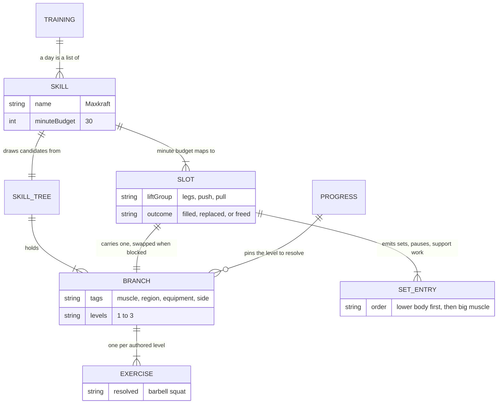
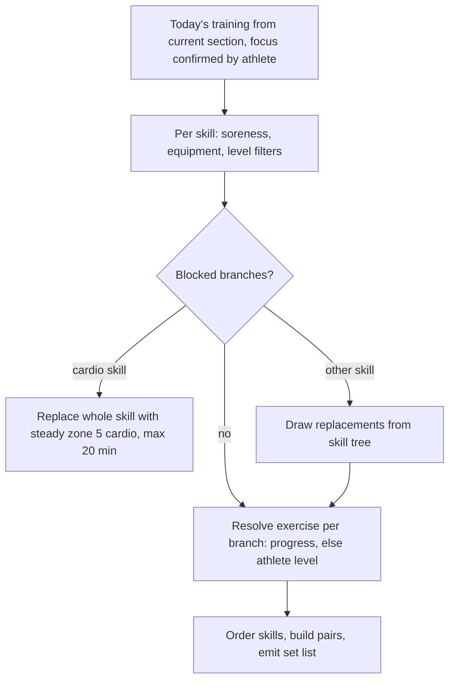

# Exercise Selection for a Newly Started Workout

## Why & What

When an athlete starts a workout, the app generates that session's exercise sequence on-device, at that moment. The stored **training plan** is only a skeleton: sections, per-day **skills** with minute budgets, and pre-selected exercise **branches**. The concrete exercises must reflect today's state — reported soreness, the chosen place and its equipment, the athlete's level and per-branch progress. This spec covers how the generator turns the plan (or, for plan-independent short workouts, the raw **skill trees**) into the ordered **set list** the athlete executes.

## Problem

The plan is authored days or weeks ahead. By start time the athlete may be sore, at another place with different equipment, or on a new level, so pre-selected branches can be unusable and a naive session would prescribe blocked exercises. Ordering is a second gap: nothing sequences a skill's exercises by body region, so the Maxkraft leg lift can land behind the upper-body lifts, where fatigue is already highest. Selection must also serve workouts outside the plan: on-demand short workouts (warm-up, mobility, foam roller, stability, cardio, prevention) and the Maxkraft strength test.

## Solution

One generator, three flows dispatched by training type:

1. **Plan workout**: filter today's pre-selected branches by soreness, equipment, and level, replace the blocked ones from the skill tree, then resolve each branch to the athlete's level.
2. **Short workout**: build the pool fresh from the requested type's skill tree, filter by prevention target, pain, soreness, equipment, age, and gender, then draw branches at random until the type's quota is met.
3. **Test workout (Maxkraft test)**: a randomized warm-up from the warm-up tree plus a fixed, authored list of test lifts per level and gender. Refused when any soreness is reported.

Maxkraft opens with its lower-body main lifts; every other skill keeps the muscle-size ordering.

Selection operates on branches (one exercise progression lane, authored levels 1 to 3); the concrete exercise is resolved last. Within a skill no resolved exercise ID may appear twice; across skills duplicates are accepted. Random picks are uniform and unseeded; a generated session is persisted, so reopening it never regenerates (see Structure).

## Out of Scope

- Plan creation from the anamnesis (see the plan creation spec); this spec starts from an existing plan
- Weight, repetition, and duration computation, feedback-based progression, and intensity tables (see the weight calculation spec)
- Exercise swapping or skipping after the set list is shown
- The soreness and place selection UI preceding generation
- Persistence of the finished workout

## Algorithm

### Inputs

Training type, athlete profile (level, gender, birthday, pain tags), reported soreness (sore muscles with timestamps), place and its equipment, weekday, the training plan (plan workouts only), per-branch progress and per-exercise history, the exercise catalog, and the authored skill trees.

### Common building blocks

- **Skill**: the training quality one block of the session trains, for example Maxkraft, hypertrophy, core, warm-up, cardio, prevention. A skill owns its skill tree, its set count, its pause lengths, and its maximum minutes per athlete level. A training day is a list of skills.
- **Slot**: the plan gives every skill of a training day a minute budget. An authored table per skill and athlete level maps that budget to a fixed number of exercise **slots**, for Maxkraft at 30 minutes: legs, push, pull. Every slot carries one pre-selected branch; the exercise filling a Maxkraft slot is its **main lift**, the heavy barbell lift that slot's sets are built around. Slots fill independently: a blocked slot takes a replacement from the same skill tree, and a slot that cannot be refilled frees its minutes.
- **Branch to exercise resolution**: prefer the stored per-branch progress level; otherwise map BEGINNER/ADVANCED/PROFESSIONAL to branch level 1/2/3 and fall back downward to the highest authored level at or below it. A branch with no resolvable exercise counts as blocked. This applies to every flow.
- **Filter chain**: each filter splits the pool into keep and replace. Soreness drops branches whose region matches a sore area (more than one sore area aborts with a soreness error). Equipment drops branches needing gear the place lacks. Level drops branches with no exercise at the athlete's level. Age and gender drop branches tagged for other groups.
- **Uniqueness**: a resolved exercise ID is used at most once per skill; candidates resolving to an already used exercise are excluded, not merely deprioritized. Duplicates across skills are tolerated. Deliberate repeats are unaffected: a one-sided exercise appears as a left and right entry, and every exercise repeats across its own sets.
- **Pairing (supersets)**: superset skills split their branches into big-muscle and small-muscle groups (big = chest, latissimus, glutes, inner thigh, outer thigh). Partners are drawn only from the same skill, and the big-muscle group is paired out first. A one-sided exercise always pairs with its other-side counterpart; otherwise the partner is a both-sided exercise, preferred in this order:
  1. an opposing or antagonistic muscle group,
  2. a big muscle group from a different body region,
  3. a big muscle group from the same region,
  4. a small muscle group from a different region,
  5. a small muscle group from the same region.

  Ties within a rank are broken uniformly at random. Excluded as partners: duplicate exercises, the same movement pattern (two horizontal presses), and the same primary muscle group (two shoulder exercises).

  Without a partner the exercise runs on its own and takes the longer after-set rest instead of the superset rest; the per-skill values are authored in the session set structure spec. Maxkraft, stability circuits, and cardio never pair.
- **Ordering**: three levels, each independent of the order in which slots were filled.
  1. Skills: fixed section order, warm-up first, cool-down last.
  2. Exercises inside a skill: big muscle (chest, latissimus, glutes, inner thigh, outer thigh) before the rest, so the demanding work sits in the fresher part of the block. Inside a group no further rule applies. In superset skills the ordered unit is the pair: a partner follows its lead exercise directly.
  3. Exercises inside Maxkraft, overriding rule 2: lower-body main lifts before upper-body main lifts, since they move the session's heaviest loads. Rule 2 then orders the lifts within each region. Support exercises stay in the breaks of their own main lift.
- **Weighted vs bodyweight ratio**: target share of weighted exercises is 50% under 16, 80% in the gym, and 50% at other places with suitable equipment. A place without dumbbells or barbells is 0%: everything is bodyweight. Age beats place: under 16 in the gym stays at 50%, since athletes below 16 must not perform heavy exercises. Enforced per skill as a quota over its slots — `weighted = ceil(share × slots)`, the rest bodyweight; each slot draws its type at random while both quotas are open, then takes whichever quota remains. Soft targets, not minimums: the share is measured over the exercises actually selected, only those surviving the age, level, pain, soreness, and equipment filters count, and any shortfall is filled with bodyweight exercises. It does not apply to Maxkraft support exercises, which balance their own share per draw.

How the blocks relate, with a Maxkraft session as the example:



### Flow 1: Plan workout



1. **Section and day**: take the section with the latest start date not after today; after a gap of 8 to 21 days, shift section starts forward by the missed weeks first. Beyond 21 days, prompt "You have not trained for more than three weeks. Do you want to create a new training plan?"; accepting hands over to plan creation (out of scope), declining continues with the existing plan.
2. **Focus**: use the training matching today's weekday. When none matches, the athlete picks today's focus from the four authored focus types — PHASE (strength/prevention), STABILITY, CARDIO (endurance), COMBINED (strength & endurance). The choice is also offered on regular training days, with the planned focus preselected as the recommendation. It applies to this session only and never changes the stored plan. A focus that has no training in the section is served like plan creation does: its skills and their minute budgets come from the authored skill priorities for that focus, keyed by age group and pain.
3. **Filter** each skill's pre-selected branches by soreness, equipment, and level. Every removed branch records its body region as a replacement request.
4. **Replace** blocked branches per skill:
   - A blocked cardio skill is replaced wholesale by steady zone 5 cardio, capped at 20 minutes.
   - Otherwise candidates come from the skill's tree, run through the same filter chain plus age, excluding branch IDs already kept for this skill and branches resolving to an exercise ID already used in it. Prefer candidates matching the blocked region; failing that, the least-used regions, capped at 5 exercises per region (6 for professionals) with a one-sided branch counting twice. The final pick is uniformly random.
   - Prevention and special warm-up skills replace all-or-nothing: if any slot cannot be refilled the skill is dropped for this session. Replacements that no longer match the skill's prevention region move under the matching prevention skill, merging minute budgets.
   - A slot that cannot be refilled frees its time. Redistribute it across the remaining suitable skills while the session's focus is preserved and no authored limit is passed: the per-skill maximum minutes for the athlete's level (SWR 35/45/60, MAX 0/45/55, CARDIO 45/60/60, GKS 25/30/40, SA and SK 30/35/35, PREV 15, WUSPEZIAL 3, otherwise 10), the fixed set count per skill, and the Maxkraft load caps. Freed time therefore buys cardio duration or an extra exercise slot, never extra sets. When no safe redistribution exists, the session is shortened accordingly.
5. **Resolve** every remaining branch to its level-matched exercise.
6. **Assemble**: order skills by the fixed section order (warm-up first, cool-down last), build pairs per skill, and emit the set list with sets, pauses, and — for weighted hypertrophy and speed strength supersets — one extra warm-up set at reduced weight.

   **Support exercises (Maxkraft only)**: support-tagged catalog exercises are drawn at random into the breaks between main-lift sets, excluding those that target sore areas, need unavailable equipment, hit the muscles the main lift is currently working as primaries, or are already used in this skill. Once the filtered pool is exhausted the remaining breaks stay empty; a break with no suitable candidate stays empty too. The general weighted ratio does not apply here.

### Flow 2: Short workout

1. Pick the requested type's skill tree: the weights-capable variant when the place has weights, the bodyweight variant otherwise. Foam roller sessions require a foam roller or foam ball, else generation fails.
2. Filter by prevention target tag (prevention types only), pain blocks from the athlete's pain tags, soreness, equipment, age, and gender. An empty pool after the pain, soreness, or gender step aborts with a typed error naming the cause. The soreness filter is deliberately disabled for the leg axis stability focus, which lower-body soreness would otherwise block permanently.
3. Draw branches uniformly at random, repeating neither a branch nor a resolved exercise, per quota:

| Type | Quota |
|---|---|
| Warm-up, mobility, foam roller, cool-down | 10 exercises, 1 set each; a one-sided branch fills two slots |
| Stability with weights | 4 exercises, any region |
| Stability bodyweight | 3 upper body plus 2 full body (falls back to any region when a quota cannot be met); one-sided handling as above, never as the last slot |
| Prevention | 3 special warm-up exercises plus 3 superset pairs; a one-sided draw seeks an opposing-direction one-sided partner, else swaps itself for a both-sided branch; weighted pairs are ordered last |
| Anything else | fill until 15 estimated minutes |

### Flow 3: Test workout

1. Any reported soreness aborts with a soreness error.
2. Warm-up: random branches from the warm-up tree per authored region quotas, without repeating a branch or a resolved exercise.
3. Test lifts: a fixed, authored list per athlete level, with a gender-specific variant when authored. Each lift gets three ramp-up sets (40%, 60%, 85% of the reference weight) and one test set at 100%.

## Structure

- **Exercise catalog**: flat list of exercises with tags (muscle, region, side, equipment, skill, block) and start values.
- **Skill tree**: per skill, a map of branches; each branch holds tags and levels 1 to 3, each referencing one exercise.
- **Training plan**: sections containing per-weekday trainings; a training holds skills, each with a minute budget and pre-selected branch references.
- **Athlete progress**: per-branch current level and per-exercise history, feeding both resolution and start values.
- **Set list**: the output; an ordered list of entries (exercise or pause) with set numbering, consumed by the active training session store that drives the workout UI.

A session is a sequence of skill blocks; each block fills its slots, then orders what it filled, then emits sets. Maxkraft as the example:

```text
SESSION  ── skill blocks, fixed section order
──────────────────────────────────────────────────────────────────
  [ warm-up ] -> [ Maxkraft ] -> [ core ] -> [ cool-down ]


MAXKRAFT BLOCK  ── 30 min, 3 slots
──────────────────────────────────────────────────────────────────
SLOTS      slot   pre-selected branch          filled with
           legs   squat | deadlift        ->   deadlift
           push   bench | shoulder press  ->   bench press
           pull   row                     ->   row (replacement)

SEQUENCE   after selection   bench press | deadlift | row
                             incidental, follows how the slots filled
           after ordering    deadlift | bench press | row
                             lower body first, then big muscle

EMISSION   per main lift     warm-up sets, working sets,
                             support exercises inside the breaks
```

Generation runs between the soreness/place selection screens and the workout overview screen. The set list goes into the session store; starting a workout never mutates the plan.

The generated session is persisted (set list, equipment, active exercise index) and survives an app restart, so reopening it never regenerates: a started workout resumes where it left off, and the overview only reads what is stored. It is cleared when the workout is finished, when the athlete runs generation again from the soreness screen, on logout, and when a generated but never started session is abandoned by leaving the pre-workout flow. There is no date-based expiry.

## Open Questions

None.
