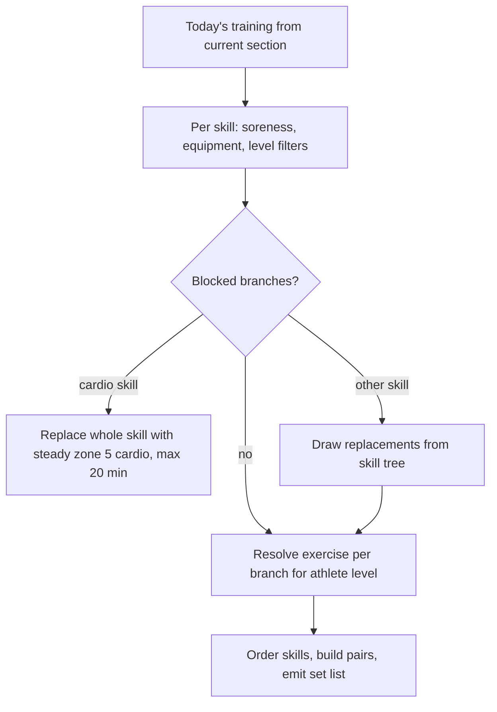

# Exercise Selection for a Newly Started Workout

## Why & What

When an athlete starts a workout, the app generates the concrete exercise sequence for that session on-device, at that moment. The stored **training plan** is only a skeleton (sections, per-day **skills** with minute budgets, and pre-selected exercise **branches**); actual exercises must reflect today's state: reported muscle soreness, the chosen training location and its equipment, the athlete's current level and per-branch progress. This spec describes how the generator turns the plan (or, for plan-independent short workouts, the raw **skill trees**) into the ordered **set list** the athlete executes.

## Problem

The plan is authored days or weeks before execution. At start time the athlete may be sore, train at a different location with other equipment, or have progressed to a new exercise level. Pre-selected branches can therefore be unusable, and a session generated naively from the plan would prescribe blocked or impossible exercises. The selection also has to run for workouts that exist outside the plan: on-demand short workouts (warm-up, mobility, foam roller, stability, cardio, prevention) and the Maxkraft strength test.

## Solution

One generator with three flows, dispatched by training type:

1. **Plan workout**: take the pre-selected branches of today's training, filter out branches blocked by soreness, equipment, or level, replace the blocked ones from the skill tree, then resolve each branch to the exercise matching the athlete's level.
2. **Short workout**: build the candidate pool fresh from the skill tree of the requested type, filter by prevention target, pain, soreness, equipment, age, and gender, then randomly draw branches until the type's quota is met.
3. **Test workout (Maxkraft test)**: a randomized warm-up drawn from the warm-up tree plus a fixed, authored list of test lifts per level and gender. Refused entirely when any soreness is reported.

Selection operates on branches (a branch is one exercise progression lane with authored levels 1 to 3); the concrete exercise is resolved from the branch last. Uniqueness is enforced per branch, not per resolved exercise (see Open Questions). All random picks are uniform and unseeded.

## Out of Scope

- Plan creation from the anamnesis (see the plan creation spec); this spec starts from an existing plan
- Weight, repetition, and duration computation, feedback-based progression, and intensity tables (see the weight calculation spec)
- Exercise swapping or skipping after the set list is shown
- The soreness and place selection UI preceding generation
- Persistence of the finished workout

## Algorithm

### Inputs

Training type, athlete profile (level, gender, birthday, pain tags), reported soreness (sore muscles with timestamps), place and its equipment list, weekday, the training plan (plan workouts only), per-branch progress and per-exercise history, the exercise catalog, and the authored skill trees.

### Common building blocks

- **Branch to exercise resolution**: prefer the athlete's stored per-branch progress level; otherwise map level BEGINNER/ADVANCED/PROFESSIONAL to branch level 1/2/3 and fall back downward to the highest authored level at or below it. A branch with no resolvable exercise is treated as blocked.
- **Filter chain**: each filter splits the pool into keep and replace. Soreness removes branches whose region matches a sore area (more than one sore area aborts generation with a soreness error). Equipment removes branches whose exercise needs gear the place lacks. Level removes branches with no exercise at the athlete's level. Age and gender remove branches tagged for other groups.
- **Pairing (supersets)**: for superset skills, branches are split into big-muscle and small-muscle groups. A one-sided exercise always pairs with its other-side counterpart. Otherwise the partner is a both-sided branch, preferring an opposing muscle group, big muscles before small. Maxkraft, stability circuits, and cardio never pair.

### Flow 1: Plan workout

1. **Section and day**: pick the section whose start date is the latest one not after today. When 8 to 21 days passed since the last workout, shift section starts forward by the missed weeks first (over 21 days currently only logs; see Open Questions). Take the training matching today's weekday; when none matches, fall back to the section's first training.
2. **Filter** each skill's pre-selected branches through soreness, equipment, and level. Every removed branch records its body region as a replacement request.
3. **Replace** blocked branches per skill:
   - A blocked cardio skill is replaced wholesale by steady zone 5 cardio, capped at 20 minutes.
   - Otherwise candidates come from the skill's tree, run through the same filter chain plus age, excluding branch IDs already kept for this skill. Candidates matching the blocked region are preferred; when none exist, fall back to the least-used regions, capped at 5 exercises per region (6 for professionals), where a one-sided branch counts twice. Within the candidate set, branches resolving to a not-yet-used exercise ID are preferred, and duplicates are accepted as a last resort. The final pick is uniformly random.
   - Prevention and special warm-up skills replace all-or-nothing: when not every slot can be refilled the skill is dropped for this session. When the replacements no longer match the skill's prevention region, they move under the matching prevention skill instead, merging minute budgets.
4. **Resolve** every remaining branch to its level-matched exercise.
5. **Assemble**: order skills by the fixed section order (warm-up first, cool-down last), build pairs per skill, and emit the set list with sets, pauses, and (for weighted hypertrophy and speed strength supersets) one extra warm-up set at reduced weight. Maxkraft sessions additionally interleave **support exercises** between main-lift sets: drawn randomly from the support-tagged catalog, excluding sore regions and missing equipment, steering a weighted vs bodyweight ratio (30% weighted for children, 60% in the studio, 50% elsewhere), and avoiding repeats until the pool is exhausted, at which point the used-list resets.

### Flow 2: Short workout

1. Pick the skill tree for the requested type; the weights-capable variant when the place has weights, the bodyweight variant otherwise. Foam roller sessions require foam roller or foam ball equipment, else generation fails.
2. Filter: prevention target tag (prevention types only), pain blocks derived from the athlete's pain tags, soreness, equipment, age, gender. An empty pool after the pain, soreness, or gender step aborts with a typed error naming the cause.
3. Draw branches uniformly at random without branch repetition, per quota:

| Type | Quota |
|---|---|
| Warm-up, mobility, foam roller, cool-down | 10 exercises, 1 set each; a one-sided branch fills two slots |
| Stability with weights | 4 exercises, any region |
| Stability bodyweight | 3 upper body plus 2 full body (falls back to any region when a quota cannot be met); one-sided handling as above, never as the last slot |
| Prevention | 3 special warm-up exercises plus 3 superset pairs; a one-sided draw seeks an opposing-direction one-sided partner, else swaps itself for a both-sided branch; weighted pairs are ordered last |
| Anything else | fill until 15 estimated minutes |

4. Each drawn branch resolves to its lowest authored level, ignoring athlete level and progress (see Open Questions).

### Flow 3: Test workout

1. Any reported soreness aborts with a soreness error.
2. Warm-up: draw random branches from the warm-up tree per authored region quotas, without branch repetition.
3. Test lifts: a fixed, authored exercise list per athlete level, with a gender-specific variant when authored. Each lift gets three ramp-up sets (40%, 60%, 85% of the reference weight) and one test set at 100%.

## Structure

- **Exercise catalog**: flat list of exercises with tags (muscle, region, side, equipment, skill, block) and start values.
- **Skill tree**: per skill, a map of branches; each branch holds tags and levels 1 to 3, each level referencing one exercise.
- **Training plan**: sections containing per-weekday trainings; a training holds skills, each with a minute budget and pre-selected branch references.
- **Athlete progress**: per-branch current level and per-exercise history, both feeding resolution and start values.
- **Set list**: the generator's output; an ordered list of entries (exercise or pause) with set numbering, consumed by the active training session store that drives the workout UI.

Generation runs entirely on-device between the soreness/place selection screens and the workout overview screen. The set list is written into the session store; the plan itself is never mutated by starting a workout.

## Open Questions

- **Can the same exercise appear multiple times in one workout? Yes, through four avenues.** Uniqueness is tracked by branch ID nearly everywhere, while several distinct branches resolve to the same exercise (branches sharing an exercise across levels or trees are authored data). Concretely: (1) in short workouts and the test warm-up, two different drawn branches can resolve to the same exercise; (2) plan replacement prefers unused exercise IDs but explicitly accepts duplicates as a last resort within a skill; (3) nothing deduplicates across skills, so a replacement in the main part can resolve to an exercise already present in the warm-up, and the zone 5 cardio fallback can duplicate an existing zone 5 skill; (4) Maxkraft support exercises repeat once the filtered support pool is exhausted. Intentional repetitions exist too: one-sided exercises appear as a left and right pair, and every exercise repeats across its own sets. Question: should selection dedupe by resolved exercise ID globally per session, falling back to branch-level dedup only when the pool runs dry? Leaning: yes for within-skill draws; cross-skill duplicates (e.g. an easy squat variant in warm-up and a loaded squat lane in the main part) may be acceptable or even desirable and need a product decision.
- Short workouts always resolve a branch at its lowest level, so advanced athletes get beginner variants. Intended simplification or gap? Leaning: use the same level resolution as plan workouts.
- When today's weekday has no training in the current section, the generator silently uses the section's first training. Should it instead refuse or ask the athlete?
- More than 21 days without training only logs "generate new plan" and continues with stale sections. The regeneration path is an open TODO.
- Selection randomness is unseeded, so aborting and restarting the same session yields different exercises. Should a session's draw be reproducible for the same day and inputs?
- When replacement finds no candidate branch at all for a non-prevention skill, the blocked slot is silently dropped, shortening the session below its minute budget. Should the time be redistributed to surviving skills?
