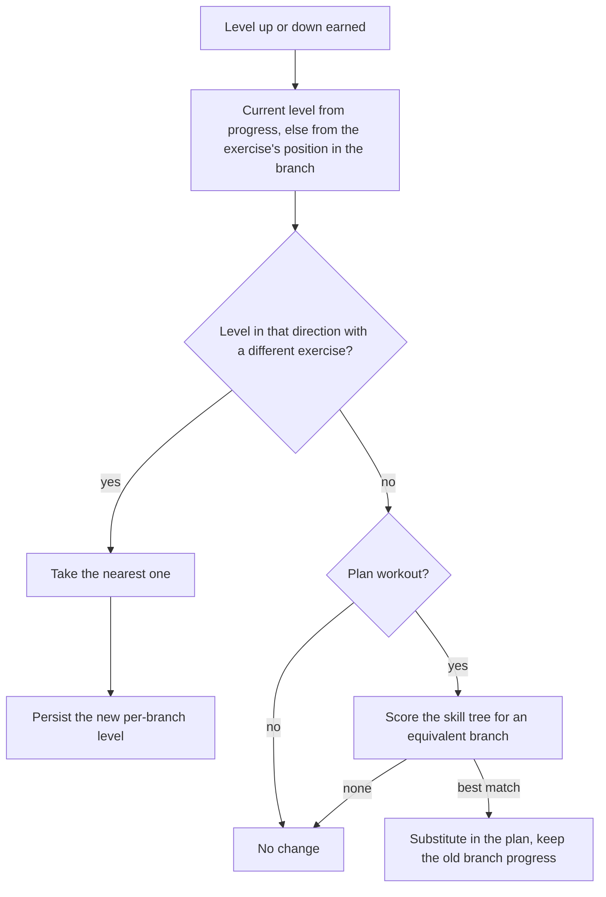
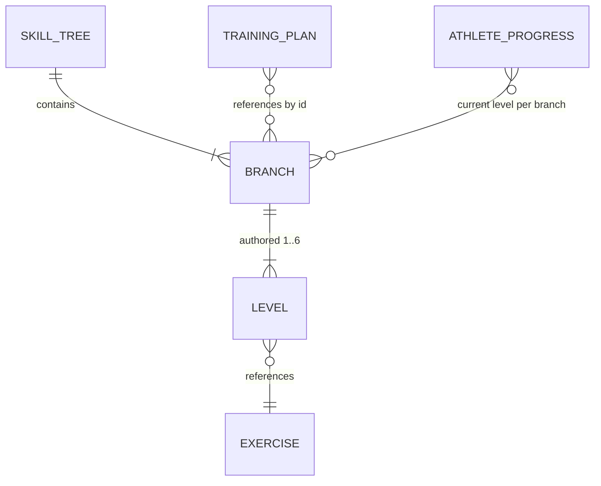

# Branches, Exercises, and Levels

## Why & What

App content sits in three layers: one **skill tree** per **skill** (the training components a session is built from: warm-up, mobility, stability, hypertrophy, Maxkraft, speed strength, prevention, cardio zones, support work), each tree made of **branches**, each branch an ordered set of **levels** that reference exercises from the flat **exercise catalog** (roughly 1200 entries with tags and value configurations). Plans and workouts reference branches only; the exercise an athlete performs is resolved from the branch at workout start using that athlete's level for it. This spec defines the three layers and the rules that move an athlete up and down levels.

## Problem

An exercise carries no difficulty relative to other exercises, and the usable difficulty differs per athlete and per movement pattern. An exercise reference in a plan therefore fixes difficulty at plan creation, couples every improvement to a plan edit, and keeps one plan structure from serving a beginner and a professional. The system needs a stable identity for "the squat-pattern slot on Tuesday" that survives the athlete moving from an assisted variant to a loaded one.

## Solution

A branch is that stable identity. The plan stores branch references, the athlete's per-branch level is stored separately, and workout generation joins the two. Progression is a one-number update. Levels carry two jobs:

1. **Entry mapping**: an athlete with no progress on a branch enters at the level matching their overall training level (BEGINNER 1, ADVANCED 2, PROFESSIONAL 3). Levels 4 to 6 are headroom earned by training, so entry caps at 3 for every athlete. A training level above PROFESSIONAL would entry-map to level 4, but the mapping is deliberately not prepared in advance; it gets added only when that training level actually ships.
2. **Progression ladder**: performance moves the per-branch level independently of the overall training level, so difficulty adapts per movement pattern instead of globally.

A **level change** must land on a level holding a different exercise, so it always surfaces as a new movement with fresh values. A branch offering no such level in the required direction is **exhausted**, and the system swaps in a comparable branch from the same skill tree (**branch substitution**), the only progression event that edits the plan.

## Out of Scope

- How branches are first selected into plans and workouts: [Training Plan Creation](../planning/training-plan-creation-from-anamnesis.md) and [Plan Workout Generation](../session/plan-workout-generation.md)
- Weight, repetition, and duration values, their start/target tables, and feedback-driven value adjustment: [Weight Calculation from Strength Tests](../progression/weight-calculation-from-strength-tests.md) and [Standard Exercise Progression](../progression/standard-exercise-progression.md). This spec covers the level decision, not the value changes around it
- Authoring workflow for skill trees and the exercise catalog
- The XP level shown in the profile, which is unrelated to branch levels

## Algorithm

### Entities

- **Skill tree**: the branch pool for one skill, keyed by branch ID. Skills trainable with and without weights have two trees, the weighted one and a bodyweight variant (suffix KG, for Körpergewicht); runtime lookup picks the variant matching the location's equipment. Trees define availability only, all difficulty lives in branch levels.
- **Exercise**: catalog entry with tags (muscle, region, side, equipment, blocks), start and target values per gender and training level, one **progression mode** (advance-by-reps or advance-by-duration), and an optional other-side counterpart for one-sided movements.
- **Branch**: belongs to exactly one skill tree; carries the branch tags every selection filter and substitution score reads, plus a map from level number to one exercise. Authored levels run 1 to 6, most branches define 3, and the map may skip numbers. An exercise may appear in several branches (about a quarter do, for example the same lift in a hypertrophy and a Maxkraft branch), and about 80% of branches repeat one exercise across adjacent levels so that every entry level resolves.
- **Athlete branch progress**: a map from branch ID to current level, absent until the first level change on that branch. It persists independently of any plan, so it survives plan regeneration, applies wherever the branch reappears, and outlives substitution of the branch.

### Resolving the level at workout start

Per branch in the session, in this order:

1. **Reconcile** the stored level against the shipped tree.
2. **Decay** the stored level after long inactivity.
3. **Resolve**: use the stored level, otherwise entry-map the overall training level to 1, 2, or 3 and fall back downward to the highest authored level at or below it.

A branch with no resolvable exercise counts as blocked and goes to the workout selection flow for replacement.

**Reconciliation** keeps progress consistent with content updates that move or remove levels:

| Stored level after the update | Action |
|---|---|
| Still authored | Keep |
| Gone, its exercise now on another level of the same branch | Move progress to that level |
| Gone, no unique match | Fall back to the next lower authored level |

**Decay**: after 12 weeks without a completed session, the stored level drops one step per 12-week pause, skipping levels as a level down does, floored at the athlete's entry level. A branch at that floor decays no further and triggers no substitution.

Both steps persist their result, so each correction happens once. Neither moves the athlete to a different branch; that stays exclusive to substitution.

### Earning a level change

The decision runs per exercise after its last set of the session.

**Standard skills** (hypertrophy, speed strength, stability, prevention, warm-up) compare the achieved reps or duration, per the exercise's progression mode, against its start and target values:

| Achieved | Bodyweight exercise | Weighted exercise |
|---|---|---|
| At or above target | Level up | Level up once weight is also at target, otherwise raise weight first |
| Below start | Level down | Level down once weight is also below start, otherwise lower weight first |
| Between start and target | No level change; difficulty feedback feeds next session's values | Same |

A weighted level up is therefore the last rung of a ladder: reps to target, then weight to target, then the level change with values reset for the new exercise.

**Maxkraft** decides from the per-weight repetition cycle (EASY, MEDIUM, HARD) plus difficulty feedback: HARD completed without a "too hard" rating levels up, as does MEDIUM completed with a "too easy" rating; failing at the minimum weight levels down.

**Cardio** exercises never change branch levels.

### Applying a level change

1. **Within the branch**: the search walks outward from the current level in the earned direction and takes the first level that exists and holds a different exercise, passing over skipped numbers and repeated exercises alike. Every real difficulty step in a branch is used before the branch counts as exhausted. Only the athlete's progress changes; the plan is untouched.
2. **On exhaustion**: plan workouts substitute, all other workout types leave everything unchanged. The candidate pool is the same skill tree (weighted and bodyweight variant when weights are available), scored against the old branch, and the plan's training day is rewritten to the winner.
   - Hard exclusions: the old branch, branches already used in the session, mismatched equipment, age, gender, or prevention region, and a switch from a both-sided to a one-sided movement.
   - Score penalties: no exercise at the target level (falling back at most two levels), different body region, switch from one-sided to both-sided, different movement direction. A different body region is the heaviest single penalty, factor 0.5 against 0.8 per soft mismatch, so the technically closest branch wins.
   - The factors 0.5 and 0.8 are the accepted starting point. They change only if a sports-science review of real substitution rankings (top 3 substitutes for representative branches, with scores and reasons) shows repeated systematic misranking; individual disagreements do not move them.
   - Ties break by uniform random pick. A one-sided to both-sided switch adds a second substitute branch to replace the lost per-side volume.
   - A level down from level 1 runs the same search with target level 1, giving a different movement at entry difficulty.
   - The replaced branch keeps its progress, so the swap can be undone at the athlete's old level. The substitute enters through normal resolution; the old level does not transfer.

### Manual exercise swapping (deferred)

Athletes cannot swap exercises manually, and building this is currently not planned. The agreed design, should it be built later:

- The athlete may pick any eligible exercise from the respective skill tree; there is no restriction to levels near the current one.
- Guidance comes from labels instead: each exercise is labeled relative to the athlete's current level in its branch, for example "easier", "appropriate", "more challenging", "significantly more challenging". Exercises near the current level are listed first, but proximity is never a selection requirement.
- A manual swap changes neither the stored branch progress nor the athlete's training level. Automatic level progression stays exclusive to the progression logic above.
- The hard exclusions keep applying: unavailable equipment, exercises unsuitable for the athlete's age or gender, and every other mandatory filter.

### Example: bodyweight squat lane

Speed strength (Schnellkraft, code SK) has the trees SK and SKKG; training at home without weights uses SKKG. Branch 253 there is the two-legged squat lane, tagged knee movement direction, lower body, both-sided, glutes and quadriceps as complex movers.

| Level | Exercise |
|---|---|
| 1 | Kniebeuge (squat), advance-by-reps, start 6, target 8 |
| 2 | Kniebeuge mit Wadenheben (squat with calf raise) |
| 4 | Sprungkniebeuge (jump squat); level 3 is unauthored |

- **Entry**: a beginner resolves level 1, an advanced athlete level 2, a professional maps to the missing level 3 and falls back to level 2.
- **Level up**: the beginner reaching 8 or more reps on the last set moves to level 2, the calf raise variant, with fresh start values. From level 2 the search passes the missing level 3 and lands on level 4, the jump squat. The plan keeps referencing branch 253 throughout.
- **Exhaustion**: from level 4 nothing higher is authored, so a plan workout scores the remaining SKKG branches (knee direction and lower body preferred, both-sided required, level 4 or at most two levels lower) and a winner such as a lunge lane takes over that training day. Branch 253 keeps its level 4 record. A failure below 6 reps at level 1 runs the same search at level 1 instead of easing the squat further.

## Structure

- Skill trees, branches, and the exercise catalog are bundled static data, read-only at runtime.
- The device-local training plan holds branch references per skill per weekday. Substitution is its only progression-driven mutation.
- A persisted progress store holds branch progress and per-exercise history, including branches no longer in the plan. Generation reads it, resolution corrects it, the post-set completion flow writes it.
- The level decision is computed separately from persistence: one input set (achieved values, feedback, branch content, workout type) yields one of three outcomes, same-branch level change, branch substitution, or no change.

## Open Questions

None.
