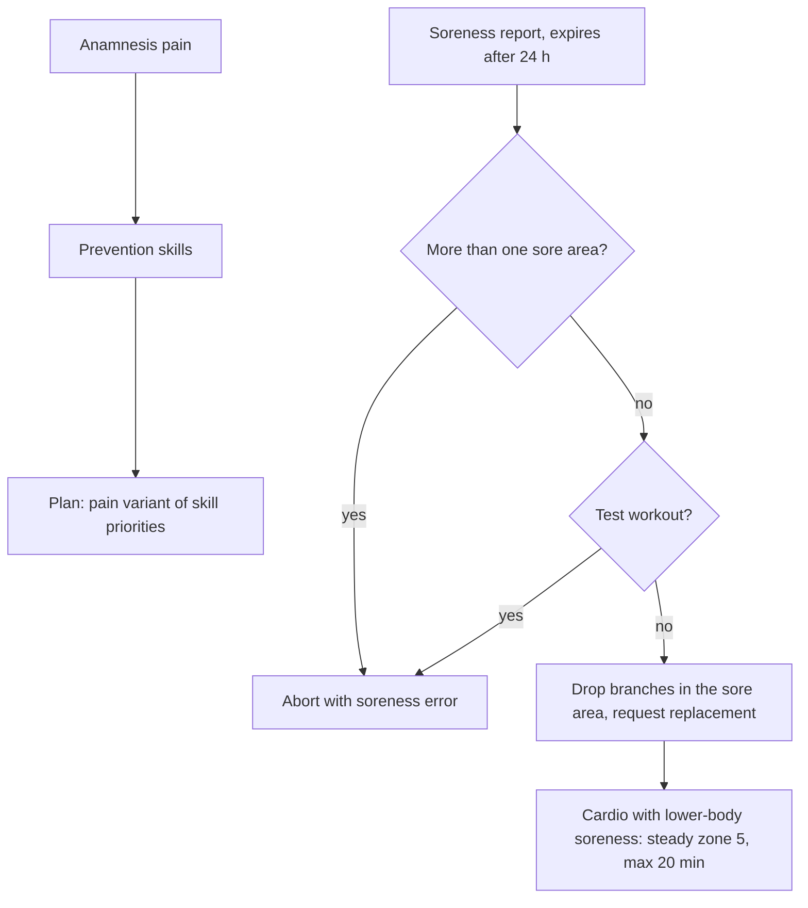

# Pain, Soreness, and Prevention

## Why & What

Two different health signals steer training. **Pain** is a lasting complaint the athlete reports in the anamnesis; it reshapes the plan permanently by adding **prevention** work. **Soreness** is a same-day report collected right before a workout; it only reshapes today's session. This spec defines both signals, their mappings to prevention skills, and the rules that filter or refuse a session.

## Problem

Three specs already consume pain and soreness: plan creation selects prevention skills by pain, exercise selection filters by soreness, cardio caps its duration. None of them defines either signal. A trainer who asks how long a soreness report lasts, or why hip pain prescribes knee prevention, has to read the generator to find out, and the rules that abort a session outright are scattered the same way.

## Solution

Keep the two signals separate:

- Pain is part of the athlete profile: it selects prevention skills and the special warm-up, and switches plan creation to the pain variant of its skill priorities. Children and adults get the same prevention work. Each pain maps to a **blocked region**, and exercises with high stress on that region stay out of the athlete's training. Pain changes when the athlete answers the anamnesis again.
- Soreness is a timestamped record that expires after 24 hours. Generation reads it once, and it never reaches the plan.

The generator filters before it refuses: a sore region removes candidate branches and the generator replaces them. It refuses a session when the signal makes the whole session unsafe or unbuildable.

## Out of Scope

- The anamnesis and soreness reporting screens
- Branch replacement mechanics once a filter removes a branch: [Plan Workout Generation](../session/plan-workout-generation.md)
- Prevention slot placement and rotation inside a training day: [Training Plan Creation](../planning/training-plan-creation-from-anamnesis.md)
- Injury diagnosis, rehabilitation programming, and any medical claim

## Algorithm

### Pain mappings

The athlete reports pain per joint and side. The mapping ignores the side: the prevention work and the authored blocked region apply to both sides.

| Reported pain | Prevention skill | Blocked region |
|---|---|---|
| Shoulder | Shoulder prevention | SHOULDER |
| Elbow | Wrist prevention | ELBOW |
| Wrist | Wrist prevention | WRIST |
| Spine | Spine prevention | SPINE |
| Hip | Knee prevention | HIP |
| Knee | Knee prevention | KNEE |
| Ankle | Ankle prevention | ANKLE |

A pain tag outside this table is ignored: it selects no prevention skill and blocks no region, so a content change can never prescribe the wrong prevention work unnoticed. Hip pain maps to knee prevention on purpose: hip and knee complaints are strongly related, and the knee prevention skill already covers the HIP and KNEE_HIP region groups, so no separate hip skill tree exists.

Each prevention skill draws from the region group it covers, which is wider than the single reported joint:

| Prevention skill | Target regions |
|---|---|
| Shoulder | SHOULDER |
| Wrist | WRIST, ELBOW, WRIST_ELBOW |
| Spine | SPINE |
| Knee | KNEE, HIP, KNEE_HIP |
| Ankle | ANKLE |

Effects of any pain at all:

1. Plan creation uses the pain variant of the skill priorities, which injects a prevention slot and a special warm-up into each training day, for children and adults alike.
2. The derived prevention skills rotate round-robin, at most one per day.
3. **Pain exclusion**: some exercises put particularly high stress on one body region, and the exercise catalog marks that region on them. When the region matches a blocked region from the table above, the athlete never gets that exercise:
   - Plan creation skips such branches when it picks exercises for the plan, in every skill. A knee complaint therefore keeps exercises with high knee stress out of the plan from the start.
   - Short workouts (focus and prevention trainings) skip such branches when they draw. When the pain leaves no exercise for the requested training, the app refuses it and names the affected region.
   - Plan workout generation adds no pain check of its own: it starts from branches plan creation already cleared.
4. Knee, ankle, hip, or spine pain excludes high-intensity plyometrics. The exercise catalog tags carry this rule.
5. During a session, the first exercise prescribed as a percentage of maximum load raises a one-time caution alert.

### Soreness lifetime

1. Before generation the athlete marks sore muscles. Each mark carries its timestamp and an expiration 24 hours later.
2. Opening the soreness step drops every expired record, so a stale report never filters a later session.
3. Marks are per muscle. Muscles map to three **areas**: upper body, core, lower body.

### Soreness rules

| Condition | Effect |
|---|---|
| Sore muscles in more than one area | Generation aborts, naming the affected regions |
| Branch region matches the sore area | Branch removed, its region requested for replacement |
| Cardio skill with lower-body soreness | Whole skill replaced by steady regeneration cardio, capped at 20 minutes |
| Strength test workout, any soreness | Refused |
| Warm-up, speed warm-up, cool-down, mobility, foam roller | Soreness ignored, these skills always run |
| Prevention workouts and focus trainings (the plan-independent short workouts, e.g. leg axis stability) | Soreness ignored, the check was removed by sprint decision on August 10, 2026 |

## Structure

Pain lives in the athlete's workout profile as tags, where plan creation and every session generation read it to pick prevention skills, the pain variant of the skill priorities, and the exercises to keep out. Soreness lives in a separate, short-lived record set on the device that only generation reads. Soreness feeds the same filter chain that also handles equipment, age, gender, and level, so a removed branch takes the ordinary replacement path regardless of which filter removed it. Prevention skills are ordinary skills with their own skill trees; the pain mapping only decides which of them enter a plan.

## Open Questions

None.
