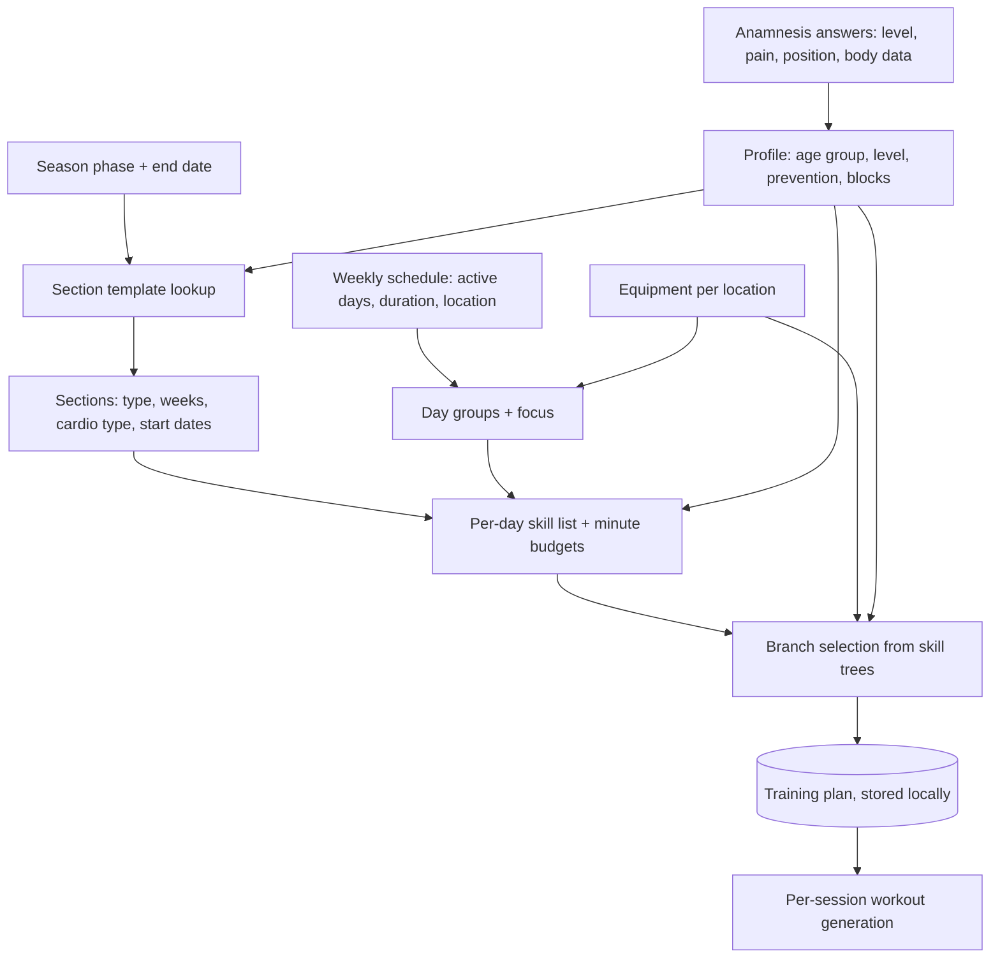

# Training Plan Creation from the Anamnesis Profile

## Why & What

After completing the **anamnesis** (the onboarding questionnaire covering fitness level, pains, position, sport, and body data), the athlete receives a personalized multi-week **training plan** without any trainer involvement. The plan is a periodized skeleton: a sequence of **sections** (mesocycles, each a multi-week block with one strength emphasis and one cardio intensity) containing per-weekday **trainings** that assign **skills** (training components such as strength work, warm-up, mobility, prevention), a minute budget per skill, and concrete exercise **branches**. Everything is generated on-device from the anamnesis profile, the weekly schedule, and the equipment available at each training location.

## Problem

Periodizing a season (which training emphasis to run in which weeks, how to lay out a training week, which exercises fit the athlete) is a trainer-level skill. Athletes self-programming default to unstructured, repetitive training that ignores their season phase, injuries, age, and available equipment. The anamnesis collects exactly this context, so the system must translate it into a coherent plan automatically.

## Solution

Plan creation is a deterministic pipeline over authored content, with randomness only in the final exercise pick:

1. Authored **section templates** (per season phase, age group, and level) decide the mesocycle sequence. This encodes sports-science periodization once, centrally, instead of computing it per user.
2. Rule-based day layout assigns each training day a **focus** (PHASE, CARDIO, STABILITY, or COMBINED) from the shape of the week and the locations' equipment. Strength is the app's focus: cardio goes only to days where strength is not the focus, and COMBINED stays rare.
3. Authored **skill priority** structures (per age group, pain status, and focus) decide which skills fill a session of a given length.
4. Filtered random selection picks exercise branches from **skill trees**, respecting age, gender, and equipment.

The plan stays a skeleton on purpose: sets, repetitions, and weights are computed per session at execution time, so day-to-day progression never requires regenerating the plan.

## Out of Scope

- Session (workout) generation: set lists, repetitions, weights, warm-up sets, supersets, pauses
- Progression between sessions and feedback handling (too easy, succeeded, too hard)
- Weight derivation from strength tests: [Weight Calculation from Strength Tests](../progression/weight-calculation-from-strength-tests.md)
- Manual single-branch replacement inside an existing plan
- Future work: archiving replaced plans, and backend persistence of plans (plans are currently device-local)
- The anamnesis questionnaire UI itself

## Algorithm

### 1. Profile derivation

The anamnesis answers are stored as tag groups and copied into the workout configuration on completion. Plan generation derives:

| Profile fact | Source | Rule |
|---|---|---|
| Age group | Birthday | Per the [Glossary](../glossary.md): CHILD under 16, otherwise adult rules. A missing birthday counts as ADULT. |
| Level | LEVEL tag | BEGINNER, ADVANCED, or PROFESSIONAL. A PROFESSIONAL child is downgraded to ADVANCED. |
| Pain status | PAIN tags | Any pain tag sets the pain variant of the skill priorities. |
| Prevention skills | PAIN tags | Mapping in [Pain, Soreness, and Prevention](../foundations/pain-soreness-and-prevention.md). |
| Position | POSITION tag | Two groups: goalkeeper (GOAL in football, ice hockey and hockey, GOALKEEPER in handball) and everyone else, including a missing position. The plan generator applies this rule to section types, cardio zones and goalkeeper-specific exercises. |
| Season phase | Anamnesis season phase step | PAUSE, PREPARATORY, or COMPETITION, with a week count to the phase end date (minimum 1). Required; generation fails without it. |
| Weights available | Equipment of active locations | True if any active training day's location has weights. |

The terms and conditions restrict the fitness area to users aged 16 and older. The CHILD rules below therefore apply only when someone enters a birthday under 16 despite that restriction; the code paths remain in place.

### 2. Section layout (periodization)

1. Look up the section template by season phase, age group (child or adult), and level. Unknown combinations fall back to the preparatory adult advanced template.
2. Templates are keyed by phase length in weeks (1 to 20). Each entry is an ordered list of sections, each with a type, week count, and cardio type. Example (preparatory, adult, beginner, 8 weeks): hypertrophy stage 1 for 3 weeks, hypertrophy stage 2 for 3 weeks, then explosive power for 2 weeks.
3. Phases longer than 20 weeks start from the 20-week entry and append from the template's repeat list cyclically; an appended section merges into the previous one when type and cardio type match.
4. Substitutions after template selection:
   - No weights available, level BEGINNER, or age group CHILD: every **max strength** section becomes hypertrophy stage 2. Explosive power stays in the child templates as authored.
   - Goalkeeper: power endurance becomes explosive power, and lactate intervals become sprint intervals.
5. The plan start snaps forward to the next Monday; each section starts where the previous one ends, giving strictly sequential blocks.

The [Glossary](../glossary.md) lists the section type and cardio zone codes.

### 3. Day grouping and focus

1. Consecutive active weekdays form groups; rest days break them, and grouping wraps across the week boundary (Sunday into Monday).
2. Each day in a group gets a focus:
   - Children: always PHASE.
   - Adults, 1 day: PHASE.
   - Adults, 2 days: PHASE goes to the studio day, the longer day, or the non-home day (in that order of applicable rules); the other day gets CARDIO with run equipment, otherwise STABILITY.
   - Adults, 3 days: assign PHASE, CARDIO, STABILITY preferring the longest studio day for PHASE, then non-home over home; CARDIO downgrades to STABILITY at home without run equipment. If no day received CARDIO, PHASE days upgrade to COMBINED.
   - More than 3 days: cycle PHASE, CARDIO, STABILITY.
3. Week-wide cardio guarantee: an adult training more than once with no CARDIO day anywhere gets one PHASE day converted:
   1. Candidates: every PHASE day except a home day without run equipment.
   2. Pick the longest candidate.
   3. The day becomes COMBINED when it lasts at least 45 minutes and its place has run equipment, otherwise CARDIO.

### 4. Skill selection and time budgeting per day

1. Pick the skill priority structure for age group, pain status, and focus. It maps minute thresholds to skill lists, e.g. adult, no pain, PHASE focus: from minute 0 the main phase work plus mobility, from 30 warm-up, from 45 cool-down, from 60 foam roller. Pain variants inject a prevention slot and a special warm-up.
2. Resolve placeholders: the PHASE slot becomes the section's type (or its KG variant when no weights are available; max strength without weights becomes hypertrophy stage 2 KG); the cardio slot becomes the section's cardio type; the warm-up variant follows the section type.
3. Prevention slots rotate round-robin through the athlete's derived prevention skills, at most one per day. The special warm-up is kept only on days that have a prevention skill. Children get the same prevention slots and special warm-up as adults.
4. Each selected skill gets its minimum duration first; leftover session time is distributed by priority, capped per skill by the maximum minutes below. Sessions longer than 45 minutes first fill the second priority skill to its maximum, which gives a prevention slot its 15 minutes. Time below a skill's minimum still uses the minimum, so short sessions can overshoot their target duration.

| Skill | Max minutes, beginner / advanced / professional |
|---|---|
| Hypertrophy (SWR) | 35 / 45 / 60 |
| Max strength (MAX) | 0 / 45 / 55 |
| Cardio | 45 / 60 / 60 |
| Full-body stability (GKS) | 25 / 30 / 40 |
| Power endurance (SA), explosive power (SK) | 30 / 35 / 35 |
| Prevention (PREV) | 15 |
| Special warm-up (WUSPEZIAL) | 3 |
| Everything else | 10 |

### 5. Branch selection per skill

1. The skill and its allotted minutes select an authored region configuration: how many exercises, and which region or movement tags (upper body, lower body, core, or named barbell lifts for max strength). The count includes both sides: a one sided exercise trains left and right and uses two slots. A prevention slot that would only fit one side of a one sided exercise stays empty.
2. Candidate branches come from the skill's skill tree, filtered by: not already in use that day, age tag, gender tag, equipment present at the day's location, and the pain exclusion described in [Pain, Soreness, and Prevention](../foundations/pain-soreness-and-prevention.md). Children may receive every branch their age tag allows, weighted ones included.
3. When weights are available, the weighted vs bodyweight share follows [Plan Workout Generation](../session/plan-workout-generation.md).
4. Each exercise slot applies cascading filters, each falling back to the previous candidate set when it would empty: movement direction (from an authored priority sequence), side (the last slot avoids one-sided exercises), muscle (prefer untrained big muscles), involvement (70% complex, 30% isolated), equipment (max strength prefers barbell), and the weighted/bodyweight share. The final pick is random among the survivors.
5. Branches resolve to an exercise by the resolution rule in [Branches, Exercises, and Levels](../foundations/branches-exercises-and-levels.md). A branch is skipped only when nothing resolves at or below the athlete's level. Only a skill left with zero usable branches after this check is removed from the day. Chosen branches are excluded for the rest of the day to avoid duplicates. A candidate branch that resolves to an exercise the skill already holds that day is skipped as well; session generation repeats this check, because branches can converge later through level changes ([Plan Workout Generation](../session/plan-workout-generation.md)).

### 6. Lifecycle and regeneration

| Trigger | Start date | Old plan |
|---|---|---|
| Anamnesis completed (first plan) | Next Monday from today | none |
| Anamnesis re-run, same season phase type | Preserved from existing plan | Overwritten |
| Anamnesis re-run, season phase changed | Next Monday from today | Overwritten |
| New plan accepted after a training gap of more than 21 days | Next Monday from today | Overwritten |
| Equipment change at a location used by an active training day | Preserved | Overwritten |

Regeneration with a preserved start date keeps unaffected days. The app runs the full pipeline, then compares each training day of each section with the old plan:

1. A day keeps its old branches when its focus, its skill list, its minute budgets, and the equipment at its place all stayed the same.
2. Every other day gets a fresh draw.

Example: the athlete adds a kettlebell at home. The home days get new exercises, and the gym days keep theirs. Per-branch progress survives both cases, since it lives outside the plan. A changed fitness level, pain, or age group changes the skill lists, so the affected days redraw by rule 1.

The active section on any given day is computed from weeks elapsed since the plan start, so the passage of time never triggers regeneration. Training gaps, measured at workout start as days since the last completed workout:

| Gap | Action |
|---|---|
| Up to 7 days | None |
| 8 to 21 days | Shift section starts forward by the missed weeks |
| More than 21 days | Ask: "You have not trained for more than three weeks. Do you want to create a new training plan?" Accepting opens plan creation, declining shifts section starts forward by the missed weeks. |

The shift lets the athlete resume where they left off instead of skipping ahead in the periodization. The app never deletes a plan for inactivity. Plans are stored on the device only, and a replaced plan is overwritten without an archive.

## Structure

Entity relationships: a plan has ordered sections; a section has one training per active weekday; a training maps skills to branch lists and minute budgets; a branch is a level-indexed ladder of exercises resolved against the athlete's per-branch progress at session time. Authored content (section templates, skill priorities, region configurations, skill trees, exercise catalog) is bundled with the app and versioned with releases. Cross-package note: plans never leave the device today; only completed workouts, exercise data, and strength tests sync to the backend.

## Open Questions

None.