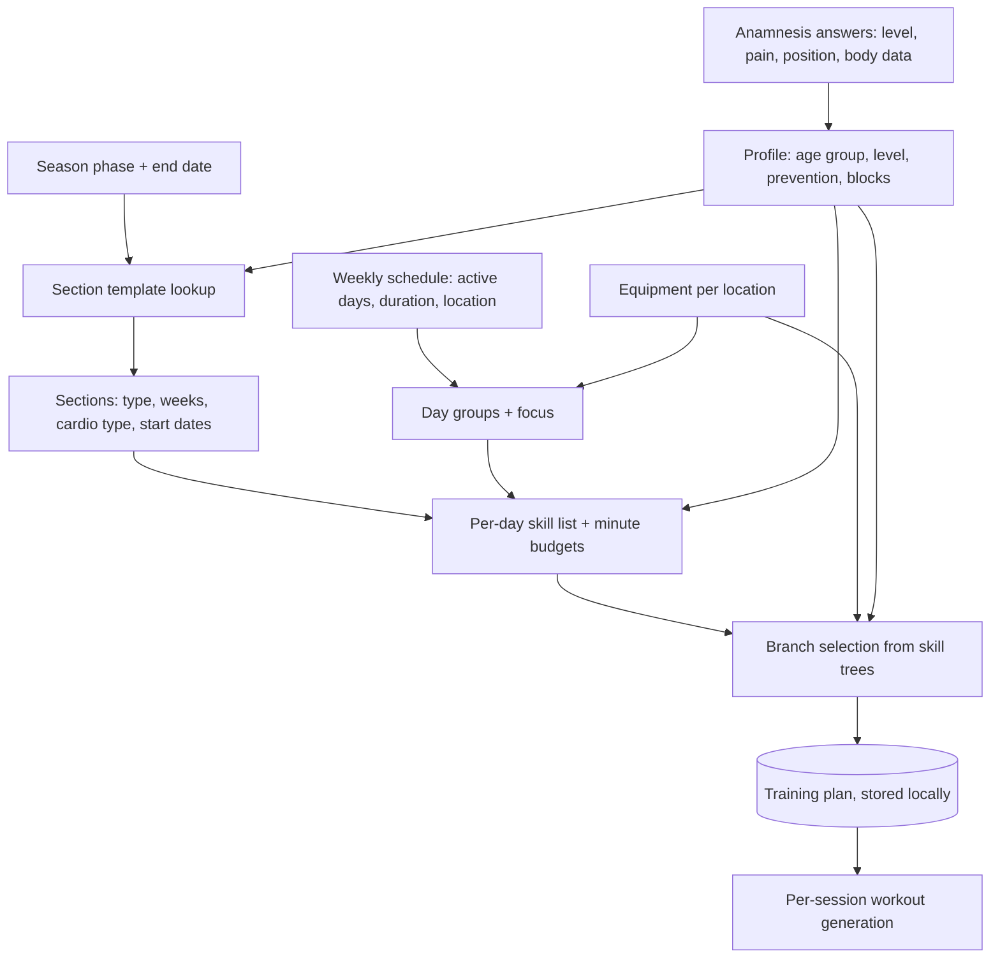

# Training Plan Creation from the Anamnesis Profile

## Why & What

After completing the **anamnesis** (the onboarding questionnaire covering fitness level, pain points, position, sport, and body data), the athlete receives a personalized multi-week **training plan** without any trainer involvement. The plan is a periodized skeleton: a sequence of **sections** (mesocycles, each a multi-week block with one strength emphasis and one cardio intensity) containing per-weekday **trainings** that assign **skills** (training components such as strength work, warm-up, mobility, prevention), a minute budget per skill, and concrete exercise **branches**. Everything is generated on-device from the anamnesis profile, the weekly schedule, and the equipment available at each training location.

## Problem

Periodizing a season (which training emphasis to run in which weeks, how to lay out a training week, which exercises fit the athlete) is a trainer-level skill. Athletes self-programming default to unstructured, repetitive training that ignores their season phase, injuries, age, and available equipment. The anamnesis collects exactly this context, so the system must translate it into a coherent plan automatically.

## Solution

Plan creation is a deterministic pipeline over authored content, with randomness only in the final exercise pick:

1. Authored **section templates** (per season phase, age group, and level) decide the mesocycle sequence. This encodes sports-science periodization once, centrally, instead of computing it per user.
2. Rule-based day layout assigns each training day a **focus** (PHASE, CARDIO, STABILITY, or COMBINED) from the shape of the week and the locations' equipment.
3. Authored **skill priority** structures (per age group, pain status, and focus) decide which skills fill a session of a given length.
4. Filtered random selection picks exercise branches from **skill trees**, respecting age, gender, and equipment.

The plan stays a skeleton on purpose: sets, repetitions, and weights are computed per session at execution time, so day-to-day progression never requires regenerating the plan.

## Out of Scope

- Session (workout) generation: set lists, repetitions, weights, warm-up sets, supersets, pauses
- Progression between sessions and feedback handling (too easy, succeeded, too hard)
- Weight derivation from strength tests: [Weight Calculation from Strength Tests](../progression/weight-calculation-from-strength-tests.md)
- Manual single-branch replacement inside an existing plan
- Backend persistence of plans (plans are currently device-local)
- The anamnesis questionnaire UI itself

## Algorithm

### 1. Profile derivation

The anamnesis answers are stored as tag groups and copied into the workout configuration on completion. Plan generation derives:

| Profile fact | Source | Rule |
|---|---|---|
| Age group | Birthday | CHILD up to 16, ADOLESCENT up to 18 (treated as adult everywhere), otherwise ADULT. Missing birthday defaults to ADULT. |
| Level | LEVEL tag | BEGINNER, ADVANCED, or PROFESSIONAL. A PROFESSIONAL child is downgraded to ADVANCED. |
| Pain status | PAIN tags | Any pain tag sets the pain variant of the skill priorities. |
| Prevention skills | PAIN tags | Shoulder maps to shoulder prevention, elbow and wrist to wrist prevention, spine to spine prevention, hip and knee to knee prevention, ankle to ankle prevention. |
| Blocked regions | PAIN tags | Authored mapping only: pain exclusions do not exist, no branch is excluded for a blocked region ([Pain, Soreness, and Prevention](../foundations/pain-soreness-and-prevention.md)). |
| Position | POSITION tag | Defaults to FIELD. Currently every athlete is treated as a keeper (temporary override until power endurance content is fixed). |
| Season phase | Anamnesis season phase step | PAUSE, PREPARATORY, or COMPETITION, with a week count to the phase end date (minimum 1). Required; generation fails without it. |
| Weights available | Equipment of active locations | True if any active training day's location has weights. |

Note on age groups: the app's fitness area is currently restricted to users aged 16 and older via the terms and conditions. The CHILD age group and all child-specific rules below therefore only apply when a birthday under 16 is entered despite that restriction; the code paths remain in place.

### 2. Section layout (periodization)

1. Look up the section template by season phase, age group (child or adult; per the terms and conditions the fitness area is 16+, so the child templates are normally not reached), and level. Unknown combinations fall back to the preparatory adult advanced template.
2. Templates are keyed by phase length in weeks (1 to 20). Each entry is an ordered list of sections, each with a type, week count, and cardio type. Example (preparatory, adult, beginner, 8 weeks): hypertrophy stage 1 for 3 weeks, hypertrophy stage 2 for 3 weeks, then explosive power for 2 weeks.
3. Phases longer than 20 weeks start from the 20-week entry and append from the template's repeat list cyclically; an appended section merges into the previous one when type and cardio type match.
4. Substitutions after template selection:
   - No weights available, or level BEGINNER: every **Maxkraft** (max strength) section becomes hypertrophy stage 2.
   - Keeper: power endurance becomes explosive power, and lactate cardio becomes short-interval cardio.
5. The plan start snaps forward to the next Monday; each section starts where the previous one ends, giving strictly sequential blocks.

Section types use German training vocabulary: SWR1 and SWR2 are hypertrophy (Muskelaufbau) stages, MAX and MAX_KRAFT are Maxkraft, SK is explosive power (Schnellkraft), SA is power endurance (Schnellkraftausdauer). A KG suffix marks the bodyweight (Körpergewicht) variant of a type. Cardio types CARDIO_1 to CARDIO_5 are heart-rate intensity zones.

### 3. Day grouping and focus

1. Consecutive active weekdays form groups; rest days break them, and grouping wraps across the week boundary (Sunday into Monday).
2. Each day in a group gets a focus:
   - Children: always PHASE.
   - Adults, 1 day: PHASE.
   - Adults, 2 days: PHASE goes to the studio day, the longer day, or the non-home day (in that order of applicable rules); the other day gets CARDIO with run equipment, otherwise STABILITY.
   - Adults, 3 days: assign PHASE, CARDIO, STABILITY preferring the longest studio day for PHASE, then non-home over home; CARDIO downgrades to STABILITY at home without run equipment. If no day received CARDIO, PHASE days upgrade to COMBINED.
   - More than 3 days: cycle PHASE, CARDIO, STABILITY.
3. Week-wide cardio guarantee: an adult training more than once with no CARDIO day anywhere gets their most suitable long PHASE day converted to CARDIO, or to COMBINED when the day is at least 45 minutes with run equipment.

### 4. Skill selection and time budgeting per day

1. Pick the skill priority structure for age group, pain status, and focus. It maps minute thresholds to skill lists, e.g. adult, no pain, PHASE focus: from minute 0 the main phase work plus mobility, from 30 warm-up, from 45 cool-down, from 60 stretching. Pain variants inject a prevention slot and a special warm-up.
2. Resolve placeholders: the PHASE slot becomes the section's type (or its KG variant when no weights are available; Maxkraft without weights becomes hypertrophy stage 2 KG); the cardio slot becomes the section's cardio type; the warm-up variant follows the section type.
3. Prevention slots rotate round-robin through the athlete's derived prevention skills, at most one per day. The special warm-up is kept only on days that have a prevention skill. Children always train bodyweight variants and receive stability and foundation skills in place of adult prevention slots (normally unreachable under the 16+ terms restriction, see Profile derivation).
4. Each selected skill gets its minimum duration first; leftover session time is distributed by priority, capped per skill by level-dependent maximum times (Maxkraft for example allows 0 minutes for beginners, 45 for advanced, 55 for professionals). Time below a skill's minimum still uses the minimum, so short sessions can overshoot their target duration.

### 5. Branch selection per skill

1. The skill and its allotted minutes select an authored region configuration: how many exercises, and which region or movement tags (upper body, lower body, core, or named barbell lifts for Maxkraft).
2. Candidate branches come from the skill's skill tree, filtered by: not already in use that day, age tag, gender tag, and equipment present at the day's location. Blocked-region tags do not filter: pain exclusions do not exist.
3. When weights are available, the target mix of weighted vs bodyweight exercises is: children (the CHILD age group, under 16, see Profile derivation) 30% weighted, adults 80% in the studio (60% for non-strength skills), 50% elsewhere.
4. Each exercise slot applies cascading filters, each falling back to the previous candidate set when it would empty: movement direction (from an authored priority sequence), side (the last slot avoids one-sided exercises), muscle (prefer untrained big muscles), involvement (70% complex, 30% isolated), equipment (Maxkraft prefers barbell), and the weighted/bodyweight mix. The final pick is random among the survivors.
5. Branches resolve to an exercise by the shared resolution rule in [Plan Workout Generation](../session/plan-workout-generation.md): an empty level falls back downward to the highest authored level below it, so the last valid exercise stays active until a higher level defines a new one (level 1 = exercise A, level 2 empty, level 3 = exercise B: an advanced athlete still trains exercise A). A branch is skipped only when no exercise resolves at or below the athlete's current level; an intentionally empty intermediate level never shrinks the pool. Only a skill left with zero usable branches after this check is removed from the day. Chosen branches are excluded for the rest of the day to avoid duplicates.

### 6. Lifecycle and regeneration

| Trigger | Start date | Old plan |
|---|---|---|
| Anamnesis completed (first plan) | Next Monday from today | none |
| Anamnesis re-run, same season phase type | Preserved from existing plan | Overwritten |
| Anamnesis re-run, season phase changed | Next Monday from today | Overwritten |
| Equipment change at a location used by an active training day | Preserved | Overwritten |

The active section on any given day is computed from weeks elapsed since the plan start, so the passage of time never triggers regeneration. When more than a week passes without a workout, section start dates shift forward by the missed time, so the athlete resumes where they left off instead of skipping ahead in the periodization. Plans are stored locally only; archiving and backend sync are open TODOs.

## Structure

Entity relationships: a plan has ordered sections; a section has one training per active weekday; a training maps skills to branch lists and minute budgets; a branch is a level-indexed ladder of exercises resolved against the athlete's per-branch progress at session time. Authored content (section templates, skill priorities, region configurations, skill trees, exercise catalog) is bundled with the app and versioned with releases. Cross-package note: plans never leave the device today; only completed workouts, exercise data, and strength tests sync to the backend.

## Open Questions

- Every athlete is currently treated as a keeper, removing power endurance sections for everyone. When power endurance content is fixed, should existing plans regenerate automatically?
- Branch selection is random, so any regeneration (e.g. an equipment tweak) reshuffles most exercises. Should selection be seeded or should regeneration preserve unaffected days? Leaning toward preserving.
- Overwritten plans vanish without archiving (marked as a TODO in the flow). Should the old plan be archived locally and on the backend before replacement?
- Minimum skill durations can overshoot a short session's target length. Should the skill list shrink instead when the budget does not fit?
- Adolescents (17 to 18) are treated as adults everywhere, including weighted-exercise ratios. Since the terms and conditions limit the fitness area to 16+, adolescents are the youngest users the app actually serves. Is the adult treatment the intended sports-science rule?
