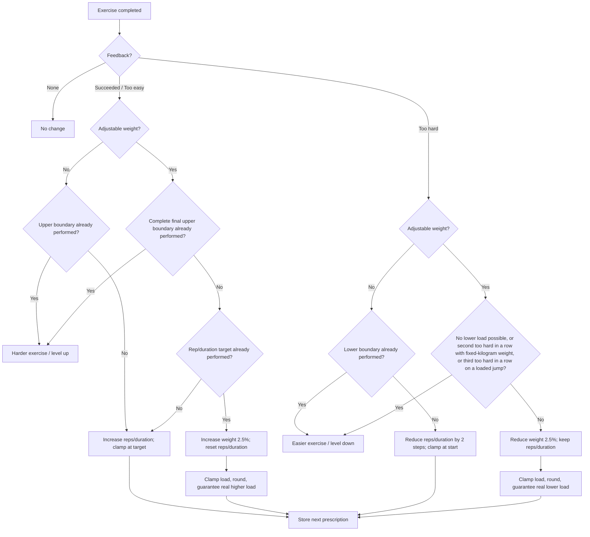

# Standard Exercise Progression

## Purpose and scope

This specification defines standard progression for:

- hypertrophy,
- explosive power,
- power endurance,
- stability,
- prevention.

Max strength and cardio use their own progression specifications.

Per exercise, progression may use:

- achieved repetitions or duration,
- prescribed weight,
- feedback (`too easy`, `succeeded`, `too hard`),
- progression mode (`advance-by-reps` or `advance-by-duration`),
- whether the exercise uses adjustable external weight,
- authored start, target, and load boundaries.

Start/target values may depend on fitness level, gender, and age group unless this specification defines a global override. The authored value configuration is the source of truth for values not overridden here. Only for hypertrophy do the training-area-specific repetition and duration ranges defined in this specification override exercise-specific authored repetition/duration values. Every other training area, full-body stability and prevention included, uses the authored values and falls back to these ranges only when an exercise has none. Exercise-specific weight rules remain unchanged.

Warm-up, special warm-up, speed warm-up, cool-down, mobility, foam roller, and strength-test exercises do not use this progression and do not collect progression feedback. Speed warm-up durations follow [Speed warm-up](#speed-warm-up).

Exercise progress is stored per athlete, skill and exercise (see [Progress per skill](#progress-per-skill)). Every record survives plan regeneration and training day moves. One feedback event must be consumed only once.

## Out of scope

- Max strength progression: [Max Strength Training](./max-strength-progression.md)
- Cardio progression: [Cardio Training System](../session/cardio-training-system.md)
- Branch/level changes and substitution rules: [Branches, Exercises, and Levels](../foundations/branches-exercises-and-levels.md)
- Initial weight derivation, equipment conversion, and rounding rules: [Weight Calculation from Strength Tests](./weight-calculation-from-strength-tests.md)
- Sets, pauses, and warm-up sets: [Session Set Structure](../session/session-set-structure.md)
- Manual value adjustment
- Additional future feedback options
- Automatic height progression
- A separate strength-endurance skill

## Core model

Progression follows:

1. repetitions **or** duration,
2. weight, if adjustable,
3. branch level / exercise variant.

An exercise never uses repetitions and duration as progression modes at the same time.

A **ladder step** changes repetitions/duration:

| Mode | 1 step | 2 steps |
|---|---:|---:|
| Repetitions | 1 rep | 2 reps |
| Duration | 5 s | 10 s |

A **weight step** changes the current rounded training weight by **±2.5%** and rounds the result to a loadable weight.

A single feedback event must never simultaneously increase repetitions/duration and weight.

## Authored values

### Hypertrophy

All exercises assigned to **Hypertrophy / Muskelaufbau** use the same standard repetition/duration ranges. Exercise difficulty is changed through the Skill Tree / branch progression, not by extending these ranges.

These repetition and duration ranges are progression boundaries; they do not by themselves guarantee a sufficient hypertrophy stimulus. Difficulty feedback should reflect whether the prescribed work was appropriately challenging while maintaining technically valid execution.

| Exercise type | Start | Target |
|---|---:|---:|
| Adjustable weight - repetitions | 8 reps | 12 reps |
| Adjustable weight - duration | 30 s | 50 s |
| No adjustable weight - repetitions | 8 reps | 12 reps |
| No adjustable weight - duration | 30 s | 60 s |

If a no-weight hypertrophy exercise is too easy at its upper boundary, use a harder exercise variant instead of extending the hypertrophy range.

There is currently only one hypertrophy training logic. A separate **strength-endurance / Kraftausdauer** logic is planned for a later implementation. Until that separate logic is specified and implemented, all current muscle-building work uses the hypertrophy rules in this document and no separate 15-20-rep / 60-80-s strength-endurance range is active.

### U16 weighted exercises

Athletes under 16 currently do not use F-Max-based weight calculation. Weighted U16 exercises use fixed authored weight values, which may depend on exercise and gender.

### Speed warm-up

Speed warm-up (WUSKSA) exercises use fixed authored durations:

- every duration is at most 30 s; a longer authored value is capped at 30 s;
- a shorter authored duration stays unchanged;
- an exercise without an authored duration uses 30 s;
- durations never change between sessions, and the speed warm-up collects no feedback.

The special warm-up (WUSPEZIAL) is not affected by this rule.

## Feedback rules

Each feedback (`too easy`, `succeeded`, `too hard`) changes the next prescription: repetitions/duration, the load, or the exercise. If a boundary or the available loads block the intended change, the exercise changes instead. A session without feedback keeps all values.

At the end of a branch, a level change triggers a branch substitution at the reached level (see [Branches, Exercises, and Levels](../foundations/branches-exercises-and-levels.md)). When no equivalent branch exists, or outside plan workouts, the athlete keeps the current exercise and values, and the app discards the feedback. This case is the one exception to the rule above.

### Exercises without adjustable weight

| Feedback | Change |
|---|---|
| `succeeded` | +1 ladder step |
| `too easy` | +2 ladder steps |
| `too hard` | -2 ladder steps |
| no feedback | no change |

Values are clamped to the resolved start/target range. For hypertrophy repetitions/duration, the global ranges defined in this specification are the resolved boundaries even if an exercise catalog entry contains different authored repetition/duration values.

If a step reaches a boundary, that boundary must be prescribed, performed, and evaluated before a branch-level change occurs.

### Exercises with adjustable weight

For `succeeded` and `too easy`:

- below the repetition/duration target: increase only repetitions/duration;
- `succeeded` = +1 ladder step;
- `too easy` = +2 ladder steps;
- clamp at the repetition/duration target;
- do not increase weight in the same feedback event.

If the repetition/duration target has already been performed and receives positive feedback:

- increase weight by one weight step;
- reset repetitions/duration to the authored start value.

For `too hard`:

- reduce only weight by one weight step;
- keep repetitions/duration unchanged.

For no feedback:

- no change.

## Weight progression

A weight step starts from the **current rounded training weight**, the load the athlete performed:

> exact increase = current rounded weight × 1.025

> exact reduction = current rounded weight × 0.975

The app clamps the exact value to the load boundaries and rounds it according to [Weight Calculation from Strength Tests](./weight-calculation-from-strength-tests.md). The rounded value replaces the training weight: the athlete performs it, and the next weight step starts from it.

A weight in percent of F-Max follows the same rule: the step converts the percentage to kg with the exercise F-Max, and the app stores the rounded load as a percentage of F-Max.

### Guaranteed real load change

Every intended weight increase/reduction must produce a real change in prescribed load. If ±2.5% rounds to the current load:

- increase → use the next available higher load;
- reduction → use the next available lower load.

Example (barbell, 2.5 kg increments):

| Step | Exact value | Rounded load | Prescribed and stored load |
|---|---:|---:|---:|
| Start | | | 40 kg |
| +2.5% | 41 kg | 40 kg | 42.5 kg (forced jump) |
| +2.5% | 43.56 kg | 42.5 kg | 45 kg (forced jump) |
| -2.5% | 43.88 kg | 45 kg | 42.5 kg (forced jump) |

If the next available load lies beyond a load boundary, the boundary wins; see [Load boundaries](#load-boundaries).

### Load boundaries

Authored start and target loads must be loadable increments according to [Weight Calculation from Strength Tests](./weight-calculation-from-strength-tests.md). If an authored load is not loadable, it is rounded with the same rules before it is used as a boundary.

The app clamps the exact value to the authored load limits before rounding:

- increase: current weight × 1.025, at most the target load;
- reduction: current weight × 0.975, at least the lowest permitted load.

The boundary check uses the exact value. Example: with a 14 kg target, an exact value of 14.1 kg exceeds the target, even though 14.1 kg rounds to 14 kg.

The boundaries take priority over the guaranteed real load change: an increase never prescribes a load above the rounded target load, and a reduction never prescribes a load below the rounded lowest permitted load.

When a step cannot change the load, the same feedback changes the exercise:

- `succeeded` or `too easy` at the repetition/duration target, where an increase cannot produce a higher load, counts as reaching the target load and levels up;
- `too hard`, where a reduction cannot produce a lower load, counts as reaching the lowest permitted load and levels down.

Example: 65% of a 123 kg F-Max is 79.95 kg and rounds to 80 kg. 80 kg is 65.04% of F-Max, and the next lower barbell load, 77.5 kg, lies below the rounded lowest permitted load. The empty bar acts the same way: 20 kg is the lowest barbell load, whatever its share of F-Max.

A load boundary counts as reached as soon as the training weight reaches it, or when a step in its direction cannot change the load.

## Boundary rules

### Upper boundary without adjustable weight

The authored target repetition/duration is the final upper boundary.

After that boundary has actually been performed:

- `succeeded` or `too easy` → harder exercise / level up;
- `too hard` → -2 ladder steps;
- no feedback → no change.

### Upper boundary with adjustable weight

The complete final upper boundary requires both:

- final authored repetition/duration target;
- final authored target load.

The complete final target must be performed before changing the exercise/level.

After it has been performed:

- `succeeded` or `too easy` → harder exercise / level up;
- `too hard` → reduce weight by one weight step; repetitions/duration unchanged;
- no feedback → no change.

Target-load checks follow [Load boundaries](#load-boundaries).

### Lower boundary without adjustable weight

The authored start value is the lower repetition/duration boundary.

A `too hard` step that would go below start is clamped to start. The lower boundary must then be performed.

After it has been performed:

- `too hard` → easier exercise / level down;
- `succeeded` or `too easy` → progress upward normally;
- no feedback → no change.

### Lower boundary with adjustable weight

Regression occurs through weight; repetitions/duration stay unchanged.

Weight may be reduced step by step to the exercise's **lowest permitted load**, even when that load is below the normal start load.

The branch-level system selects an easier exercise / level on a `too hard` at the bottom of the load range, or earlier on the consecutive `too hard` count.

For weighted hypertrophy, repetitions remain 8-12 and duration remains 30-50 s during weight regression.

**Fixed-kilogram weights:** exercises whose weight is authored in fixed kilograms (full-body stability, weighted prevention, U16 weighted exercises) have no lowest permitted load. The first `too hard` reduces the weight by one weight step. A second `too hard` in a row leads to a level down instead of another reduction. Any other feedback resets the count.

**Bottom of the load range:** when no lower load exists, the first `too hard` leads to a level down, for every weighted exercise and regardless of the `too hard` count. Examples: 0 kg additional weight on a bodyweight exercise, the empty barbell, or the lowest permitted load. Above the bottom, the count adds an earlier exit: the second `too hard` in a row for fixed-kilogram weights, the third for loaded jumps. The count of consecutive `too hard` ratings is part of the stored exercise progress, so each skill counts its own `too hard` ratings of an exercise.

Pure explosive exercises, for example loaded jumps, carry authored load limits in the exercise catalog. Those limits take priority over the skill's load range, so the explosive power floor of 50% F-Max does not apply to them. The exercise catalog must author these load limits for every loaded jump exercise and fitness level, as a share of the knee-direction 1RM converted to the equipment (see [Weight Calculation from Strength Tests](./weight-calculation-from-strength-tests.md)):

| Fitness level | Start load | Target load |
|---|---:|---:|
| Beginner | 5% | 10% |
| Advanced | 10% | 20% |
| Professional | 10% | 20% |

The lowest permitted load of a loaded jump exercise equals its start load. The loaded jumps are jump squats and jumped lunges.

## Progression flow



## Height

Automatic height progression is not implemented.

For exercises using repetitions + height:

- height stays fixed;
- only repetitions progress;
- the final repetition target at that fixed height is treated as the exercise's final target;
- after positive feedback at that performed target, the branch system selects the next exercise;
- height is not increased and repetitions are not reset for another height stage.

A later implementation may add height progression analogous to weight progression.

## Default start, target, and load values

These are fallback values for plan-mode workouts only. Exercise-specific start and target values always take precedence, except for the explicit hypertrophy override. The prevention defaults (10–15 reps / 40–60 s) must not override authored exercise values.

| Training area | Start | Target | Load / notes |
|---|---:|---:|---|
| Explosive power with adjustable weight | 4 reps | 6 reps | Beginner 52.5-65% F-Max; Advanced 55-67.5%; Professional 55-70%; lowest load 50%; authored targets at most 8 reps (catalog rule, no cap on stored values) |
| Pure explosive exercises with an authored load limit | 4 reps | 6 reps | The exercise catalog's load limits replace the skill's load range; loaded jumps author Beginner 5-10%, Advanced and Professional 10-20% of the knee-direction 1RM, see Lower boundary with adjustable weight; authored targets at most 8 reps (catalog rule, no cap on stored values) |
| Explosive power without adjustable weight | 4 reps | 6 reps | General default; authored targets at most 8 reps (catalog rule, no cap on stored values) |
| Plyometrics | 4 reps | 12 reps | Authored values apply; these defaults apply only where values are missing; the 8-rep maximum of explosive power does not apply |
| Hypertrophy, adjustable weight, reps | 8 reps | 12 reps | Beginner 67.5-75%; Advanced 70-77.5%; Professional 70-77.5%; lowest load 65% |
| Hypertrophy, adjustable weight, duration | 30 s | 50 s | Same weight-boundary logic |
| Hypertrophy, no adjustable weight, reps | 8 reps | 12 reps | Standard hypertrophy range |
| Hypertrophy, no adjustable weight, duration | 30 s | 60 s | Standard hypertrophy range |
| Full-body stability, adjustable weight, reps | 8 reps | 12 reps | Exercise-specific start/target weights; no F-Max calculation; second `too hard` in a row → level down |
| Full-body stability, adjustable weight, duration | 30 s | 50 s | Exercise-specific start/target weights; no F-Max calculation; second `too hard` in a row → level down |
| Full-body stability, no adjustable weight, reps | 8 reps | 12 reps | standard Full-body stability range |
| Full-body stability, no adjustable weight, duration | 30 s | 60 s | standard Full-body stability range |
| Leg-axis stability | 5 reps / 30 s | 8 reps / 45 s | Exercise-specific |
| Prevention | 10 reps / 40 s | 15 reps / 60 s | Same range with and without weights; weighted exercises use exercise-specific start/target weights, no F-Max calculation; second `too hard` in a row → level down |
| U16 weighted exercises | per training area | per training area | Fixed authored **weight** values; no F-Max calculation; second `too hard` in a row → level down. Repetition/duration follows the applicable training-area rules; for hypertrophy use 8-12 reps or 30-50 s for weighted duration. |
| Speed warm-up | authored | authored | Fixed duration, at most 30 s, 30 s when missing; no progression, see [Speed warm-up](#speed-warm-up) |

**Full-body stability – exercise-specific weights:**
For weighted exercises, use the existing exercise-specific start and target weights. These weights are not calculated from strength tests or F-Max. No general weight values apply to this training area. Authored weights must be loadable increments; see [Load boundaries](#load-boundaries).

## Deferred feedback

When progression is deferred to the next generation, stored feedback is applied exactly once using the feedback rules above. After application, the stored feedback is consumed. Feedback reaches the record only when the exercise is completed. Feedback given in a session that is skipped or aborted writes nothing.

## Worked example

Weighted hypertrophy, repetition-based:

- start: 8 reps
- target: 12 reps
- training weight: 38 kg

| Session | Feedback | Next prescription |
|---|---|---|
| 1: 8 reps | `succeeded` | 9 reps, same weight |
| 2: 9 reps | `too easy` | 11 reps, same weight |
| 3: 11 reps | `too easy` | 12 reps, same weight |
| 4: 12 reps | `succeeded` | +2.5% weight, reset to 8 reps |
| 5: new weight | `too hard` | -2.5% weight, keep 8 reps |

Session 3 stops at 12 reps even though `too easy` normally adds two ladder steps. The same feedback event does not also increase weight.

Weight example:

> 38 kg × 1.025 = 38.95 kg

The result is rounded using [Weight Calculation from Strength Tests](./weight-calculation-from-strength-tests.md). If rounding gives the same usable load, use the next real available load in the intended direction.

## State and persistence

Store per exercise, where applicable:

- last prescribed/achieved repetitions,
- last prescribed/achieved duration,
- rounded training weight,
- weight type,
- authored height,
- pending feedback,
- current progression position.

Per-branch levels are stored separately and stay shared across all skills and workouts.

The new workout generator and the completion keep the progress per skill, see [Progress per skill](#progress-per-skill). The old generator reads one record per exercise whatever its skill.

The rounded training weight is both the execution prescription and the source for future ±2.5% calculations. The app stores no unrounded weight.

Stored repetitions and durations always stay within the currently resolved start and target values. Each session generation clamps them, for every training area, so a later change to authored or global values takes effect for athletes with existing progress.

Pending feedback is the handover token between session completion and next-generation application.

After a level change:

- the branch level changes for every skill;
- a level change resets the record of the left exercise only under the skill that changed the level, and the records of that exercise under other skills stay;
- the new exercise starts with its resolved start values; for hypertrophy repetitions/duration, use the global hypertrophy start values from this specification rather than exercise-specific authored repetition/duration values.

The records under other skills preserve history for a future manual exercise-swap feature.

### Progress per skill

The app stores exercise progress as `exerciseProgress[skill][exerciseId]`. The new workout generator reads it for plan, short and custom workouts; a session writes the record of the skill its exercise trains under. Prevention placeholders resolve to body region skills (for example `PREVKNEE`) before the skill keys the record. Variants keep separate records: SWR1 and SWR2, SWR1KG and SWR2KG, GKS and GKSKG, MAX and MAX_STRENGTH, and each prevention skill.

Rules:

1. Every write sets `updatedAt` (Unix seconds). A record without `updatedAt` counts as the oldest.
2. A skill that meets an exercise for the first time copies the load seed: weight and weight type from the newest record of that exercise under another skill with a matching weight type. Without a matching record, the usual start values apply.
3. Repetitions, duration, height, feedback, `too hard` count and max strength steps start fresh. Max strength steps never seed.
4. A skipped or aborted set writes nothing.
5. Moving a training day or recreating a plan keeps every record.

Example. Exercise 342 trains under SWR1 with 50 kg. A short workout then trains it under SA. The generator seeds 50 kg from SWR1 and starts the repetitions at the SA start value. The completion writes the SA record:

```json
{
  "exerciseProgress": {
    "SWR1": { "342": { "exerciseId": "342", "skill": "SWR1", "weight": 50, "weightType": "weightAbsolute", "repetition": 15, "updatedAt": 1761550000 } },
    "SA":   { "342": { "exerciseId": "342", "skill": "SA", "weight": 50, "weightType": "weightAbsolute", "repetition": 12, "updatedAt": 1761640000 } }
  }
}
```

**Older record per exercise.** Before the records per skill, the store kept one record per exercise in `exerciseData`, naming the skill that wrote it last. The store keeps `exerciseData` and merges every write and reset into it as before, so the old generator and the sync see no change. No migration runs: an athlete updating the app keeps `exerciseData` and starts with an empty `exerciseProgress`. Until a skill has a record of its own, the new generator reads the older record as that skill's record when it names the skill, and as a load seed source otherwise. The first write of another skill takes over the older record, so the skill that wrote it before keeps only what its own record holds.
