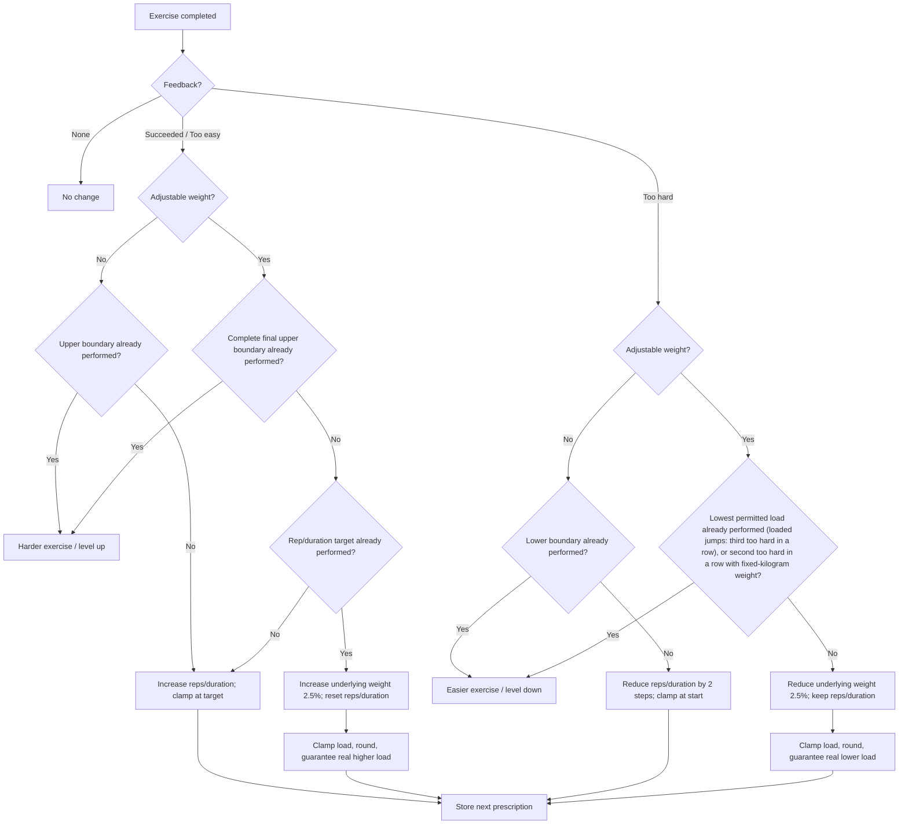

# Standard Exercise Progression

## Purpose and scope

This specification defines standard progression for:

- hypertrophy,
- explosive power,
- power endurance,
- stability,
- prevention.

Max strength and cardio use their own progression specifications.

Per exercise, progression may use:

- achieved repetitions or duration,
- prescribed weight,
- feedback (`too easy`, `succeeded`, `too hard`),
- progression mode (`advance-by-reps` or `advance-by-duration`),
- whether the exercise uses adjustable external weight,
- authored start, target, and load boundaries.

Start/target values may depend on fitness level, gender, and age group unless this specification defines a global override. The authored value configuration is the source of truth for values not overridden here. For hypertrophy, full-body stability, and prevention, the training-area-specific repetition and duration ranges defined in this specification override exercise-specific authored repetition/duration values. Exercise-specific weight rules remain unchanged.

Warm-up, special warm-up, speed warm-up, cool-down, mobility, foam roller, and strength-test exercises do not use this progression and do not collect progression feedback. Speed warm-up durations follow [Speed warm-up](#speed-warm-up).

Exercise-specific history is stored per athlete and survives plan regeneration. One feedback event must be consumed only once.

## Out of scope

- Max strength progression: [Max Strength Training](./max-strength-progression.md)
- Cardio progression: [Cardio Training System](../session/cardio-training-system.md)
- Branch/level changes and substitution rules: [Branches, Exercises, and Levels](../foundations/branches-exercises-and-levels.md)
- Initial weight derivation, equipment conversion, and rounding rules: [Weight Calculation from Strength Tests](./weight-calculation-from-strength-tests.md)
- Sets, pauses, and warm-up sets: [Session Set Structure](../session/session-set-structure.md)
- Manual value adjustment
- Additional future feedback options
- Automatic height progression
- A separate strength-endurance skill

## Core model

Progression follows:

1. repetitions **or** duration,
2. weight, if adjustable,
3. branch level / exercise variant.

An exercise never uses repetitions and duration as progression modes at the same time.

A **ladder step** changes repetitions/duration:

| Mode | 1 step | 2 steps |
|---|---:|---:|
| Repetitions | 1 rep | 2 reps |
| Duration | 5 s | 10 s |

A **weight step** changes the underlying unrounded training weight by **±2.5%**.

A single feedback event must never simultaneously increase repetitions/duration and weight.

## Authored values

### Hypertrophy

All exercises assigned to **Hypertrophy / Muskelaufbau** use the same standard repetition/duration ranges. Exercise difficulty is changed through the Skill Tree / branch progression, not by extending these ranges.

These repetition and duration ranges are progression boundaries; they do not by themselves guarantee a sufficient hypertrophy stimulus. Difficulty feedback should reflect whether the prescribed work was appropriately challenging while maintaining technically valid execution.

| Exercise type | Start | Target |
|---|---:|---:|
| Adjustable weight - repetitions | 8 reps | 12 reps |
| Adjustable weight - duration | 30 s | 50 s |
| No adjustable weight - repetitions | 8 reps | 12 reps |
| No adjustable weight - duration | 30 s | 60 s |

If a no-weight hypertrophy exercise is too easy at its upper boundary, use a harder exercise variant instead of extending the hypertrophy range.

There is currently only one hypertrophy training logic. A separate **strength-endurance / Kraftausdauer** logic is planned for a later implementation. Until that separate logic is specified and implemented, all current muscle-building work uses the hypertrophy rules in this document and no separate 15-20-rep / 60-80-s strength-endurance range is active.

### U16 weighted exercises

Athletes under 16 currently do not use F-Max-based weight calculation. Weighted U16 exercises use fixed authored weight values, which may depend on exercise and gender.

### Speed warm-up

Speed warm-up (WUSKSA) exercises use fixed authored durations:

- every duration is at most 30 s; a longer authored value is capped at 30 s;
- a shorter authored duration stays unchanged;
- an exercise without an authored duration uses 30 s;
- durations never change between sessions, and the speed warm-up collects no feedback.

The special warm-up (WUSPEZIAL) is not affected by this rule.

## Feedback rules

### Exercises without adjustable weight

| Feedback | Change |
|---|---|
| `succeeded` | +1 ladder step |
| `too easy` | +2 ladder steps |
| `too hard` | -2 ladder steps |
| no feedback | no change |

Values are clamped to the resolved start/target range. For hypertrophy repetitions/duration, the global ranges defined in this specification are the resolved boundaries even if an exercise catalog entry contains different authored repetition/duration values.

If a step reaches a boundary, that boundary must be prescribed, performed, and evaluated before a branch-level change occurs.

### Exercises with adjustable weight

For `succeeded` and `too easy`:

- below the repetition/duration target: increase only repetitions/duration;
- `succeeded` = +1 ladder step;
- `too easy` = +2 ladder steps;
- clamp at the repetition/duration target;
- do not increase weight in the same feedback event.

If the repetition/duration target has already been performed and receives positive feedback:

- increase weight by one weight step;
- reset repetitions/duration to the authored start value.

For `too hard`:

- reduce only weight by one weight step;
- keep repetitions/duration unchanged.

For no feedback:

- no change.

## Weight progression

One weight step is calculated from the **current underlying unrounded training weight**:

> increase = current underlying weight × 1.025

> reduction = current underlying weight × 0.975

The underlying progression value is calculated first. The final loadable prescription is then rounded according to [Weight Calculation from Strength Tests](./weight-calculation-from-strength-tests.md).

### Guaranteed real load change

Every intended weight increase/reduction must produce a real change in prescribed load:

- an increase compares with the rounded load of the previous underlying value;
- a reduction compares with the load the athlete last performed.

If ±2.5% rounds to the same usable load:

- increase → use at least the next available higher load;
- reduction → use at least the next available lower load.

The rounded execution load must **not** replace the underlying unrounded progression value used for future ±2.5% calculations. The next weight step always starts from the underlying value. If that step rounds to the load the athlete already performed, the athlete performs that load again; no second forced jump occurs.

Example (barbell, 2.5 kg increments):

| Step | Underlying value | Rounded load | Prescribed load |
|---|---:|---:|---:|
| Start | 40 kg | 40 kg | 40 kg |
| +2.5% | 41 kg | 40 kg | 42.5 kg (forced jump) |
| +2.5% | 42.03 kg | 42.5 kg | 42.5 kg (same load again) |
| -2.5% after the forced jump (from 41 kg) | 39.98 kg | 40 kg | 40 kg (real change from the performed 42.5 kg) |

If the next available load lies above the target load, the target load wins; see [Load boundaries](#load-boundaries).

### Load boundaries

Authored start and target loads must be loadable increments according to [Weight Calculation from Strength Tests](./weight-calculation-from-strength-tests.md). If an authored load is not loadable, it is rounded with the same rules before it is used as a boundary.

The underlying progression value is clamped to the authored load limits:

```text
increase: nextUnderlyingWeight = min(calculatedIncrease, targetWeight)
reduction: nextUnderlyingWeight = max(calculatedReduction, lowestPermittedWeight)
```

The equipment-specific rounded execution load is derived afterward.

The target load takes priority over the guaranteed real load change: an increase never prescribes a load above the rounded target load. If the clamped increase produces no real load change, the target load counts as reached.

A load boundary counts as reached as soon as the rounded execution load reaches the rounded target load or the rounded lowest permitted load.

## Boundary rules

### Upper boundary without adjustable weight

The authored target repetition/duration is the final upper boundary.

After that boundary has actually been performed:

- `succeeded` or `too easy` → harder exercise / level up;
- `too hard` → -2 ladder steps;
- no feedback → no change.

### Upper boundary with adjustable weight

The complete final upper boundary requires both:

- final authored repetition/duration target;
- final authored target load.

The complete final target must be performed before changing the exercise/level.

After it has been performed:

- `succeeded` or `too easy` → harder exercise / level up;
- `too hard` → reduce weight by one weight step; repetitions/duration unchanged;
- no feedback → no change.

Target-load checks treat the boundary as reached when the rounded execution load is **at or above** the rounded target load, or when the underlying value is at or above target, while the stored progression value remains clamped to target. When an increase cannot produce a real load change without exceeding the target load, the target load also counts as reached (see [Load boundaries](#load-boundaries)).

### Lower boundary without adjustable weight

The authored start value is the lower repetition/duration boundary.

A `too hard` step that would go below start is clamped to start. The lower boundary must then be performed.

After it has been performed:

- `too hard` → easier exercise / level down;
- `succeeded` or `too easy` → progress upward normally;
- no feedback → no change.

### Lower boundary with adjustable weight

Regression occurs through weight; repetitions/duration stay unchanged.

Weight may be reduced step by step to the exercise's **lowest permitted load**, even when that load is below the normal start load.

Only after the lowest permitted load has been performed and is still `too hard` does the branch-level system select an easier exercise / level.

For weighted hypertrophy, repetitions remain 8-12 and duration remains 30-50 s during weight regression.

**Fixed-kilogram weights:** exercises whose weight is authored in fixed kilograms (full-body stability, weighted prevention, U16 weighted exercises) have no lowest permitted load. The first `too hard` reduces the weight by one weight step. A second `too hard` in a row emits `LEVEL_DOWN` instead of another reduction. Any other feedback resets the count. The count of consecutive `too hard` ratings is part of the stored exercise progress.

Pure explosive exercises, for example loaded jumps, carry authored load limits in the exercise catalog. Those limits take priority over the skill's load range, so the explosive power floor of 50% F-Max does not apply to them. The exercise catalog must author these load limits for every loaded jump exercise and fitness level, as a share of the knee-direction 1RM converted to the equipment (see [Weight Calculation from Strength Tests](./weight-calculation-from-strength-tests.md)):

| Fitness level | Start load | Target load |
|---|---:|---:|
| Beginner | 5% | 10% |
| Advanced | 10% | 20% |
| Professional | 10% | 20% |

The lowest permitted load of a loaded jump exercise equals its start load. Reaching that load does not emit `LEVEL_DOWN` by itself: a `too hard` at the lowest permitted load keeps the load, and only the third `too hard` in a row emits `LEVEL_DOWN`, as described below.

The two jump exercises, jump squats and jumped lunges, add one exit: the third `too hard` in a row moves the athlete off the exercise, as a level down does. Every other exercise follows the rules above. The count of consecutive `too hard` ratings is part of the stored exercise progress.

## Progression flow



## Height

Automatic height progression is not implemented.

For exercises using repetitions + height:

- height stays fixed;
- only repetitions progress;
- the final repetition target at that fixed height is treated as the exercise's final target;
- after positive feedback at that performed target, the branch system selects the next exercise;
- height is not increased and repetitions are not reset for another height stage.

A later implementation may add height progression analogous to weight progression.

## Default start, target, and load values

These are the current general values where the authored content resolves to the corresponding training area.

| Training area | Start | Target | Load / notes |
|---|---:|---:|---|
| Explosive power with adjustable weight | 4 reps | 6 reps | Beginner 52.5-65% F-Max; Advanced 55-67.5%; Professional 55-70%; lowest load 50%; authored targets at most 8 reps (catalog rule, no cap on stored values) |
| Pure explosive exercises with an authored load limit | 4 reps | 6 reps | The exercise catalog's load limits replace the skill's load range; loaded jumps author Beginner 5-10%, Advanced and Professional 10-20% of the knee-direction 1RM, see Lower boundary with adjustable weight; authored targets at most 8 reps (catalog rule, no cap on stored values) |
| Explosive power without adjustable weight | 4 reps | 6 reps | General default; authored targets at most 8 reps (catalog rule, no cap on stored values) |
| Plyometrics | 4 reps | 12 reps | Authored values apply; these defaults apply only where values are missing; the 8-rep maximum of explosive power does not apply |
| Hypertrophy, adjustable weight, reps | 8 reps | 12 reps | Beginner 67.5-75%; Advanced 70-77.5%; Professional 70-77.5%; lowest load 65% |
| Hypertrophy, adjustable weight, duration | 30 s | 50 s | Same weight-boundary logic |
| Hypertrophy, no adjustable weight, reps | 8 reps | 12 reps | Standard hypertrophy range |
| Hypertrophy, no adjustable weight, duration | 30 s | 60 s | Standard hypertrophy range |
| Full-body stability, adjustable weight, reps | 8 reps | 12 reps | Exercise-specific start/target weights; no F-Max calculation; second `too hard` in a row → level down |
| Full-body stability, adjustable weight, duration | 30 s | 50 s | Exercise-specific start/target weights; no F-Max calculation; second `too hard` in a row → level down |
| Full-body stability, no adjustable weight, reps | 8 reps | 12 reps | standard Full-body stability range |
| Full-body stability, no adjustable weight, duration | 30 s | 60 s | standard Full-body stability range |
| Leg-axis stability | 5 reps / 30 s | 8 reps / 45 s | Exercise-specific |
| Prevention | 10 reps / 40 s | 15 reps / 60 s | Same range with and without weights; weighted exercises use exercise-specific start/target weights, no F-Max calculation; second `too hard` in a row → level down |
| U16 weighted exercises | per training area | per training area | Fixed authored **weight** values; no F-Max calculation; second `too hard` in a row → level down. Repetition/duration follows the applicable training-area rules; for hypertrophy use 8-12 reps or 30-50 s for weighted duration. |
| Speed warm-up | authored | authored | Fixed duration, at most 30 s, 30 s when missing; no progression, see [Speed warm-up](#speed-warm-up) |

**Full-body stability – exercise-specific weights:**
For weighted exercises, use the existing exercise-specific start and target weights. These weights are not calculated from strength tests or F-Max. No general weight values apply to this training area. Authored weights must be loadable increments; see [Load boundaries](#load-boundaries).

## Deferred feedback

When progression is deferred to the next generation, stored feedback is applied exactly once using the feedback rules above. After application, the stored feedback is consumed.

## Worked example

Weighted hypertrophy, repetition-based:

- start: 8 reps
- target: 12 reps
- underlying training weight: 38 kg

| Session | Feedback | Next prescription |
|---|---|---|
| 1: 8 reps | `succeeded` | 9 reps, same weight |
| 2: 9 reps | `too easy` | 11 reps, same weight |
| 3: 11 reps | `too easy` | 12 reps, same weight |
| 4: 12 reps | `succeeded` | +2.5% underlying weight, reset to 8 reps |
| 5: new weight | `too hard` | -2.5% underlying weight, keep 8 reps |

Session 3 stops at 12 reps even though `too easy` normally adds two ladder steps. The same feedback event does not also increase weight.

Weight example:

> 38 kg × 1.025 = 38.95 kg

The result is rounded using [Weight Calculation from Strength Tests](./weight-calculation-from-strength-tests.md). If rounding gives the same usable load, use the next real available load in the intended direction.

## State and persistence

Store per exercise, where applicable:

- last prescribed/achieved repetitions,
- last prescribed/achieved duration,
- underlying unrounded training weight,
- rounded/loadable prescribed weight,
- weight type,
- authored height,
- pending feedback,
- current progression position.

Per-branch levels are stored separately.

The underlying unrounded weight remains the source for future ±2.5% calculations. The rounded value is only the execution prescription.

Stored repetitions and durations always stay within the currently resolved start and target values. Each session generation clamps them, for every training area, so a later change to authored or global values takes effect for athletes with existing progress.

Pending feedback is the handover token between session completion and next-generation application.

After a level change:

- previous exercise progression remains stored;
- the new exercise starts with its resolved start values; for hypertrophy repetitions/duration, use the global hypertrophy start values from this specification rather than exercise-specific authored repetition/duration values.

This preserves history for a future manual exercise-swap feature.