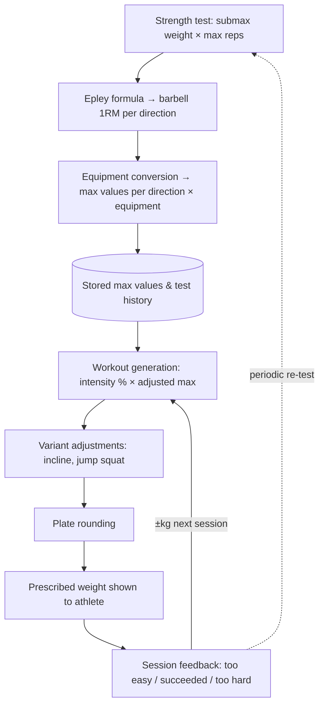

# Weight Calculation from Strength Tests

## Why & What

Athletes should never have to guess a training weight. The app uses a **test-then-train** model: periodic barbell **strength tests** per movement direction yield an estimated **1RM** (one-rep max), from which every prescribed training weight is derived automatically, adjusted for equipment, training phase, and exercise variant, and rounded to loadable plate increments.

## Problem

Self-selected weights are unreliable: beginners underload, ambitious athletes overload, and neither adapts systematically over a training cycle. Trainers cannot supervise every session, so weight selection is the hardest programming decision the athlete faces alone. Weights must also stay coherent across equipment (a barbell test result does not transfer per-hand to a dumbbell) and across phases with different intensity goals.

## Solution

Derive all weights from a single measured quantity per movement direction: the barbell 1RM. The chain is deterministic: test result, 1RM estimate, equipment-adjusted max values, phase-specific intensity percentage, plate rounding. Session feedback nudges the next session's weight, keeping the prescription adaptive between tests.

Rejected alternative: direct 1RM testing (a true single-rep max attempt) is unsafe for unsupervised athletes. A submaximal rep-out with the **Epley formula** estimates 1RM with acceptable error and far lower injury risk.

## Out of Scope

- Rep and set scheme selection per phase (only the weight is specified here)
- Mesocycle progression logic for hypertrophy and endurance phases
- Exercise selection and plan generation
- Bodyweight-only exercises (no external load to calculate)
- The web tool workflow for authoring per-exercise intensity data

## Algorithm

### 1. 1RM estimation (Epley)

The athlete lifts a submaximal test weight for as many reps as possible:

> **1RM = test weight × (1 + reps / 30)**

Edge case: at exactly 1 rep the test weight itself is the 1RM.

*Example: 80 kg × 8 reps → 80 × (1 + 8/30) ≈ 101 kg.*

### 2. Movement directions

Strength is tracked independently per **movement direction**; each has its own barbell test exercise and its own 1RM:

| Direction | Typical test exercise |
|---|---|
| Horizontal push | Barbell bench press |
| Horizontal pull | Barbell row |
| Vertical push | Barbell overhead press |
| Vertical pull | Weighted pull-up |
| Hip | Barbell hip thrust / deadlift |
| Knee | Barbell squat |
| Lower body | Barbell squat variant |

Every exercise is tagged with one direction, which selects the 1RM it references.

### 3. Equipment conversion

Each 1RM expands into **adjusted max values** per equipment variant, giving a direction × equipment lookup of ready-to-use maxima:

| Equipment variant | % of barbell 1RM | Rationale |
|---|---|---|
| Barbell | 100% | Test result as-is |
| Dumbbells (per hand) | 45% | 90% of barbell load, split over two hands |
| Single-arm upper body | 45% | Same as dumbbell per hand |
| Single-leg barbell | 45% | Reduced for unilateral loading |
| Single-leg dumbbell | 22.5% | 45% single-leg, halved for one dumbbell |
| Single-leg with support | 30% | 60% supported stance, halved for one dumbbell |

### 4. Training weight per phase

Per-exercise intensity percentages come from authored intensity data; the phase determines the typical range:

| Training phase | German term | Typical % of 1RM | Goal |
|---|---|---|---|
| Max strength | Max-Kraft | 70-90% | Peak force production |
| Hypertrophy | Muskelaufbau | 60-80% | Muscle growth |
| Speed strength | Schnellkraft | 50-70% | Explosive power |
| Speed endurance | Schnelligkeitsausdauer | 30-50% | Sustained high-speed output |

> **Training weight = intensity % × equipment-adjusted max value for the exercise's direction**

### 5. Variant adjustments

- **Incline bench press** (horizontal push + incline equipment tag): barbell variant uses 1RM − 7.5 kg; dumbbell variant uses 40% per hand instead of 45%.
- **Jump squat** (barbell or dumbbell): bodyweight-relative start weight, capped for safety:
  > **Start weight = ((squat 1RM + body weight) × 0.4) − body weight**, capped at **25% of squat 1RM**.

### 6. Plate rounding

Every calculated weight is rounded to a loadable increment:

| Weight range | Rounded to |
|---|---|
| ≤ 25 kg | 0.5 kg |
| 25-100 kg | 1 kg |
| > 100 kg | 2.5 kg |

### 7. Max strength session progression

Max strength sessions (warm-up sets, then high-intensity working sets) adjust between sessions from athlete feedback:

| Feedback | Next session |
|---|---|
| Too hard | −5 kg |
| Succeeded | +2.5 kg |
| Too easy | +2.5 kg |

Working sets never drop below an intensity floor: 72.5% of 1RM for professionals, 70% for advanced and beginners. Set counts and reps-per-weight tables vary by age group and training level.

### 8. Strength test session protocol

1. General warm-up (~5 min, mobility work).
2. Per tested direction: 50% × 12 reps (warm-up), 75% × 8 reps (warm-up), 100% × max reps (test set); 60 s rest between exercises, 120 s after the test set.
3. Starting test weight: returning athletes 65% of last 1RM (professionals 70%); first-time athletes a per-exercise default.
4. Test set result feeds the Epley formula (step 1), producing the new 1RM.

## Structure

Entities: the **test history** (past test results per direction) and the **max value table** (direction × equipment maxima) are the persistent state; everything downstream is recomputed per workout. Intensity percentages are authored content (per exercise, per phase), not athlete state.

## Open Questions

- Should "too easy" progress faster than "succeeded"? Both currently yield +2.5 kg, so honest feedback about an underloading session is not rewarded. Leaning yes: a larger step for "too easy".
- Why do beginners and advanced athletes share the same 70% intensity floor? Options: keep the shared floor, or set a lower beginner floor for gentler technique-focused sessions. Needs a sports-science decision.
- Should the re-test cadence be prescribed by the system (e.g. every N mesocycles) instead of left to the athlete/trainer? Feedback-based drift accumulates error between tests.
