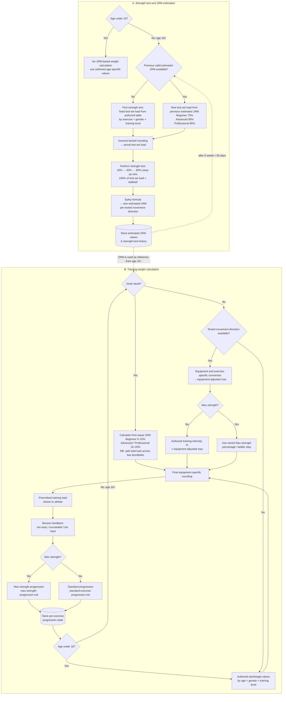

# Weight Calculation from Strength Tests

## Why & What

Athletes should not have to guess training weights.
For weighted exercises linked to a tested movement direction, the app uses a **test-then-train** model:
strength test → estimated 1RM → equipment/exercise adjustment → authored training intensity → final rounding.
Exercises without a test-based reference use authored start and target values instead.

## Problem

Self-selected weights are hard to standardize across athletes, equipment variants, training phases, and repeated sessions.
A barbell 1RM cannot be transferred directly to another equipment setup, and some weighted exercises intentionally do not use test-based calculation at all.
This specification therefore distinguishes between:
1. test-based weight calculation,
2. authored exercise values,
3. exercise-specific exceptions,
4. final load rounding,
5. progression logic owned by other specifications.

## Solution

For test-based exercises:
> strength test → estimated barbell 1RM → movement-direction reference → equipment/exercise conversion → authored intensity → final rounding
For exercises without a tested movement direction:
> authored start/target values by training level, gender, and age group
A true direct 1RM attempt is not required. The app uses a submaximal AMRAP test set and estimates the theoretical 1RM with the **Epley formula**.

## Out of Scope

- Set and repetition scheme selection for normal sessions
- General exercise progression: [Standard Exercise Progression](./standard-exercise-progression.md)
- Max-strength progression: [Max Strength Training](./max-strength-progression.md)
- Cardio progression: [Cardio Training System](../session/cardio-training-system.md)
- Exercise selection and plan generation
- Strength-test session flow, soreness handling, reps, rests, and UI: [Plan-Independent Workouts](../session/plan-independent-workouts.md)

## Algorithm

### 1. 1RM estimation (Epley)

The athlete performs the submaximal test-set load for as many technically valid repetitions as possible.
> **Estimated 1RM = actual test-set load × (1 + repetitions / 30)**
If exactly 1 repetition is completed, the actual test-set load is treated as the estimated 1RM.
Example:
> 80 kg × 8 reps → 80 × (1 + 8 / 30) ≈ 101 kg
The Epley calculation uses the **actual rounded AMRAP test-set load**.

### 2. Movement directions

Strength-test-based calculation exists only for:
| Direction | Test exercise | Test-based calculation |
|---|---|---|
| Horizontal push | Barbell bench press | Yes |
| Horizontal pull | Bent-over barbell row | Yes |
| Vertical push | Barbell overhead press | Yes |
| Hip-dominant lower body | Barbell deadlift | Yes |
| Knee-dominant lower body | Barbell squat | Yes |
There is currently **no vertical-pull strength test** and **no generic lower-body movement direction**.
**Age gate:** athletes **under 16** always use authored age-specific start/target weight values, even if an exercise is assigned to a tested movement direction. Test-/1RM-based personal weight calculation applies from **age 16 onward**.
Weighted exercises without a tested movement direction also use authored start/target values.
Those values may depend on training level, gender, and age group (e.g. U16 vs 16+).
Examples include weighted core exercises and other lower-body exercises such as barbell calf raises.

### 3. Equipment conversion

For test-based exercises, convert the estimated barbell 1RM into an equipment-specific adjusted max.
| Equipment variant | % of barbell 1RM | Rule |
|---|---:|---|
| Barbell | 100% | Use movement-direction 1RM as-is |
| Dumbbells, per hand | 42.5% | 85% of barbell load, split over two hands |
| Single-arm upper body | 42.5% | Same as one dumbbell per hand |
| Single-leg barbell | 45% | Unilateral lower-body conversion |
| Single-leg dumbbell, per hand | 22.5% | 45% single-leg load, split over two dumbbells |
| Single-leg with support, barbell | 60% | Supported unilateral lower-body conversion |
| Single-leg with support, dumbbell per hand | 30% | 60% supported load, split over two dumbbells |
More specific exercise rules override these generic conversions.

### 4. Training weight per phase

The exact intensity percentage comes from **authored intensity data for the specific exercise and phase**.
The following ranges are **informational only** and must not be used to choose, clamp, or infer intensity unless another specification explicitly says so.
| Training phase | German term | Informational range | Goal |
|---|---|---:|---|
| Max strength | Max-Kraft | 70–90% | Peak force production |
| Hypertrophy | Muskelaufbau | 60–80% | Muscle growth |
| Explosive power | Schnellkraft | 50–70% | Explosive power |
| Power endurance | Schnellkraftausdauer | 30–50% | Sustained high-speed output |
For normal test-based weighted exercises:
> **Unrounded training weight = authored intensity % × equipment-adjusted max**
The ranges above are not fallback values, minimums, or maximums.
**Max strength:** starting intensities, ladders, and floors are defined exclusively in [Max Strength Training](./max-strength-progression.md). Max-strength percentages/floors apply to the **equipment-adjusted max value**.
**Power endurance:** the calculation logic remains valid but is currently not selected by active workout generation.

### 5. Exercise-specific adjustments

#### Incline bench press

Reference: horizontal-push barbell bench-press 1RM.
**Barbell incline bench press**
> **Adjusted max = bench-press 1RM × 90%**
**Dumbbell incline bench press**
> **Adjusted max per hand = bench-press 1RM × 38.25%**
The 38.25% already includes:
> 90% incline factor × 85% dumbbell factor ÷ 2 hands
Do not apply another generic dumbbell factor.

#### Jump squat

Reference: knee-dominant lower-body barbell squat 1RM.
The previous bodyweight-relative formula and 25% cap no longer apply.
| Athlete level | Start load | Target load |
|---|---:|---:|
| Beginner | 5% of squat 1RM | 10% of squat 1RM |
| Advanced | 10% of squat 1RM | 20% of squat 1RM |
| Professional | 10% of squat 1RM | 20% of squat 1RM |
These percentages define **total external load**.
For a barbell jump squat, use that total barbell load.
For a two-dumbbell jump squat:
1. calculate total external load,
2. split equally across both dumbbells,
3. apply final dumbbell-per-hand rounding.
No 85% dumbbell conversion and no 42.5% per-hand conversion applies to jump squats.
Example:
> total load 10 kg → 5 kg per dumbbell before rounding

### 6. Weight rounding

Apply rounding **only after all movement-direction, equipment, exercise-specific, and training-intensity calculations**.
If the calculated value lies exactly halfway between two available increments, round **down**.

#### 6.1 General rounding

Applies to strength-test loads and normal weighted exercises unless a specific rule overrides it.
**Dumbbell, per hand**
- ≤10 kg: nearest 1 kg
- >10 kg: nearest 2 kg
The value refers to **one dumbbell per hand**.
**Barbell, total load**
- all weights: nearest **2.5 kg**
The value refers to **total load including the bar**.
**Other weighted exercises**
- all weights: nearest 1 kg

#### 6.2 Max-strength rounding

Max strength uses the **same equipment-specific rounding rules as all other training phases**. There is no separate Max-strength rounding increment.

Further Max-strength progression is based on the **stored percentage/ladder step**, not the rounded kilogram value.
The rounded kilogram value is only the execution value shown to the athlete.

### 7. Max-strength progression

Max-strength progression is **not defined here**.
Do not apply fixed kilogram changes from this file.
The following are owned by [Max Strength Training](./max-strength-progression.md):
- set-specific percentage/repetition ladders,
- feedback-driven ladder movement,
- starting intensities,
- intensity floors,
- level-specific rules,
- completion and progression state.
This document only defines the final load rounding after the max-strength percentage step is resolved.

### 8. Strength-test reference load and 1RM update

This section defines strength-test reference loads and the resulting 1RM update for athletes **aged 16+**. U16 athletes use authored age-specific weight values instead of 1RM-derived training weights.
Session flow, soreness handling, repetitions, rests, and UI generation are owned by [Plan-Independent Workouts](../session/plan-independent-workouts.md).

#### 8.1 Fixed test-exercise order

Every strength test uses the same order:
| Order | Test exercise | Movement direction |
|---:|---|---|
| 1 | Barbell squat | Knee-dominant lower body |
| 2 | Barbell deadlift | Hip-dominant lower body |
| 3 | Barbell bench press | Horizontal push |
| 4 | Bent-over barbell row | Horizontal pull |
| 5 | Barbell overhead press | Vertical push |
There is no vertical-pull test.
The exercise order does not change by gender or training level.

#### 8.2 First strength test: authored test-set loads

If no previous valid estimated 1RM exists, use the following absolute **test-set load**.
These values are 100% **test-set loads**, not 100% 1RM values.
| Test exercise | Beginner female | Advanced female | Professional female | Beginner male | Advanced male | Professional male |
|---|---:|---:|---:|---:|---:|---:|
| Barbell squat | 30 kg | 45 kg | 60 kg | 40 kg | 60 kg | 80 kg |
| Barbell deadlift | 30 kg | 45 kg | 60 kg | 40 kg | 60 kg | 80 kg |
| Barbell bench press | 20 kg | 25 kg | 30 kg | 35 kg | 50 kg | 60 kg |
| Bent-over barbell row | 20 kg | 30 kg | 35 kg | 30 kg | 45 kg | 55 kg |
| Barbell overhead press | 15 kg | 20 kg | 25 kg | 25 kg | 30 kg | 40 kg |
Gender affects only the first-test load values, not the test list or order.

#### 8.3 Second and later strength tests

If a previous valid estimated 1RM exists:
| Athlete level | Test-set load |
|---|---:|
| Beginner | 75% of previous estimated 1RM |
| Advanced | 80% of previous estimated 1RM |
| Professional | 85% of previous estimated 1RM |
Round the test-set load with the **general barbell rounding rule** before use.

#### 8.4 Meaning of 100%

Two different reference bases exist.
**100% 1RM**
> the athlete's estimated theoretical reference maximum for that test exercise
**100% test-set load**
> the full submaximal AMRAP test load
From the second test onward, 100% test-set load equals:
- Beginner: 75% of previous estimated 1RM
- Advanced: 80%
- Professional: 85%
It does **not** mean 100% of estimated 1RM.

#### 8.5 Ramp-up load reference

Ramp-up percentages refer to the **actual rounded test-set load**, not directly to the estimated 1RM.
Resolve and round the test-set load first, then calculate and round each ramp-up load with the general barbell rounding rule.
| Set | % of test-set load |
|---|---:|
| Ramp-up set 1 | 40% |
| Ramp-up set 2 | 60% |
| Ramp-up set 3 | 85% |
| AMRAP test set | 100% |
Repetitions and rests are defined in [Plan-Independent Workouts](../session/plan-independent-workouts.md).

#### 8.6 Updating the estimated 1RM

After the AMRAP test set:
1. use the actual rounded test-set load performed,
2. use the number of technically valid repetitions,
3. calculate the new estimated 1RM with the Epley formula,
4. store it for the tested movement direction,
5. append the result to strength-test history.
The new estimated 1RM becomes the reference for later weight calculations and the next strength test.

#### 8.7 Re-test cadence

A new strength test becomes due automatically **8 weeks / 56 days after the last completed strength test**.
The due-state belongs to training logic; the message/screen presentation is a UI concern.

## Structure

### Persistent state

Persist:
- strength-test history,
- estimated 1RM values per tested movement direction,
- per-exercise progression state used by Standard Exercise Progression,
- max-strength percentage/ladder state used by Max Strength Training.
Rounded kilogram values are execution values and must not replace underlying percentage-based progression state.
Authored content supplies:
- first-test load values,
- exercise intensity data,
- exercise start/target values,
- age-, gender-, and level-specific values where applicable.
