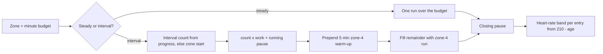

# Cardio Training System

## Why & What

Cardio is the endurance half of the training system: every plan section carries one **zone** (a heart-rate intensity band with its own interval structure), and CARDIO days spend their whole minute budget in it. A cardio block alternates one work interval with a timed running pause, or runs steadily for the whole budget, under a heart-rate band the athlete must hold. This spec defines the six zones, how each one turns a minute budget into a set list, and how the work progresses between sessions.

## Problem

A CARDIO day shows the athlete a timer and a heart-rate target, and neither traces to a written rule. The zones differ in work length, pause length, interval count, heart-rate band, and whether they run as intervals at all, and those values live in the generator alone. Nothing records how the generator fills a 45-minute budget, or which quantity moves when a session feels easy. Two heart-rate formulas coexist, so the band on screen matches no documented decision.

## Solution

Six authored zones, split into two structures:

- **Steady zones** (CARDIO_4, CARDIO_5): one continuous run for the full budget.
- **Interval zones** (CARDIO_1_SHORT, CARDIO_1_LAKTAT, CARDIO_2, CARDIO_3): a fixed work interval alternating with a running pause, repeated an athlete-specific number of times, then padded to the budget with zone-4 running.

The heart-rate band comes from the athlete's age, which lets the same structure run on a treadmill, a track, and outdoors. For interval zones the ladder is the **interval count**: the work interval defines the zone and holds constant across sessions.

## Out of Scope

- Which day of the week gets cardio and which zone a section carries: [Training Plan Creation](../planning/training-plan-creation-from-anamnesis.md)
- Branch and exercise selection for the cardio skill: [Plan Workout Generation](./plan-workout-generation.md)
- Strength set structure, supersets, and rest tables: [Session Set Structure](./session-set-structure.md)
- Live heart-rate measurement, external sensors, and GPS tracking

## Algorithm

### Zones

Zone numbering runs from hardest (1) to easiest (5). Zone 1 has two variants: short sprint intervals and lactate intervals. The heart-rate band is a fraction of the age-based maximum, **max HR = 210 - age**.

| Zone | Purpose | Structure | Work | Running pause | Heart-rate band |
|---|---|---|---|---|---|
| CARDIO_1_SHORT | Sprint intervals | intervals | 10 s | 80 s | not authored |
| CARDIO_1_LAKTAT | Lactate tolerance | intervals | 30 s | 240 s | 80 to 95% |
| CARDIO_2 | Maximal aerobic power | intervals | 60 s | 60 s | 90 to 100% |
| CARDIO_3 | Extensive intervals | intervals | 120 s | 60 s | 80 to 95% |
| CARDIO_4 | Steady endurance | steady run | full budget | 60 s closing | 65 to 80% |
| CARDIO_5 | Regeneration | steady run | full budget | 60 s closing | 55 to 65% |

Goalkeepers train short sprint intervals in place of lactate intervals; plan creation makes the substitution.

### Building the block

Input: the zone, its minute budget, the selected cardio exercise, and today's soreness.

1. **Steady zones**: emit one entry over the whole budget, then a 60 s closing pause. Lower-body soreness caps the budget at 20 minutes.
2. **Interval zones**:
   1. Take the interval count from the athlete's stored value for that exercise, otherwise the zone's start value.
   2. Emit `count` pairs of (work interval, running pause) at the zone's lengths, subtracting both from the remaining budget.
   3. With more than 5 minutes still remaining, prepend a 5-minute zone-4 warm-up run.
   4. With more than 1 minute still remaining, append a zone-4 filler run over the remainder, then a closing pause of the zone's pause length.

The block therefore always consumes its budget: intervals first, warm-up and filler absorb the rest.

```text
CARDIO_2 BLOCK  ── 20 min budget, interval count 4
──────────────────────────────────────────────────────────────
  [5 min zone-4 warm-up]
  60 s work | 60 s running pause      x4
  [zone-4 filler over the remainder] [60 s closing pause]
```

### Progression

The interval count is the ladder. Per zone and training level, authored start and target counts bound it, and session feedback moves it by the zone's adjustment step. Zone 2 as the example:

| Training level | Start count | Target count |
|---|---|---|
| BEGINNER | 3 | 7 |
| ADVANCED | 4 | 9 |
| PROFESSIONAL | 6 | 12 |

| Feedback | Step |
|---|---|
| Too easy | +1 |
| Succeeded | +1 |
| Too hard | -2 |

Rules:

- A cardio block writes its result once per session, taken from the main cardio entry (the last interval or run belonging to a real branch), not once per interval.
- Cardio never changes a branch level, so reaching the target count raises nothing further: the target and the minute budget cap the count.
- Steady zones progress by duration through the same feedback mechanism, bounded by the skill's minute budget.

### Soreness and blocking

| Condition | Effect |
|---|---|
| Lower-body soreness, steady zone | Budget capped at 20 minutes |
| Lower-body soreness, interval zone | Whole cardio skill replaced by steady zone 5, capped at 20 minutes |
| More than one sore area | Generation aborts with a soreness error (all skills) |
| Place without run equipment | The day loses cardio at plan creation and trains stability instead |

## Structure

A cardio skill in a plan carries one zone and a minute budget. Generation resolves the zone's branch to an exercise, then expands it into a set list of alternating work and pause entries; the pause entries are ordinary set-list entries, so the workout UI drives them with the same timer as strength rests. Generation computes the heart-rate band per entry from the athlete's birthday and the zone, and the workout UI shows it beside the timer. Progress holds the interval count per exercise, like any other exercise.



## Open Questions

- Two heart-rate formulas exist: the per-zone fraction of `210 - age`, and a Karvonen calculation over a fixed resting rate of 65 with three coarse bands. Athletes see the per-zone table. Should the Karvonen path go, or does it become the model once the app collects resting heart rate? Leaning toward dropping it until the anamnesis asks for a resting rate.
- CARDIO_1_SHORT has no authored heart-rate band and falls back to 100% of max HR, so the athlete sees one number where every other zone shows a range. Author a sprint band, or hide the display for that zone? Leaning toward authoring a band.
- The short-interval pause is 80 s in the block builder and 50 s in the generic skill pause table, and the builder wins today. Which value is correct? Leaning toward the builder's 80 s, the value the zone table above documents.
- Cardio results run through the same start and target comparison as strength exercises, which can read a missing repetition value as below start. Should cardio get its own evaluation path, given that it never changes a branch level? Leaning yes.
