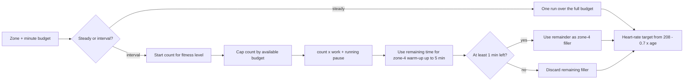

# Cardio Training System

## Why & What

Cardio is the endurance half of the training system: every plan section carries one **zone** (a heart-rate intensity band with its own interval structure), and CARDIO days spend their whole minute budget in it. A cardio block alternates one work interval with a timed running pause, or runs steadily for the whole budget, under a heart-rate target the athlete should follow. This spec defines the six zones, how each one turns a minute budget into a set list, and the authored start and target values for interval progression.

## Problem

A CARDIO day shows the athlete a timer and a heart-rate target, and those values need to trace to explicit written rules. The zones differ in work length, running-pause length, interval count, heart-rate target, and whether they run as intervals at all.

The generator must also define exactly how a fixed minute budget is filled, especially when the authored interval count does not fully fit into the available time.

Previously, two heart-rate formulas coexisted. This specification resolves that ambiguity by using one age-based maximum-heart-rate formula for all authored cardio zones.

## Solution

Six authored zones, split into two structures:

- **Steady zones** (CARDIO_4, CARDIO_5): one continuous run for the full available budget.
- **Interval zones** (CARDIO_1_SHORT, CARDIO_1_LAKTAT, CARDIO_2, CARDIO_3): a fixed work interval alternating with a fixed running pause, repeated according to the authored interval count for the athlete's fitness level and capped by the available minute budget. Remaining time is first used for a zone-4 warm-up and then, where applicable, for a zone-4 filler run.

The heart-rate target comes from the athlete's age. Maximum heart rate is calculated as:

`max HR = 208 - (0.7 × age)`

If no birthday is available, an age of **20 years** is used for the heart-rate calculation.

For interval zones, the **interval count** is the intended progression variable. The work interval and running pause define the zone and remain constant.

Feedback-based cardio progression is not implemented yet. Therefore, the current implementation always uses the authored start count for the athlete's fitness level, limited by the available minute budget.

## Out of Scope

- Which day of the week gets cardio and which zone a section carries: [Training Plan Creation](../planning/training-plan-creation-from-anamnesis.md)
- Branch and exercise selection for the cardio skill: [Plan Workout Generation](./plan-workout-generation.md)
- Strength set structure, supersets, and rest tables: [Session Set Structure](./session-set-structure.md)
- Live heart-rate measurement, external sensors, and GPS tracking

## Algorithm

### Zones

Zone numbering runs from hardest (1) to easiest (5). Zone 1 has two variants: short sprint intervals and lactate intervals.

The heart-rate bands are fractions of the age-based maximum heart rate from the Solution.

| Zone | Purpose | Structure | Work | Running pause | Heart-rate band |
|---|---|---|---|---|---|
| CARDIO_1_SHORT | Sprint intervals | intervals | 10 s | 80 s | MAX. |
| CARDIO_1_LAKTAT | Lactate tolerance | intervals | 30 s | 240 s | 80 to 95% |
| CARDIO_2 | Maximal aerobic power | intervals | 60 s | 60 s | 90 to 100% |
| CARDIO_3 | Extensive intervals | intervals | 120 s | 60 s | 80 to 95% |
| CARDIO_4 | Steady endurance | steady run | full budget | none | 65 to 80% |
| CARDIO_5 | Regeneration | steady run | full budget | none | 55 to 65% |

CARDIO_1_SHORT displays **MAX.** instead of a heart-rate range because the 10-second work interval is too short for heart rate to rise quickly enough to make a conventional heart-rate range useful.

For the current implementation, CARDIO_1_LAKTAT is not inserted into training plans. All athletes currently use the baseline logic that was originally used for goalkeepers, so CARDIO_1_SHORT is used instead of CARDIO_1_LAKTAT.

Position-specific differentiation between CARDIO_1_SHORT and CARDIO_1_LAKTAT is only relevant once the corresponding lactate / power-endurance logic is implemented.

### Building the block

Input: the zone, its minute budget, the selected cardio exercise, the athlete's fitness level, and today's soreness.

1. **Steady zones**:
   1. Emit one continuous run over the full available budget.
   2. Do not add a closing pause.

2. **Interval zones**:
   1. Take the authored start interval count for the athlete's fitness level.
   2. Each interval consists of one complete pair of:
      - the zone-specific work interval, and
      - the zone-specific running pause.
   3. The running pause is part of the interval's total time and therefore part of the cardio minute budget.
   4. Emit only as many complete interval pairs as fit into the available budget. If the authored interval count would exceed the available budget, reduce the actual interval count until all emitted intervals fit.
   5. Never shorten either the work interval or its running pause to make another interval fit.
   6. After the intervals have been inserted, use the remaining time for a zone-4 warm-up of up to 5 minutes.
   7. The warm-up may be shorter than 5 minutes and may also be shorter than 1 minute.
   8. After the warm-up, use any remaining time of at least 1 minute as a zone-4 filler run.
   9. If less than 1 minute remains after the warm-up, discard that remaining filler time.
   10. Do not add a closing pause after an interval block.

The time-allocation order is therefore:

`intervals including running pauses → zone-4 warm-up up to 5 min → zone-4 filler`

The block consumes the available cardio budget except for a possible final filler remainder of less than 1 minute.

```text
CARDIO_2 BLOCK  ── 20 min budget, start interval count 4
──────────────────────────────────────────────────────────────
  60 s work | 60 s running pause      x4
  [5 min zone-4 warm-up]
  [7 min zone-4 filler]
──────────────────────────────────────────────────────────────
  Total: 20 min
```

If the requested interval count does not fit into the minute budget, only the maximum number of complete intervals that fit is emitted.

### Progression

Interval zones have authored **start counts** and **target counts** for each fitness level.

| Cardio zone | Fitness level | Start count | Target count |
|---|---|---:|---:|
| CARDIO_1_SHORT | BEGINNER | 3 | 5 |
| CARDIO_1_SHORT | ADVANCED | 4 | 6 |
| CARDIO_1_SHORT | PROFESSIONAL | 5 | 8 |
| CARDIO_1_LAKTAT | BEGINNER | 2 | 4 |
| CARDIO_1_LAKTAT | ADVANCED | 3 | 5 |
| CARDIO_1_LAKTAT | PROFESSIONAL | 3 | 6 |
| CARDIO_2 | BEGINNER | 3 | 7 |
| CARDIO_2 | ADVANCED | 4 | 8 |
| CARDIO_2 | PROFESSIONAL | 5 | 10 |
| CARDIO_3 | BEGINNER | 3 | 6 |
| CARDIO_3 | ADVANCED | 4 | 8 |
| CARDIO_3 | PROFESSIONAL | 5 | 8 |

The intended feedback adjustment for interval-count progression is:

| Feedback | Step |
|---|---|
| Too easy | +2 |
| Succeeded | +1 |
| Too hard | -2 |

However, **feedback-based cardio progression is not implemented yet**.

The current implementation therefore follows these rules:

- The interval count always starts from the authored start value for the athlete's fitness level.
- If that start count does not fit into the available minute budget, only the number of complete intervals that fit is emitted.
- No interval-count value is currently stored between sessions.
- No feedback-based interval-count adjustment currently takes place.
- Reaching a target count does not currently trigger an automatic exercise change because the progression and persistence path is not yet implemented.
- A different cardio exercise may currently be selected when the training plan is regenerated.
- CARDIO_4 and CARDIO_5 do not progress by duration. They always use their full available minute budget.
- Older app versions changed stored cardio levels from feedback, lowering most of them. A one-time migration resets every athlete's cardio level to the entry level, the only cardio level in use.

Once interval-count progression is implemented, additional intervals must replace the corresponding amount of zone-4 filler time rather than increasing the total cardio duration.

For example, in CARDIO_2 one additional interval adds:

`60 s work + 60 s running pause = 120 s`

The zone-4 filler must therefore be reduced by the same 120 seconds so that the total cardio minute budget remains unchanged.

Once the target count of an interval exercise is reached, the intended progression behavior is to select another suitable exercise from the **same cardio zone**, provided that the required equipment is available at the training location. The replacement exercise starts again at the start count for the athlete's fitness level and can progress toward its own target count.

If no other suitable exercise is available, an exercise that has already reached its target count may be used again.

Cardio feedback-based progression is not implemented yet. No interval-count evaluation or persistence is currently performed. The existing workout should be tested to verify that cardio entries are not accidentally processed through the strength-exercise progression path.

### Soreness and blocking

[Pain, Soreness, and Prevention](../foundations/pain-soreness-and-prevention.md) owns the soreness rules: lower-body soreness replaces any planned zone with CARDIO_5, capped at 20 minutes. [Training Plan Creation](../planning/training-plan-creation-from-anamnesis.md) decides which days lose cardio for lack of run equipment.

## Structure

A cardio skill in a plan carries one zone and a minute budget. Generation resolves the zone's branch to an exercise, then expands it into a set list.

For interval zones, the set list alternates work intervals and running pauses. Running pauses are ordinary set-list entries, so the workout UI drives them with the same timer mechanism used for other timed entries.

For steady zones, one continuous running entry uses the full available budget.

Generation computes the heart-rate target from the athlete's birthday and the zone.


