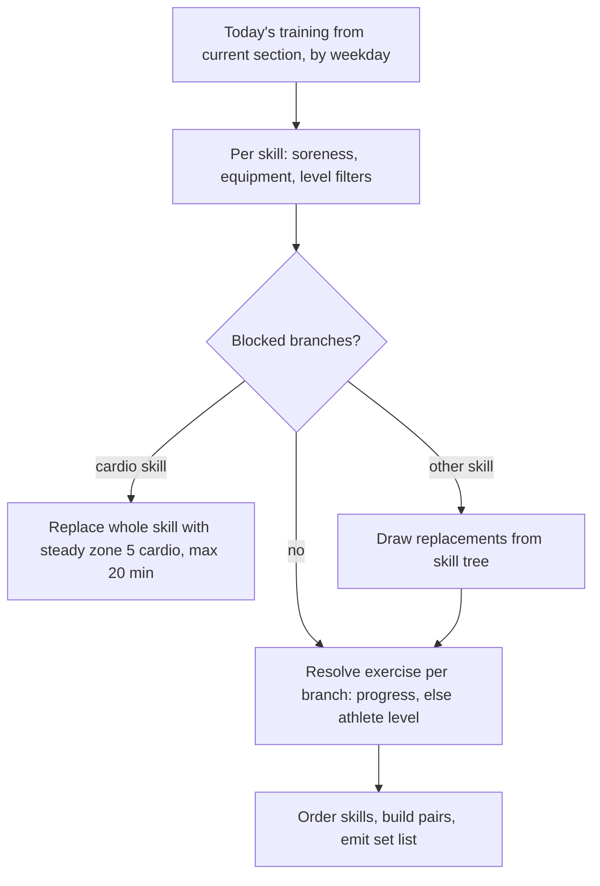

# Plan Workout Generation

## Why & What

When an athlete starts a workout, the app generates that session's exercise sequence on-device, at that moment. The stored **training plan** is only a skeleton: sections, per-day **skills** with minute budgets, and pre-selected exercise **branches**. The concrete exercises must reflect today's state, which covers reported soreness, the chosen place and its equipment, the athlete's level, and per-branch progress. This spec covers how the generator turns the plan into the ordered **set list** the athlete executes.

## Problem

The plan is authored days or weeks ahead. By start time the athlete may be sore, at another place with different equipment, or on a new level, so pre-selected branches can be unusable and a naive session would prescribe blocked exercises. Ordering is a second gap: nothing sequences a skill's exercises by body region, so the Maxkraft leg lift can land behind the upper-body lifts, where fatigue is already highest.

## Solution

Filter today's pre-selected branches by soreness, equipment, and level, replace the blocked ones from the skill tree, then resolve each branch to the athlete's level. Workouts the athlete starts without a plan run the same filters over a pool drawn straight from the skill trees: [Plan-Independent Workouts](./plan-independent-workouts.md).

Maxkraft opens with its lower-body main lifts; every other skill orders big muscle groups first and rotates body regions as a soft priority.

Selection operates on branches (one exercise progression lane, authored levels 1 to 3); the concrete exercise is resolved last. Within a skill no resolved exercise ID may appear twice; across skills duplicates are accepted. Random picks are uniform and unseeded; a generated session is persisted, so reopening it never regenerates (see Structure).

## Out of Scope

- Plan creation from the anamnesis: [Training Plan Creation](../planning/training-plan-creation-from-anamnesis.md); this spec starts from an existing plan
- On-demand short workouts and the Maxkraft strength test: [Plan-Independent Workouts](./plan-independent-workouts.md)
- Weight, repetition, and duration computation, feedback-based progression, and intensity tables: [Weight Calculation from Strength Tests](../progression/weight-calculation-from-strength-tests.md) and [Standard Exercise Progression](../progression/standard-exercise-progression.md)
- Exercise swapping or skipping after the set list is shown
- The soreness and place selection UI preceding generation
- Persistence of the finished workout

## Algorithm

### Inputs

Athlete profile (level, gender, birthday, pain tags), reported soreness (sore muscles with timestamps), place and its equipment, weekday, the training plan, per-branch progress and per-exercise history, the exercise catalog, and the authored skill trees.

### Building blocks

- **Skill**: the training quality one block of the session trains, for example Maxkraft, hypertrophy, core, warm-up, cardio, prevention. A skill owns its skill tree, its set count, its pause lengths, and its maximum minutes per athlete level. A training day is a list of skills.
- **Slot**: the plan gives every skill of a training day a minute budget. An authored table per skill and athlete level maps that budget to a fixed number of exercise **slots**, for Maxkraft at 30 minutes: legs, push, pull. Every slot carries one pre-selected branch; the exercise filling a Maxkraft slot is its **main lift**, the heavy barbell lift that slot's sets are built around. Slots fill independently: a blocked slot takes a replacement from the same skill tree, and a slot that cannot be refilled frees its minutes.
- **Branch to exercise resolution**: prefer the stored per-branch progress level; otherwise map BEGINNER/ADVANCED/PROFESSIONAL to branch level 1/2/3 and fall back downward to the highest authored level at or below it, so an intentionally empty intermediate level keeps the lower level's exercise active instead of blocking the branch. A branch counts as blocked only when nothing resolves at or below the athlete's level. [Training Plan Creation](../planning/training-plan-creation-from-anamnesis.md) and [Plan-Independent Workouts](./plan-independent-workouts.md) reuse this rule.
- **Filter chain**: each filter splits the pool into keep and replace. Soreness drops branches whose region matches a sore area (more than one sore area aborts with a soreness error). Equipment drops branches needing gear the place lacks. Level drops branches with no exercise at the athlete's level. Age and gender drop branches tagged for other groups.
- **Uniqueness**: a resolved exercise ID is used at most once per skill, and a candidate resolving to an exercise the skill already holds drops out of the pool. Duplicates across skills are tolerated. Deliberate repeats stand: a one-sided exercise appears as a left and right entry, and every exercise repeats across its own sets.
- **Big vs small muscle groups**: the big muscle groups are chest, upper back, latissimus, front thigh (quadriceps), glutes, and rear thigh (hamstrings), with side-specific muscles counting per side. Every other muscle group is small, explicitly including the inner thigh (adductors) and outer thigh (abductors). This one classification drives pairing, superset prioritization, and the ordering by muscle-group size below.
- **Pairing (supersets)**: superset skills split their branches into big-muscle and small-muscle groups per the classification above. Partners come only from the same skill, and the big-muscle group pairs out first. A one-sided exercise always pairs with its other-side counterpart; otherwise the partner is a both-sided exercise, preferred in this order:
  1. an opposing or antagonistic muscle group,
  2. a big muscle group from a different body region,
  3. a big muscle group from the same region,
  4. a small muscle group from a different region,
  5. a small muscle group from the same region.

  The generator breaks ties within a rank uniformly at random. Excluded as partners: duplicate exercises, the same movement pattern (two horizontal presses), and the same primary muscle group (two front-shoulder exercises). Front and rear shoulder count as separate primary muscle groups, so a front-shoulder and a rear-shoulder exercise may pair.

  Without a partner the exercise rests on its skill's longer single-exercise rest between its sets, never the shorter superset pause; [Session Set Structure](./session-set-structure.md) carries the per-skill values. Maxkraft, stability circuits, and cardio never pair.
- **Ordering**: three levels, each independent of the order in which slots were filled.
  1. Skills: fixed section order, warm-up first, cool-down last.
  2. Exercises inside a skill: big muscle groups (per the classification above) before the rest, so the demanding work sits in the fresher part of the block. In superset skills the ordered unit is the pair: a partner follows its lead exercise directly. Sequencing the resulting units (single exercises or formed pairs) follows soft priorities:
     - Rotate body regions: full body (where the skill has it, full-body stability for example), then lower body, upper body, core, then start over.
     - Prefer a different body region after each unit, and avoid training the same primary muscles in the directly following unit when an alternative exists.
     - Break ties among equally suitable units uniformly at random, so the same sequences and combinations do not recur every session.
     - When no unit matches the preferred region or a different primary muscle group, take the next-best one.

     These are soft priorities, never exclusions: no exercise is removed and no pair discarded over ordering, and no further special-case logic applies. Prevention and leg-axis stability draw from deliberately small, region-limited pools, so there the same body region or the same primary muscles may follow back to back when no alternative exists.
  3. Exercises inside Maxkraft, overriding rule 2: lower-body main lifts before upper-body main lifts, since they move the session's heaviest loads. Rule 2 then orders the lifts within each region. Support exercises stay in the breaks of their own main lift.
- **Weighted vs bodyweight ratio**: the target share of weighted exercises is 30% under 16 (the CHILD age group), 80% in the gym (60% for non-strength skills), and 50% at other places with suitable equipment. A place without dumbbells or barbells is 0%: everything is bodyweight. Age beats place: under 16 in the gym stays at 30%, since athletes below 16 must not perform heavy exercises. [Training Plan Creation](../planning/training-plan-creation-from-anamnesis.md) uses the same shares.

  Each skill enforces the share as a quota over its slots, `weighted = ceil(share × slots)` with the rest bodyweight. A slot draws its type at random while both quotas are open, then takes whichever quota remains. These are soft targets: the share is measured over the exercises the generator selected, only those surviving the age, level, soreness, and equipment filters count, and bodyweight exercises fill any shortfall. Maxkraft support exercises are exempt and balance their own share per draw.

### Generating the session



1. **Section and day**: take the section with the latest start date not after today; after a gap of 8 to 21 days, shift section starts forward by the missed weeks first. Beyond 21 days, prompt "You have not trained for more than three weeks. Do you want to create a new training plan?"; accepting hands over to plan creation (out of scope), declining continues with the existing plan.
2. **Training for today**: use the training matching today's weekday; when none matches, the generator falls back to the section's first training. This weekday fallback is the decided model: a session-time focus choice for planned workouts, where the athlete would pick one of the four focus types (PHASE strength/prevention, STABILITY, CARDIO endurance, COMBINED strength & endurance) for a single session, is deliberately not specified and not implemented. The focus types themselves exist: plan creation assigns one per training day. An athlete who wants a different emphasis today starts a focus training instead, one of the plan-independent short workouts ([Plan-Independent Workouts](./plan-independent-workouts.md)).
3. **Filter** each skill's pre-selected branches by soreness, equipment, and level. Every removed branch records its body region as a replacement request.
4. **Replace** blocked branches per skill:
   - A blocked cardio skill gives way wholesale to steady zone 5 cardio, capped at 20 minutes.
   - Otherwise candidates come from the skill's tree, run through the same filter chain plus age, excluding branch IDs already kept for this skill and branches resolving to an exercise ID already used in it. Prefer candidates matching the blocked region; failing that, the least-used regions, capped at 5 exercises per region (6 for professionals) with a one-sided branch counting twice. The final pick is uniformly random.
   - Prevention and special warm-up skills replace all-or-nothing: if any slot cannot be refilled the skill is dropped for this session. Replacements that no longer match the skill's prevention region move under the matching prevention skill, merging minute budgets.
   - A slot that cannot be refilled frees its time. Redistribute it across the remaining suitable skills as long as the session keeps its focus and no authored limit breaks: the per-skill maximum minutes below, the fixed set count per skill, and the Maxkraft load caps. Freed time therefore buys cardio duration or an extra exercise slot, never extra sets. With no safe redistribution available, the session gets shorter.

     | Skill | Max minutes, beginner / advanced / professional |
     |---|---|
     | Hypertrophy (SWR) | 35 / 45 / 60 |
     | Maxkraft (MAX) | 0 / 45 / 55 |
     | Cardio | 45 / 60 / 60 |
     | Full-body stability (GKS) | 25 / 30 / 40 |
     | Power endurance (SA), explosive power (SK) | 30 / 35 / 35 |
     | Prevention (PREV) | 15 |
     | Special warm-up (WUSPEZIAL) | 3 |
     | Everything else | 10 |

     The SWR code belongs to hypertrophy: it originally stands for jump, throwing, and core strength (Sprung-, Wurf- und Rumpfkraft).
5. **Resolve** every remaining branch to its level-matched exercise.
6. **Assemble**: order skills by the fixed section order (warm-up first, cool-down last), build pairs per skill, and emit the set list with sets and pauses. Weighted hypertrophy and explosive power supersets gain one extra warm-up set at reduced weight.

   **Support exercises (Maxkraft only)**: the generator draws support-tagged catalog exercises at random into the breaks between main-lift sets, skipping those that target sore areas, need unavailable equipment, hit the muscles the main lift works as primaries, or already appear in this skill. Once the filtered pool runs out the remaining breaks stay empty, as does any break with no suitable candidate. The general weighted ratio does not apply here.

## Structure

- **Exercise catalog**: flat list of exercises with tags (muscle, region, side, equipment, skill, block) and start values.
- **Skill tree**: per skill, a map of branches; each branch holds tags and levels 1 to 3, each referencing one exercise.
- **Training plan**: sections containing per-weekday trainings; a training holds skills, each with a minute budget and pre-selected branch references.
- **Athlete progress**: per-branch current level and per-exercise history, feeding both resolution and start values.
- **Set list**: the output; an ordered list of entries (exercise or pause) with set numbering, consumed by the active training session store that drives the workout UI.

A session is a sequence of skill blocks; each block fills its slots, then orders what it filled, then emits sets. Maxkraft as the example:

```text
SESSION  ── skill blocks, fixed section order
──────────────────────────────────────────────────────────────────
  [ warm-up ] -> [ Maxkraft ] -> [ core ] -> [ cool-down ]


MAXKRAFT BLOCK  ── 30 min, 3 slots
──────────────────────────────────────────────────────────────────
SLOTS      slot   pre-selected branch          filled with
           legs   squat | deadlift        ->   deadlift
           push   bench | shoulder press  ->   bench press
           pull   row                     ->   row (replacement)

SEQUENCE   after selection   bench press | deadlift | row
                             incidental, follows how the slots filled
           after ordering    deadlift | bench press | row
                             lower body first, then big muscle

EMISSION   per main lift     warm-up sets, working sets,
                             support exercises inside the breaks
```

Generation runs between the soreness/place selection screens and the workout overview screen. The set list goes into the session store; starting a workout never mutates the plan.

The app persists the generated session (set list, equipment, active exercise index) and it survives a restart, so reopening it never regenerates: a started workout resumes where it left off, and the overview only reads what is stored. The app clears it when the workout finishes, when the athlete runs generation again from the soreness screen, on logout, and when the athlete leaves the pre-workout flow holding a generated but never started session. There is no date-based expiry.

## Open Questions

None.
