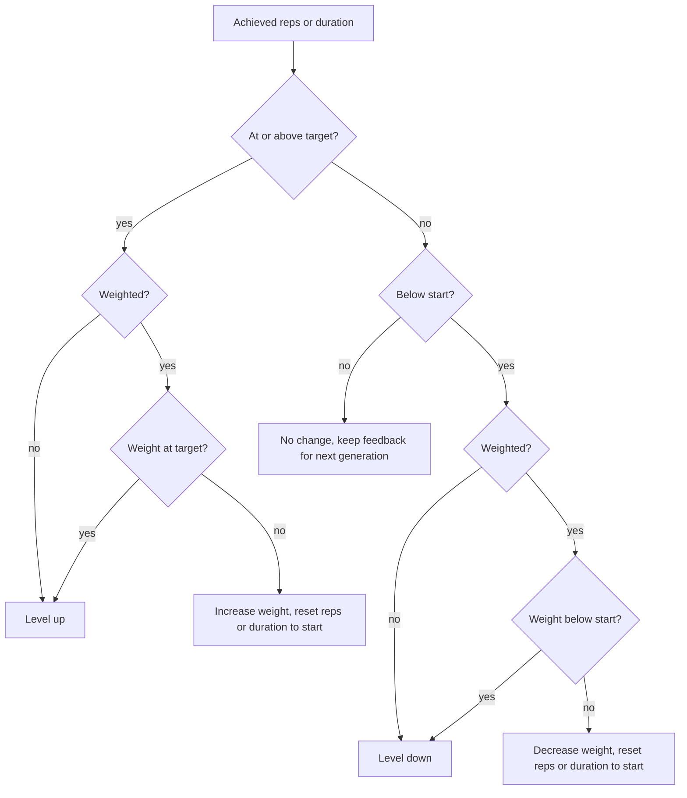

# Standard Exercise Progression

## Why & What

Every skill except Maxkraft and cardio (hypertrophy, speed strength, speed endurance, stability, basis, prevention) progresses through the same loop: the athlete performs an exercise, the app compares what was achieved against that exercise's **start value** and **target value**, and either changes the load, changes the branch level, or defers to the athlete's difficulty feedback. This spec defines that loop: which quantity moves, by how much, and when.

## Problem

The Maxkraft spec covers ladder-based weight progression and the level spec covers the level decision, so the everyday case is unowned: nobody can state how many repetitions a hypertrophy exercise gains after a session rated "too easy", when weight rises instead of repetitions, or what happens in the common case where the athlete lands between start and target. The rules are also split across two moments in time (immediately after the last set, and at the next session's generation), which makes double counting the main risk.

## Solution

One decision per exercise after its last set, over a fixed ladder: repetitions or duration first, then weight, then the branch level. Three outcomes:

1. **Target reached** or **below start**: act now (weight change, or a level change handed to the level system).
2. **Between start and target**: change nothing now, keep the athlete's difficulty feedback, and let the next generation apply it to all values at once.

Splitting the work this way keeps a single writer per situation: whichever side acts clears the feedback, so a value is never adjusted twice for one session.

## Out of Scope

- Maxkraft progression (max strength training spec) and cardio interval progression (cardio spec)
- The level change itself, level skipping, and branch substitution (branch and level spec)
- Deriving absolute training weights from strength tests, and plate rounding (weight calculation spec)
- Set counts, pauses, and warm-up sets (session set structure spec)

## Algorithm

### Inputs and scope

Per exercise: the achieved repetitions, duration and height, the prescribed weight, the athlete's difficulty feedback (too easy, succeeded, too hard), the exercise's **progression mode** (advance-by-reps or advance-by-duration), whether it is weighted, and the start and target values for the athlete's gender and training level.

Skills that never progress: warm-up, special warm-up, cool-down, mobility, foam roller, and test exercises. Workout types that never progress: the warm-up, cool-down, mobility, foam roller and test short workouts. In those cases nothing is written and no feedback is collected.

### The decision after the last set

- The comparison uses the exercise's progression mode: advance-by-reps compares repetitions, advance-by-duration compares seconds. An exercise carrying both is evaluated on both, and a level change wins over a weight change.
- A weight change resets repetitions or duration to the start value (the exercise's own value first, the skill's default second) and clears the stored feedback.
- A level change stores the achieved values as they are and hands the direction to the level system.

### Step sizes

Steps come from the skill's authored adjustment table, selected by feedback and resolved with the fallback chain gender and level, then level, then default. Weighted exercises use the absolute table when the weight is in kilograms and the F-Max table when it is a percentage of the athlete's maximum. Hypertrophy stage 1 as the example:

| Quantity | Too easy | Succeeded | Too hard |
|---|---|---|---|
| Repetitions | +2 | +1 | -2 |
| Repetitions (male, advanced and professional) | +3 | +2 | -2 |
| Duration | +10 s | +5 s | -10 s |
| Duration (male, advanced and professional) | +15 s | +10 s | -10 s |
| Weight, percent of F-Max | +5 | +2.5 | -2.5 |
| Weight, absolute | +2 kg | +1 kg | -1 kg |

A skill without an authored table falls back to: repetitions +4 / +2 / -2, duration and height +10 / +5 / -5, F-Max +5 / +2.5 / -2.5, absolute weight +2 / +1 / -1.

### Applying deferred feedback at the next generation

When the last session ended in the between zone, its feedback is still stored, and generation adds the step to every quantity the exercise uses: repetitions or duration, jump height, and weight. Clamps: F-Max percentages stay within 50 to 100%, absolute weight never goes below 0. Feedback is consumed by this application.

### Worked example

Hypertrophy exercise, advance-by-reps, weighted, start 12 reps at 65% of F-Max, target 20 reps at 80%.

| Session | Achieved | Outcome |
|---|---|---|
| 1 | 14 reps, rated succeeded | Between zone: next session prescribes 15 reps at 67.5% |
| 2 | 20 reps | Target reached, weight below target: weight rises to 70%, reps reset to 12 |
| 3 | 10 reps | Below start, weight above start: weight drops to 67.5%, reps reset to 12 |
| later | 20 reps at 80% | Reps and weight both at target: level up, new exercise with fresh values |

## Structure

Per-exercise progress (last prescribed weight, repetitions, duration, height, weight type, and pending feedback) is stored per athlete alongside per-branch levels, survives plan regeneration, and is the only input the next generation needs. Two writers touch it: the session, immediately after an exercise's last set, and generation, when it consumes pending feedback. The feedback flag is the handover token between them. Authored content contributes the per-skill adjustment tables and the per-exercise start and target values; both are bundled with the app.

## Open Questions

- Feedback streaks are ignored: three "too easy" sessions in a row move the same step as one. Should repeated identical feedback accelerate the step, or stay linear for predictability? Leaning toward linear until data on real progression rates exists.
- Only hypertrophy authors gender-specific and level-specific steps; other skills fall back to their default row. Should the remaining skills be authored, or is the default row intentional?
- Jump height carries the same step for every feedback value in some tables, so a "too hard" rating raises the box. Is that intended, or an authoring gap?
- The between zone changes nothing when feedback is missing (the athlete skipped the rating), so an exercise can stall indefinitely. Should a missing rating be treated as "succeeded"?
