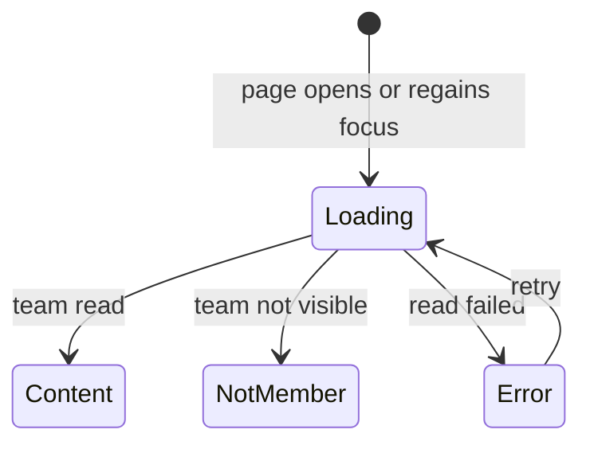

# Team Info Page

## Why & What

An athlete in a team trains with the team on some days and alone with the app on the others. The **team info page** tells the athlete what the team expects: the **guidance** the team owner writes, for example the team training days, and the **weekly target**, the number of training days per week the owner expects. The owner writes both in the trainer dashboard; the athlete reads them in the app. This spec defines how the athlete reaches the page, when it loads, and what it shows in each state.

## Problem

The athlete plans the week in the app, while the team's expectations come from the trainer. To plan around the team, the athlete needs to know how many training days the team asks for and which days are team sessions. The expectations change during a season, so the athlete needs the current values, never a copy from the day they joined.

## Solution

Every row under Your Teams opens a read-only page for that team. The page shows the team name, the guidance and the weekly target. It reads the team again each time it appears. The weekly target is a displayed count only; the training plan ignores it.

Rejected: showing the team description. It stays a note for the trainer dashboard; guidance is the field written for athletes.

## Out of Scope

- Editing guidance or weekly target in the app. Only the team owner edits them, in the trainer dashboard.
- Using the weekly target in the training plan.
- Home, Additional trainings: tapping a team there opens its workouts.

## Algorithm

### Reaching the page

1. Every team row under Your Teams opens the page, including a team the athlete owns.
2. The Leave button leaves the team and never opens the page. Owners see no Leave button.

### Loading

1. The page reads the team by its ID when it opens and again each time the athlete returns to it, so a trainer's change shows without restarting the app.
2. While reading, the page shows a loading indicator.
3. A failed read shows an error with a retry button. It never shows the empty guidance hint, because the app does not know whether guidance exists.
4. A team the athlete can no longer see, for example after leaving it or being removed, shows "You are no longer a member of this team".

### Content

1. The page always shows the team name.
2. With a weekly target set, it shows "N training days per week", in singular for one day.
3. With guidance set, it shows the text as the owner wrote it.
4. With neither set, it shows a hint that the trainer has not added guidance yet.

## Structure

## Open Questions

None.
