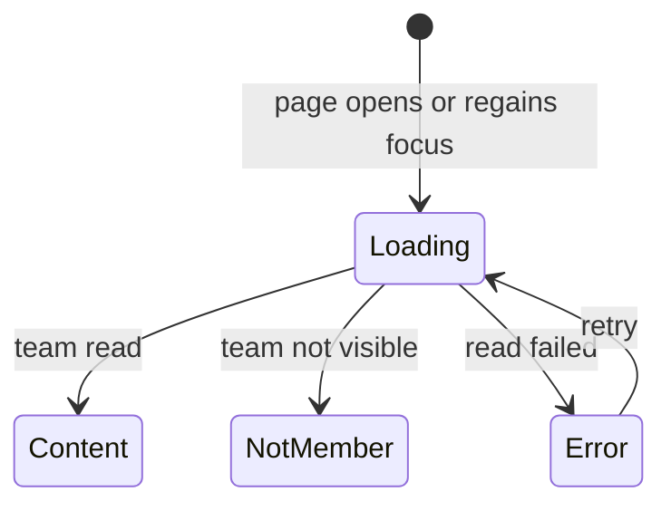

# Team Info Page

## Why & What

Athletes see the names of their teams under More, Team Management, but learn nothing about what the team expects. The **team info page** shows each team's **guidance** and **weekly target**, which the team owner writes in the trainer dashboard. Athletes read the expectations in the app instead of asking the trainer.

## Problem

Tapping a team did nothing. How often the team expects athletes to train, and when the team trains together, lived only in conversations with the trainer.

## Solution

Every row under Your Teams opens a read-only page for that team. The page loads the team each time it appears and shows the name, the guidance and the weekly target. The weekly target is a displayed count only and does not touch the training plan.

Rejected: showing the team description. It stays a note for the trainer dashboard; guidance is the field written for athletes.

## Out of Scope

- Editing guidance or weekly target in the app. Only the team owner edits them, in the trainer dashboard.
- Using the weekly target in the training plan.
- Home, Additional trainings: tapping a team there keeps opening its workouts.

## Algorithm

### Reaching the page

1. Every team row under Your Teams opens the page, including a team the athlete owns.
2. The Leave button leaves the team and never opens the page. Owners see no Leave button.

### Loading

1. The page reads the team by its ID when it opens and again each time the athlete returns to it, so a trainer's change shows without restarting the app.
2. While reading, the page shows a loading indicator.
3. A failed read shows an error with a retry button. It never shows the empty guidance hint, because the app does not know whether guidance exists.
4. A team the athlete can no longer see, for example after leaving it or being removed, shows "You are no longer a member of this team".

### Content

1. The page always shows the team name.
2. With a weekly target set, it shows "N training days per week", in singular for one day.
3. With guidance set, it shows the text as the owner wrote it.
4. With neither set, it shows a hint that the trainer has not added guidance yet.

## Structure

## Open Questions

None.
