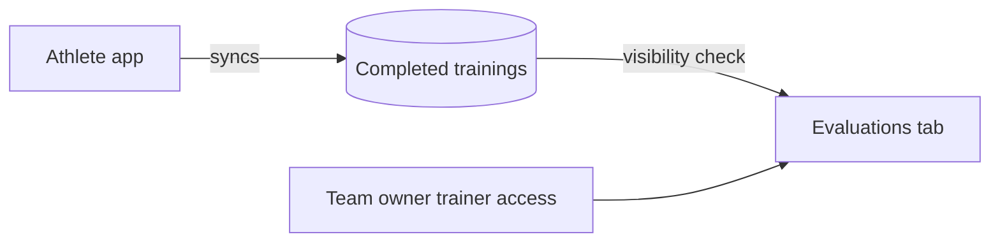

# Athlete Evaluations

## Why & What

Trainers follow their athletes through the **completed trainings** the athlete app syncs. The evaluations tab shows one **athlete** at a time over a **period**: three totals and a list of trainings. This spec defines who sees which data, the period windows and the totals.

## Problem

Training data is personal. A trainer must see the athletes of their own team and nobody else's, and a revoked trainer must lose that view. The totals need fixed definitions so trainer and athlete read the same numbers.

## Solution

The database decides visibility per athlete: the caller must own the team or be a co-owner in it, and the team's owner must hold **trainer access**. The dashboard shows whatever the database returns; hidden data appears as zeros, without an error. Periods are rolling windows counted back from now.

## Out of Scope

- How the athlete app records and syncs a workout, and how it computes points
- Roles: [Members and Roles](../teams/members-and-roles.md)
- Granting trainer access: [Trainer Access and Admin](../access/trainer-access-and-admin.md)

## Rules

### Visibility

A caller sees an athlete's completed trainings when both hold for one team the athlete belongs to:

1. The caller is that team's owner or a co-owner in it.
2. That team's owner has trainer access.

The check uses the owner's grant, so a co-owner without own trainer access still sees the data.

### Athlete list

1. Athletes are members with role member. Owner and co-owners stay out of the list.
2. List athletes by join date. Select the first one on load.
3. A team without athletes shows "No athletes in this team yet. Invite athletes using the invite code."

### Periods

| Period | Window |
|---|---|
| Last week (default) | last 7 days |
| Last month | last 30 days |
| Last year | last 365 days |
| Total | all trainings |

A training counts when its date falls inside the window. The chosen period stays when the trainer switches athletes.

### Totals

| Total | Rule |
|---|---|
| Duration | Round each training to whole minutes, then sum. Shown as minutes, hours, or hours and minutes. |
| Number of trainings | Count of trainings in the period |
| Points | Sum of points |

### Completed trainings list

Newest first, no other sort order. Columns: time, duration, number of exercises, points, training type, focus. Unknown type or focus codes show the raw code; missing values show a dash. A period without trainings shows "No trainings in this time period".

## Structure

The dashboard loads all athletes' trainings of the team in one request and filters per athlete and period in the browser.

## Open Questions

- Moved weight arrives with every training but the tab does not show it. Should it become a fourth total? Leaning: yes.
- The column header says "Training Phase" but shows the training type. Should it read "Training Type"? Leaning: yes.
- Type and focus labels show in German in every language. Should they move to the translation files? Leaning: yes.
