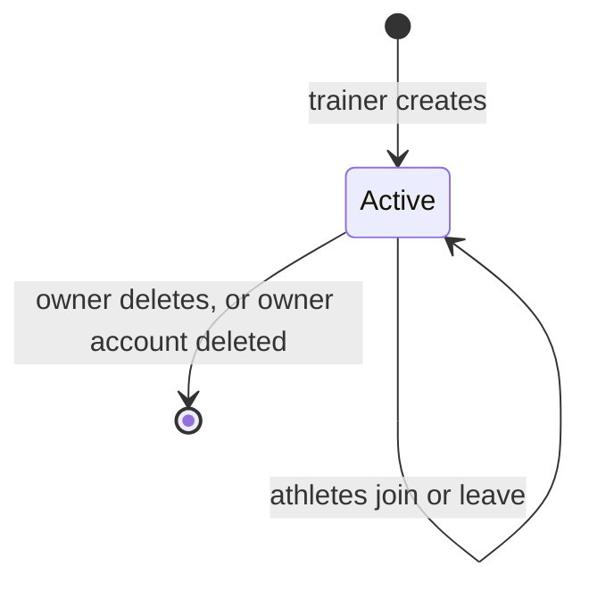

# Team Lifecycle

## Why & What

A **team** connects one trainer with the athletes whose training the trainer follows. A trainer creates a team, athletes join it, and the **owner** deletes it at the end. This spec defines team selection, creation and deletion.

## Problem

An account can belong to several teams in different roles. The dashboard needs one rule for which teams a user sees, who may create one, and what deletion removes.

## Solution

Team selection lists every team the user belongs to, in any role. Accounts with trainer access create teams; there is no limit on how many teams a trainer owns, and names need not be unique. Only the owner deletes a team, and deletion removes members and invite codes with it. The owner cannot leave or hand over the team.

Rejected: transferring ownership when the owner leaves. An earlier design passed ownership to the longest-standing member; the current rules drop that path.

## Out of Scope

- Invite codes and joining: [Invite Codes and Joining](./invite-codes-and-joining.md)
- Member roles, removal and leaving: [Members and Roles](./members-and-roles.md)
- Editing a team's name or description: no such feature exists

## Rules

### Team selection

1. List the user's teams, newest first. Each card shows name, member count and description.
2. With no teams, show "You are not a member of any team yet".
3. The last card offers "Create Team" to trainers, "Trainer access required" to everyone else, and "Join Team" to all.
4. A team card opens that team's dashboard.

### Create

1. The user enters a name (required) and an optional description. The dashboard trims both and stores an empty description as none.
2. The backend rejects callers without a session or without trainer access, and rejects an empty name. No length limits apply.
3. In one transaction the backend:
   1. creates the team with the caller as owner,
   2. adds the caller as member with role owner,
   3. creates the first invite code without expiry or use limit.
4. On success the dashboard opens the new team. On failure the user stays on team selection and sees a translated message, never the raw code.

### Delete

1. The owner confirms "Delete Team?". The dialog warns that all members leave and the step cannot be undone.
2. The backend deletes the team, its memberships and its invite codes.
3. The dashboard returns to team selection.

Deleting the owner's account deletes every team the account owns.

## Structure

## Open Questions

- The member count on a team card counts owner and co-owners as "players". Should it count athletes only? Leaning: yes.
